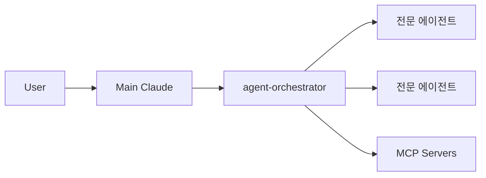
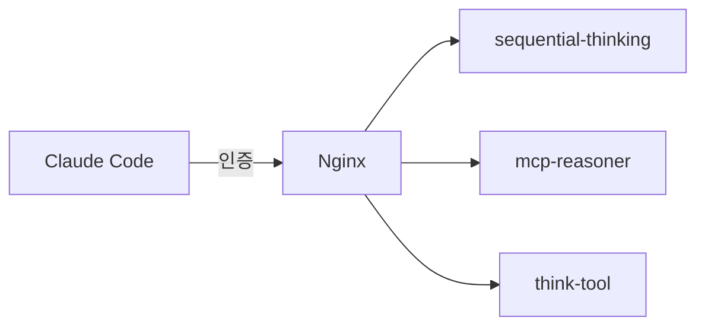
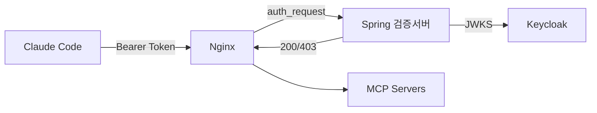

# AI와 함께한 개발 워크플로우 회고

<!-- =============================================
  SKETCH / OUTLINE (작성 전 메모)
  =============================================

## 글 방향
- 시간순 여정형 회고
- 단일 글 + 목차(TOC) 구조
- 기억하려고 쓰는 글, 정보 공유 느낌
- Mermaid 다이어그램 활용

## 목차 구조

### 1. 들어가며
- AI를 개발에 쓰기 시작한 계기
- 처음엔 그냥 검색 대체 수준이었음

### 2. Claude 기본 사용
- 웹/API로 시작
- 주로 코드 설명, 에러 디버깅, 개념 정리
- 한계: 컨텍스트가 날아감, 코드베이스 모름

### 3. Claude Code (+ Super Claude)
- CLI로 전환, 프로젝트 파일과 직접 연결
- Super Claude: 커맨드 체계, 페르소나, 플래그 등 강화된 워크플로우
- 코드베이스를 알고 대화하는 게 다름

### 4. 커스텀 에이전트 · 로컬 MCP · Commands
- github.com/newkayak12/Claude-Agents-Commands
- 20개+ 전문 에이전트 (java-expert, spring-boot-expert, database-admin 등)
- sc/ 커맨드: analyze, build, implement, test, git, spawn 등
- [핵심] Orchestration을 목표로 했음
  - orch/ 커맨드: 4-phase 프로세스
    Phase 1: Requirements Analysis
    Phase 2: Context Analysis
    Phase 3: Agent Orchestrator Delegation (MCP 연동)
    Phase 4: Result Summary
  - Main Claude → agent-orchestrator → 전문 에이전트들 위임
  - 토큰 최적화: 38% 절감 (22K → 13.7K)
  - 병렬/순차 실행 패턴
- [Mermaid: Orchestration 흐름도]

### 5. Remote MCP 인프라 구축
- 왜 Remote MCP인가: 로컬 MCP는 세션마다 재시작, 외부 접근 불가
- Docker Compose로 구성
  - mcp-proxy-server (메인: context7, memory, memory-bank, taskmanager)
  - sequential-thinking-server
  - mcp-reasoner-server (Beam Search, MCTS 기반)
  - think-tool-server
  - auth-service (Python, X-API-Key 인증)
  - nginx (reverse proxy, SSE 최적화, 포트 7070/7071)
- keycloak_oauth 프로젝트: MCP 인증 체계 더 고도화 시도
- [Mermaid: MCP 서버 아키텍처]

### 6. Skills — 지금 쓰는 방식
- claude-skills 플러그인 마켓플레이스 (직접 만듦)
  /plugins install https://github.com/newkayak12/claude-skills
- 25개 스킬 포함
- 자주 쓰는 스킬들:
  - brainstorming: 구현 전 아이디어 정리
  - writing-plans: 구현 계획 수립
  - spring-boot-engineer: Spring Boot 3.x 관련
  - test-master: 테스트 전략
  - architecture-designer: 아키텍처 설계
  - dispatching-parallel-agents: 독립 작업 병렬 처리
- 공식 docs 참고 링크 포함할 것

### 7. 사이드 프로젝트에서의 활용
- AI한테 맡긴 것: 설계 문서, Gherkin give-when-then 테스트 케이스
- 내가 직접 한 것: 실제 코드 작성 (공부 목적)
- 느낀 점: AI가 "틀"을 잡아주면 사람이 채우는 분업

### 8. 마치며
- AI를 잘 쓴다는 건 무엇인가
- 도구를 쌓아가는 과정 자체가 공부
- 앞으로 더 고도화하고 싶은 것들

## Mermaid 다이어그램 계획
1. Orchestration 4-phase 흐름도 (섹션 4)
2. Remote MCP 아키텍처 (섹션 5)
3. 전체 AI 도구 스택 개요 (선택)

============================================= -->


## 목차
1. [들어가며](#들어가며)
2. [Claude Code, Super Claude](#claude-code-super-claude)
3. [커스텀 에이전트 · 로컬 MCP · Commands](#커스텀-에이전트--로컬-mcp--commands)
4. [Remote MCP 인프라 구축](#remote-mcp-인프라-구축)
5. [Skills](#skills)
6. [사이드 프로젝트 활용](#사이드-프로젝트-활용)
7. [마치며](#마치며)

---

## 들어가며

- 처음엔 그냥 간단한 질의 응답을 진행했다.
  - 에러 붙여넣고 "이거 왜 나요?" 수준
  - 코드 설명, 개념 정리, 구글 검색 대체 정도

- 쓰다 보니 한계가 명확했다:
  - 세션 끊기면 컨텍스트 날아감
  - 내 프로젝트 구조를 모름
  - 매번 같은 내용 다시 설명

> "AI가 편리하다"는 말이 맞긴 한데, 실질적으로  개발 워크플로우에 진짜로 녹아들지는 않았다.

---

## Claude Code, Super Claude

웹 UI의 문제:
- 매 세션마다 프로젝트 설명 반복
- 컨텍스트가 날아가면 처음부터 다시
- 파일 직접 붙여넣지 않으면 코드도 모름

Claude Code (CLI):
- 프로젝트 디렉토리 안에서 대화
- 파일 직접 읽고, 수정하고, 테스트 실행
- "내 코드를 아는 AI"가 비로소 가능해짐

Super Claude:
- 장점
  - Claude Code 위에 올라가는 커맨드/페르소나/플래그 체계
  - 작업 유형마다 모드 전환, 반복 패턴 구조화
  - 처음엔 꽤 만족했음
- 단점 
  - 기능이 많은 만큼 프롬프트가 무거움
  - 대화가 길어질수록 토큰이 빠르게 닳음
  - 중반을 넘어가면 응답 품질이 눈에 띄게 떨어짐

선택지:
1. Super Claude 그냥 계속 쓴다
2. 내 상황에 맞는 경량화 버전을 직접 만든다

→ 2번. 자주 쓰는 것만 남기면 충분했다.

---

## 커스텀 에이전트 · 로컬 MCP · Commands

### 에이전트

- github에서 괜찮은 것을 찾기도 했으며, 직접 작성 하기도 했다. 
- 도메인별로 20개+ 정리 (java-expert, spring-boot-expert, orchestration-master 등)

### 로컬 MCP

- `sequential-thinking`, `reasoner`, `think-tool`, `mermaid`, `memory`, `memory-bank` 등 로컬에서 연결
- 외부 도구로 claude 동작의 부족한 점을 보완하고나 확장할 수 있었 음 

### Command
- agent, MCP 활용에 대한 지침이나 정책을 명시
- 구조된 동작으로 Claude가 더 일관되게 동작함

#### Orchestration — 핵심 목표

- Claude가 직접 다 판단하면 컨텍스트가 빠르게 무거워짐
- Agent의 역할을 더 명확히 하는 방향으로 Command 작성
- Orchestration-master가 Planning, Agent 배분 등을 할 수 있도록 구성 


고민한 구조:
1. 중간 조율자(`agent-orchestrator`)를 두고 위임
2. 이 과정 조차도 적절한 MCP 도구를 쥐어주고 효과를 극대화 


```
Phase 1: Requirements Analysis  — 요구사항 파악
Phase 2: Context Analysis       — 관련 컨텍스트 수집
Phase 3: Agent Delegation       — 전문 에이전트 위임 (MCP 연동)
Phase 4: Result Summary         — 결과 통합 및 정리
```



- 독립 작업은 병렬, 의존성 있는 작업은 순차 처리
- 압축 컨텍스트 + 심볼 기반 출력으로 토큰 약 38% 절감 (22K → 13.7K)

---

## Remote MCP 인프라 구축

로컬 MCP 한계:
- 세션 끊기면 서버도 같이 내려감
- 상태 유지 어려움
- 여러 환경에서 접근 불가

→ Docker로 MCP 서버 상시 운영 인프라로 전환

이 시점에 MCP 구성도 함께 정리했다.
로컬에서 쓰던 것들 중 뭘 남길지 고민했다:
- `memory`, `memory-bank`, `mermaid` 등 → 컨텍스트 소모가 크다는 걸 체감했으며 실질적 이득이 없다고 판단 
- `sequential-thinking`, `think-tool`, `reasoner` → 추론에 직접 도움이 됨

→ 3개만 남겼다.

구성: MCP 서버들 Docker로 띄우고, Nginx가 인증 거친 요청만 통과시킴



### 인증 고도화 — Keycloak + Kotlin/Spring

API Key 방식에서 더 나아가 Keycloak 기반 JWT 인증으로 교체했다:
- Nginx가 요청 수신
- Spring 검증 서버에 토큰 전달
- Keycloak JWKS로 서명 검증
- 통과 여부 결정 후 MCP로 전달



- 검증 서버는 Kotlin + Spring Boot로 작성

---

## Skills

MCP, Commands 방식의 문제:
- 세션 시작부터 컨텍스트에 올라감
- 쓰든 안 쓰든 토큰 차지
- Super Claude 버린 이유랑 같은 맥락

Skills는 다르다:
- [공식 docs](https://code.claude.com/docs/en/skills)에 따르면, `SKILL.md`의 `description` 기반으로 상황에 맞을 때만 점진적으로 로딩
- 필요한 순간에만 컨텍스트에 올라옴
- `/skill-name`으로 직접 호출도 가능
- [Plugin](https://code.claude.com/docs/en/plugins)으로 묶으면 네임스페이스 생겨서 충돌 없이 배포 가능

- 자주 쓰는 패턴들 25개 스킬로 정리해서 플러그인으로 묶어 마켓에 올렸음
- 여러 방법으로 활용 중이고, 공부 중

---

## 사이드 프로젝트 활용

- AI를 사용한 방식:
  - 아키텍처 구조 검증
  - 설계 문서 작성
  - 엣지 케이스 포함한 Gherkin give-when-then 테스트 케이스 생성
  - 막히는 부분 Pair 형태로 같이 검토

- 위 과정에서 AI 쓰는 패턴이 꽤 일정하다는 것을 알 수 있었다. 
  - 브레인스토밍 상대
  - 가능한 선택지 전부 나열
  - 내 생각이 맞는지 틀린지 검증

> - 코드나 문서 뽑아내는 것보다 이쪽이 훨씬 자주 쓰는 패턴이었다. 
> - 내가 알 수 없는 코드는 결과적으로 기술 부채가 될 가능성이 높기 때문이다.

---

## 마치며

돌아보면 단계가 뚜렷하게 나뉜다:

> 웹 UI로 질문 → CLI로 코드베이스 연결 → 에이전트/커맨드 직접 제작 → MCP 인프라 구축 → 인증 서버 구현

- 각 단계마다 "이전 방식의 한계"가 다음 단계를 만들었음
- 더 편하게 쓰려고 만든 도구를 만드는 데 더 많은 시간을 쓰는 아이러니가 있긴 한데, 그 과정 자체가 공부였다

> AI를 잘 쓴다는 건, 뭘 시키느냐보다 어떻게 쓰느냐의 문제였다.

제일 자주, 제일 유용하게 쓰는 패턴:
- 아이디어를 꺼내놓는 브레인스토밍 상대
- 가능한 선택지를 전부 펼쳐주는 도구
- 내 생각이 맞는지 틀린지 부딪혀보는 검증 장치
