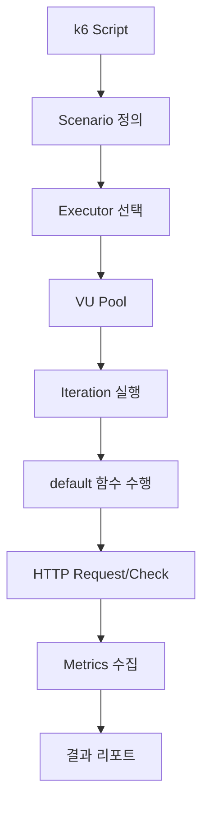
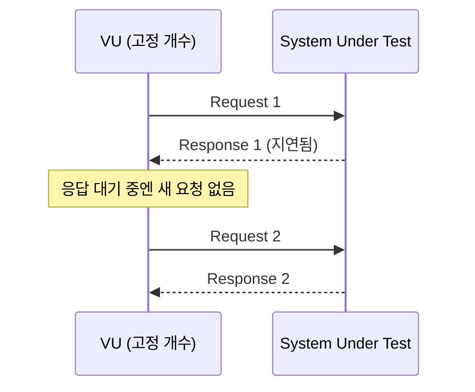
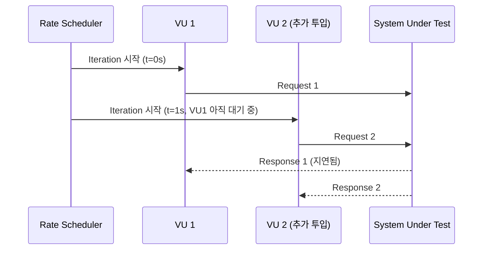

### Virtual User부터 Open Model, Closed Model까지
 

---

  

## 1. 왜 Open/Closed Model을 알아야 하는가

  

k6로 부하 테스트를 돌리다 보면 흔히 겪는 일이 있다. `vus: 100, duration: '1m'`으로 테스트를 돌렸는데, 정작 응답 지연이 커지자 RPS가 오히려 떨어지는 현상이다. "VU를 늘렸는데 왜 처리량이 안 늘지?"라는 질문의 답은 대부분 **실행 모델(Execution Model)**에 대한 이해 부족에서 시작된다.

  

성능 테스트 도구가 부하를 어떻게 "생성"하느냐는 테스트 결과의 해석 자체를 바꿔놓는다. 같은 시나리오, 같은 VU 수라도 Closed Model이냐 Open Model이냐에 따라 시스템이 받는 부하의 성격이 완전히 달라진다. 이걸 모르고 숫자만 보면 잘못된 결론에 도달하기 쉽다.

  

## 2. k6란?

  

k6는 Grafana Labs에서 만든 오픈소스 부하 테스트 도구다. JavaScript로 테스트 스크립트를 작성하고, 실제 실행 엔진은 Go로 되어 있어 적은 리소스로도 높은 부하를 생성할 수 있다. CLI 기반이라 CI/CD 파이프라인에 통합하기 좋고, Grafana/Prometheus와의 연동을 통해 결과를 시각화하기도 쉽다.

  

k6를 이해하는 핵심은 "무엇을 반복 실행하는가"와 "언제 그 반복을 시작하는가"를 분리해서 생각하는 것이다. 이 두 가지 축이 바로 뒤에서 다룰 Executor와 Open/Closed Model의 이야기다.

  

## 3. 성능 테스트에서 사용하는 용어

  

### Virtual User (VU)

하나의 독립적인 실행 스레드(정확히는 goroutine)를 의미한다. 각 VU는 스크립트의 `default` 함수를 처음부터 끝까지 순차적으로 실행하며, 다른 VU와 상태를 공유하지 않는다.

  

### Iteration

VU가 `default` 함수를 한 번 실행하는 단위다. 하나의 VU는 테스트가 진행되는 동안 여러 번 Iteration을 반복할 수 있다.

  

### Scenario

"어떤 Executor로, 어떤 부하 패턴으로, 어떤 함수를 실행할지"를 정의하는 설정 블록이다. 하나의 스크립트 안에 여러 Scenario를 정의해 동시에 실행할 수도 있다.

  

### Executor

Scenario 안에서 VU와 Iteration을 실제로 스케줄링하는 알고리즘이다. k6가 부하를 어떤 방식으로 만들어낼지 결정하는 핵심 컴포넌트이며, 뒤에서 다룰 Open/Closed Model의 차이도 결국 Executor 선택의 차이로 귀결된다.

  

### Arrival Rate

단위 시간당 새로 시작되는 Iteration(또는 요청)의 수를 의미한다. Open Model 계열 Executor에서만 등장하는 개념이다.

  

## 4. k6의 실행 구조

  

  

k6는 스크립트에 정의된 Scenario를 읽고, 지정된 Executor에 따라 VU를 생성/스케줄링한다. 각 VU는 독립적으로 Iteration을 반복 실행하며, 그 과정에서 발생하는 응답 시간, 실패율 등의 메트릭이 수집되어 최종 리포트로 집계된다.

  

## 5. Closed Model

  

### 개념

**"VU 개수가 곧 동시성(concurrency)의 상한"**이 되는 모델이다. VU는 하나의 Iteration을 마치고 나서야 다음 Iteration을 시작한다. 즉, 이전 요청의 응답을 기다리는 동안 그 VU는 새로운 요청을 만들지 않는다.

  

### 동작 방식

1. VU가 Iteration을 시작해 요청을 보낸다.

2. 응답이 올 때까지 대기한다.

3. 응답을 받으면 (설정에 따라 think time 후) 다음 Iteration을 시작한다.

  

응답 지연이 커질수록 VU가 다음 요청을 보내는 시점도 함께 늦춰진다. 결과적으로 **시스템이 느려지면 부하 자체도 자동으로 줄어든다.**

  

  

### 장단점

- **장점**: 설정이 단순하고 직관적이다. "동시 접속자 N명"이라는 실제 사용자 행동 패턴과 유사하게 매핑된다.

- **단점**: 시스템 병목이 부하 생성 자체를 억제해버리는 **self-throttling** 현상이 발생한다. 이로 인해 시스템의 진짜 한계치(breaking point)를 찾기 어렵고, RPS 목표치를 정확히 맞추기 힘들다.

  

`vus`, `ramping-vus` Executor가 이 모델에 해당한다.

  

## 6. Open Model

  

### 개념

**"단위 시간당 새로 시작되는 요청 수(Arrival Rate)"가 곧 부하의 기준**이 되는 모델이다. 이전 요청이 아직 응답을 받지 못했더라도, 정해진 시간이 되면 새로운 Iteration이 시작된다.

  

### 동작 방식

1. 스케줄러가 "초당 N개의 Iteration을 시작한다"는 목표를 유지한다.

2. 필요하면 VU Pool에서 유휴 VU를 꺼내 새 Iteration을 배정한다.

3. 응답이 지연되어 기존 VU가 바쁘면, 추가 VU를 동원해서라도 목표 Arrival Rate를 유지한다.

  

  

### 장단점

- **장점**: 시스템 응답 속도와 무관하게 목표한 부하(RPS)를 실제로 유지할 수 있다. 시스템의 실제 한계치를 찾는 스트레스 테스트에 적합하다.

- **단점**: VU가 무한정 늘어날 수 있어 k6를 실행하는 클라이언트 머신 자체의 리소스(메모리, 파일 디스크립터, 네트워크 대역폭)가 병목이 될 수 있다. `maxVUs` 설정으로 상한을 관리해야 한다.

  

`constant-arrival-rate`, `ramping-arrival-rate` Executor가 이 모델에 해당한다.

  

## 7. Open Model인데 왜 VU가 필요한가?

  

여기서 흔히 헷갈리는 지점이 나온다. "Arrival Rate 기반이면 VU 개념이 필요 없는 것 아닌가?"라는 의문이다.

  

답은 이렇다. Arrival Rate는 "언제 Iteration을 **시작**할지"를 결정할 뿐이고, 실제로 그 Iteration을 실행하려면 물리적으로 스크립트를 수행할 goroutine, 즉 VU가 필요하다. Open Model에서 VU는 동시성의 상한을 정하는 역할이 아니라, **목표 Arrival Rate를 유지하기 위한 실행 리소스 풀**의 역할을 한다.

  

그래서 Open Model Executor에는 `preAllocatedVUs`(미리 확보해둘 VU 수)와 `maxVUs`(응답 지연 시 추가로 투입 가능한 VU 상한)라는 두 개의 설정이 존재한다. 응답이 빨라 VU가 금방 반환되면 적은 VU로도 목표 Arrival Rate를 유지할 수 있지만, 응답이 느려지면 k6는 `maxVUs` 한도 내에서 VU를 추가로 투입해서라도 Arrival Rate를 지키려 한다. `maxVUs`에 도달하면 그때부터는 목표 Arrival Rate를 더 이상 유지하지 못하고 드롭된 Iteration이 발생하는데, 이 지점이 바로 시스템의 실질적인 한계를 드러내는 신호다.

  

## 8. Executor 종류

  

| Executor | 모델 | 특징 |
|---|---|---|
| `shared-iterations` | Closed | 고정된 총 Iteration 수를 VU들이 나눠 처리 |
| `per-vu-iterations` | Closed | VU마다 동일한 Iteration 수를 각자 처리 |
| `constant-vus` | Closed | 고정 VU 수로 duration 동안 반복 |
| `ramping-vus` | Closed | VU 수를 단계적으로 증감 |
| `constant-arrival-rate` | Open | 고정된 Arrival Rate 유지 |
| `ramping-arrival-rate` | Open | Arrival Rate를 단계적으로 증감 |

  

## 9. 언제 어떤 모델을 선택해야 하는가

  

- **실제 사용자 행동을 시뮬레이션하고 싶을 때** (예: "동시 접속자 500명이 브라우징하는 상황") → Closed Model. think time을 포함한 사용자 시나리오와 자연스럽게 매핑된다.

- **시스템이 특정 RPS를 견딜 수 있는지 검증하고 싶을 때** (예: "초당 1000건의 주문 요청을 처리할 수 있는가") → Open Model. 응답 지연 여부와 무관하게 목표 부하를 실제로 가할 수 있다.

- **시스템의 breaking point를 찾는 스트레스 테스트** → Open Model이 적합하다. Closed Model은 시스템이 느려지는 순간 부하도 함께 줄어들어 진짜 한계치를 가리기 쉽다.

- **간단한 스모크 테스트나 기능 검증** → Closed Model(`shared-iterations`, `constant-vus`)로 충분하다.

  

## 10. 정리

  

- Closed Model은 **VU 개수가 동시성의 상한**이 되며, 응답 지연이 부하를 자동으로 줄이는 self-throttling 특성을 가진다.

- Open Model은 **Arrival Rate가 부하의 기준**이 되며, 응답 지연과 무관하게 목표 처리량을 유지하려 한다.

- Open Model에서도 VU는 여전히 필요하다. 다만 그 역할이 "동시성 제한"이 아니라 "Arrival Rate를 유지하기 위한 실행 리소스"로 바뀐다.

- 무엇을 검증하고 싶은지(사용자 시나리오 재현 vs. 시스템 한계치 탐색)에 따라 모델을 선택해야, 테스트 결과를 올바르게 해석할 수 있다.