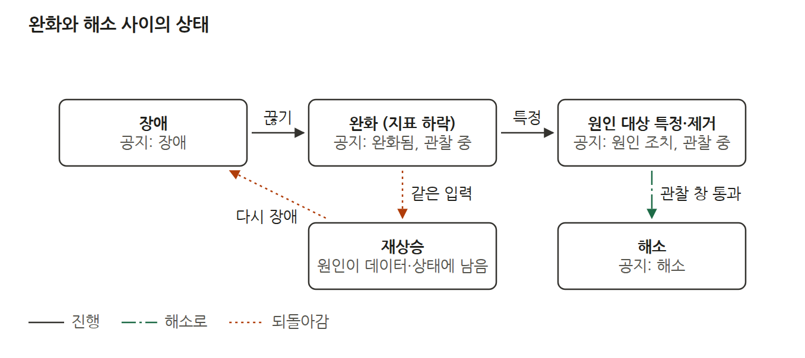

> - 1년 동안 쌓인 장애 기록을 다시 읽으며 정리한 글입니다. 서비스·피해 규모는 일반화했습니다.
> - 이 글은 개인적인 의견을 다룹니다.

# 다루는 내용
- 지표가 내려간 것과 원인이 사라진 것을 나누는 기준, 그리고 회고에서 원인 태그 하나 대신 트리거와 증폭 요인을 따로 적는 이유

---
## 목차
### 1. 지표가 내려가면 끝난 걸까?
### 2. 끊는 조치는 무엇을 남기나?
### 3. 끊지 않고 버티면?
### 4. 원인이 내 쪽에 없다면?
### 5. 그럼 해소는 언제 선언하나?
### 6. 원인 태그는 왜 다 같아질까?
### 7. 트리거와 증폭 요인을 나누면?
### 8. 두 구분은 왜 같은 이야기일까?
### 9. 결과적으로?

---

## 1. 지표가 내려가면 끝난 걸까?

- 1년치 장애 22건의 기록을 다시 읽다가 비슷한 장면이 몇 번 눈에 걸렸다.
- 조치를 하고, 지표가 내려가고, 끝났다고 본다. 그리고 얼마 뒤 같은 증상이 다시 올라온다.
- 대응 과정을 다시 적으려는 글은 아니다. 각 장애에서 무슨 일이 일어났고 무엇이 일을 키웠는지, 그리고 그걸 보며 든 생각만 정리한다.

가장 선명했던 건 조회 화면 하나가 멈춘 장애였다.

- 발생 현상
	- 읽기 전용 DB 인스턴스의 CPU가 99%에 붙었다.
	- 컨테이너를 재시작하자 CPU가 내려갔지만, 얼마 뒤 다시 올랐다.
- 일을 키운 것
	- 상품 수가 비정상적으로 많은 주문 1건이 JOIN 조건이 빠진 쿼리를 만나 N×N행을 읽고 있었다.
	- 재시작은 실행 중이던 쿼리를 끊었을 뿐, 그 쿼리를 다시 부를 데이터는 그대로 남겼다. 화면을 다시 여는 순간 같은 쿼리가 다시 돌았다.

> 결과적으로 **CPU 하락은 완화의 효과였지 원인이 사라졌다는 증거가 아니었다.**

## 2. 끊는 조치는 무엇을 남기나?

- 장애 중에 쓰는 조치는 대부분 "끊는" 조치다. 롤링, 재시작, 세션 kill, 롤백.
- 이 조치들은 원인을 몰라도 쓸 수 있다는 점에서 굉장히 강력하다.
	- 원인을 몰라도 쓸 수 있는 수단(롤백·리소스 즉시 조정·세션 kill)의 중앙값 MTTR은 47분이었다.
	- 원인을 먼저 밝혀야 하는 데이터 보정·우회·설정 원복은 수백~수천 분이 걸렸다.
- 그래서 끊는 조치를 먼저 쓰는 판단 자체는 맞다고 생각한다. 문제는 끊은 뒤에 무엇이 남는지를 같이 보지 않을 때였다.

사례를 "끊은 것"과 "남긴 것"으로 나눠 보면 아래와 같다.

<!-- 표 1: 끊는 조치가 끊은 것과 남긴 것 -->

| 조치 | 끊은 것 | 남긴 것 |
|---|---|---|
| 세션 kill | 락을 잡은 트랜잭션 | 아직 처리되지 않은 대량 작업 |
| 수동 롤링 | 헬스체크 실패 → 컨테이너 교체 루프 | 트랜잭션 안에서 외부 API를 기다리는 구조 |
| 재시작 | 실행 중인 무거운 쿼리 | **원인 데이터** (얼마 뒤 재발) |
| 로그 truncate | 가득 찬 로그 파일 | **로테이션 없는 로깅, 비정상 상태의 로깅 드라이버** |
| 자기 배포 롤백 | (효과 없음) | "우리 변경이 원인"이라는 가설이 약해졌다는 정보 |

*표 1. 끊는 조치는 실행 중인 것을 끊고, 저장된 것을 남긴다*

- 오른쪽 열이 핵심이다. 재시작과 롤링은 프로세스와 커넥션, 실행 중인 쿼리를 끊는다.
- 반대로 저장된 데이터, 디스크와 드라이버의 상태, 다른 곳의 설정은 그대로 둔다.
- 원인이 "실행 중인 것"에 있으면 끊는 조치가 곧 해결이 되고, "저장된 것"에 있으면 시간을 버는 것에 그친다.

**한가지 더!** 끊는 조치는 증거도 같이 지운다.

- 실행 중인 쿼리 목록이나 영향받은 화면·고객 범위는 끊기 전에 먼저 떠 두는 편이 낫다.
- 특이 데이터 건처럼 "한 곳의 한 화면만" 아픈 상황이라면 정상인 쪽과 무엇이 다른지가 가장 빠른 단서다. 전체 롤링은 그 차이를 지워 버린다.

## 3. 끊지 않고 버티면?

반대 방향의 사례도 있었다. 이번엔 끊지 않고 버티는 쪽이었다.

- 발생 현상
	- 한 연동 서버의 디스크가 컨테이너 로그로 가득 찼다.
	- 로그 파일을 비우고 디스크를 늘린 뒤 며칠 동안은 괜찮아 보였다.
	- 그 뒤 로그 수집이 조용히 끊겼고, 디스크 I/O가 포화돼 서버가 멈췄다.
- 일을 키운 것
	- 로그를 비운 뒤 로깅이 비정상 상태로 들어갔다.
	- 로그 로테이션이 없었고, 로그 수집이 끊겨도 울리는 경보가 없었다.

재시작을 피하려던 동기는 충분히 이해가 간다. 다만 이 장면에서 느낀 건, 응급처치 뒤에 "무엇을 보고 끝났다고 할지"가 없으면 문제는 사라지지 않고 미뤄진다는 점이다.

- 조치 뒤에 볼 지표와 기대값(디스크 사용률, I/O 대기, 로그 전송 여부)
- 그 지표가 기대와 다를 때의 다음 조치
- 임시 조치의 만료

> 결과적으로 **응급처치는 "끝"이 아니라 "기한이 붙은 상태"로 적어야 한다.** 그렇지 않으면 문제를 며칠 뒤로 미루거나, 상태를 더 나쁘게 만든 채로 잊힌다.

## 4. 원인이 내 쪽에 없다면?

세 번째 장면은 감지는 빨랐는데 끝나기까지 오래 걸린 장애였다.

- 발생 현상
	- 파일 업로드·다운로드가 전부 실패했다.
	- 최근 배포를 되돌려도 증상은 그대로였다. 비슷한 시각 다른 시스템에서도 이상이 보였다.
- 일을 키운 것
	- 원인은 다른 팀이 추가한 네트워크 엔드포인트였다. 기존 스토리지 트래픽이 새 경로로 꺾였고, 허용 목록에 없는 요청이 모두 막혔다.
	- 가장 잘 보이는 변경인 "우리 배포"를 먼저 보게 되는 탓에, 공유하는 층으로 눈을 돌리기까지 시간이 걸렸다.

여기서 든 생각은 두 가지다.

- 롤백은 "우리 배포가 원인"이라는 가설을 확인하는 실험이기도 하다. 효과가 없었다면, 그 자체가 탐색 방향을 바꾸라는 신호다.
	- "내 시스템 변경 이력이 깨끗하면 즉시 다른 팀 변경 이력으로 넘어간다."
- 다른 시스템도 같은 시각에 이상하다면, 원인은 두 시스템이 공유하는 층(네트워크, 인프라)에 있을 가능성이 크다.

## 5. 그럼 해소는 언제 선언하나?

세 장면을 겹쳐 보니 공통점이 하나 있었다.

- 원인이 "실행 중인 것"이 아니라 데이터, 상태, 다른 팀의 변경에 있었다.
- 그래서 원인 대상을 특정하기 전의 조치(롤링, truncate, 롤백)로는 세 건 모두 끝나지 않았다. 실제로 끝난 시점은 늘 원인 대상을 특정해 없앤 뒤였다.

그래서 완화와 해소를 아래처럼 나눠 보기로 했다.

<!-- 표 2: 완화와 해소의 구분 -->

| | 완화 | 해소 |
|---|---|---|
| 조건 | 지표가 내려감 | 원인 대상을 특정했고, 제거·격리했고, 관찰 창 동안 재상승이 없음 |
| 원인 대상의 예 | (몰라도 됨) | 쿼리 + 그 입력 데이터 / 가득 찬 리소스 + 채우는 쪽 / 바뀐 설정 + 바꾼 주체 |
| 공지 문구 | "완화됨, 관찰 중" | "해소" |
| 임시 조치 | 확인 지표, 다음 조치, 만료를 함께 적음 | 근본 조치의 소유자와 기한을 적음 |

*표 2. 지표 하락은 완화의 조건이고, 해소의 조건은 원인 대상이다*

*그림 1. 원인 대상을 특정하기 전까지는 "완화" 상태에 머문다*

- 핵심은 "원인 대상"을 단어가 아니라 **대상**으로 적는 것이다.
	- "DB 부하"가 아니라 "이 쿼리와 이 주문"
	- "디스크 부족"이 아니라 "이 로그와 로테이션 없는 설정"
	- "인프라 문제"가 아니라 "이 엔드포인트와 그것을 만든 변경"
- 대상을 적을 수 없다면 아직 완화 상태라고 보는 편이 맞다.
- 공지를 "완화됨, 관찰 중"과 "해소"로 나누는 것도 같은 맥락이다. 운영자의 낙관이 사용자에게 확정된 약속으로 전달되지 않게 하려는 것이다.
- 물론 trade-off는 있다. 관찰 창을 두면 현장에서는 "끝났는데 왜 아직 관찰 중이냐"는 이야기를 듣는다. 그래도 정상화를 공지했다가 다시 제보가 들어오는 쪽의 신뢰 비용이 더 크다고 생각한다.

## 6. 원인 태그는 왜 다 같아질까?

여기서부터는 회고 이야기다. 대응 중에 원인을 한 단어로 닫는 습관은 회고 양식에도 그대로 있었다.

- 장애 리포트에는 원인 분류 태그가 있다. 여러 개를 고를 수 있다.
- 그런데 22건 중 18건에 "코드 로직 버그"가 붙어 있었다. 이쯤 되면 분류가 아니라 거의 상수다.

왜 이렇게 됐을까? 이유를 두 가지로 봤다.

1. **고친 곳과 원인 구조가 다르다.** 장애는 결국 어딘가의 코드를 고치면서 끝나는 경우가 많다. 리소스 고갈도, 특이 데이터도, 마지막 조치가 쿼리 수정이면 "코드 로직 버그"가 붙는다.
2. **한 칸에 세 가지가 섞인다.** "이번에 왜 지금 터졌나"(트리거), "왜 이만큼 커졌나"(증폭 요인), "원래부터 있던 결함은 무엇이었나"(잠복 결함)가 태그 하나에 같이 들어간다.

심각도도 비슷한 한계가 있었다.

- 유일한 최고 등급 건은 170분 만에 끝났고, 가장 오래 간 세 건은 그보다 낮은 등급이었다.
- 심각도는 그 순간의 충격을 담을 뿐, 감지가 얼마나 늦었는지나 복구가 얼마나 어려웠는지는 담지 않는다. 우선순위 지표로 쓰기엔 꽤나 거칠다.

## 7. 트리거와 증폭 요인을 나누면?

- 사후 분류를 하면서 나온 제안은 태그를 "트리거 + 증폭 요인"으로 나누자는 것이었다.
- 실제로 22건 중 가장 잘 쓰인 사후 분석 하나는 이미 원인을 "방아쇠 / 증폭 / 근본" 세 단으로 적고 있었다.

같은 태그가 붙은 건들을 이 칸으로 다시 적어 보면 아래와 같다.

<!-- 표 3: 같은 태그, 다른 트리거와 증폭 요인 -->

| 건 | 원인 태그 | 트리거 (왜 지금) | 증폭 요인 (왜 이만큼) | 잠복 결함 |
|---|---|---|---|---|
| 커넥션 고갈 | DB 고갈 + 코드 버그 | 트랜잭션 안에서 외부 API를 기다리는 요청이 몰림 | DB까지 검사하는 헬스체크 → 컨테이너 교체 → 새 컨테이너도 초기화 중 DB 조회로 실패 | 트랜잭션 경계 |
| 인증 경로 DB OOM | DB 고갈 + 코드 버그 | 외부 시스템의 인증 API 반복 호출 | 요청마다 커넥션을 새로 맺는 경로 / 컨테이너 교체가 다시 뒤따름(같은 원인인지는 기록으로 못 가름) | 풀을 쓰지 않는 인증 경로 |
| 조회 화면 CPU 99% | DB 고갈 + 코드 버그 | 상품 수가 비정상적으로 많은 주문 1건 | (원인 데이터가 남아 재발) | JOIN 조건 누락 |
| 연동 서버 다운 | 앱 리소스 고갈 | 로그 누적 | truncate 이후의 비정상 로깅, 감지 경보 공백 | 로그 로테이션 없음 |

*표 3. 태그는 같아도 트리거와 증폭 요인은 다르다*

- 태그 열만 보면 위 세 건은 구분이 안 된다.
- 트리거 열로 보면 셋은 전혀 다른 사건이다. 요청 패턴, 외부 호출, 데이터 한 건.
- 증폭 요인 열로 보면 다른 묶음이 보인다.
	- 첫 건의 증폭 요인(DB까지 검사하는 헬스체크)은 바로 그 앞 장애의 재발 방지책으로 바꾼 것이었다.
	- 3주 뒤 두 번째 건에서도 컨테이너 교체가 다시 뒤따랐다.
- 두 번째 건의 교체가 같은 헬스체크 때문이었는지는 기록만으로 가를 수 없다. 바로 그 점이 아쉬웠다. 증폭 요인 칸이 있었다면 "이번 교체도 헬스체크 때문인가?"라는 질문이 리포트에 남았을 것이다.

- 첫 건에서도 헬스체크 이야기는 리포트 본문에는 있었지만 분류 칸에는 남지 않았다. 다음 장애가 같은 태그로 들어왔을 때 둘을 이어 줄 칸이 없었던 셈이다.

재발 묶음은 대개 트리거보다 증폭 요인 쪽에서 보인다고 생각한다. 트리거는 매번 다르게 오지만, 피해를 키우는 구조는 같은 자리에 남아 있기 때문이다.

참고로 "어떻게 드러났나"(발현 방식)로 나누면 감지 속도가 설명된다. 이 이야기는 에러 없이 결과만 틀리는 장애를 다룬 다른 글에서 따로 다룬다. 이 글에서는 트리거와 증폭 요인만 본다.

## 8. 두 구분은 왜 같은 이야기일까?

처음에는 두 이야기가 따로라고 생각했다. 하나는 장애 중의 종료 판단이고, 하나는 회고 양식이다. 그런데 정리하다 보니 같은 질문이었다.

- 원인이 **어디에 있는가?** 실행 중인 것인가, 저장된 것인가, 다른 팀의 변경인가.
- 무엇이 **피해를 키웠는가?** 헬스체크, 응급처치, 경보 공백.

대응 중에 이 둘을 뭉개면 너무 일찍 "해소"로 닫는다. 회고에서 뭉개면 "코드 버그"로 닫고, 다음 장애와 묶이지 않는다. 그래서 칸을 이렇게 나눠 두면 어떨까 싶다.

<!-- 표 4: 대응 중의 칸과 회고의 칸 -->

| 시점 | 뭉개면 | 나눠 적을 칸 |
|---|---|---|
| 대응 중 | "정상화", "해소" | 완화 조치 / 원인 대상(무엇을, 어디서) / 관찰 창 / 임시 조치의 만료 |
| 원인 탐색 | "우리 배포 탓" | 내 변경 / 다른 팀·인프라 변경 / 공유 층 여부 |
| 회고 | "코드 로직 버그" | 트리거 / 증폭 요인 / 잠복 결함 |

*표 4. 대응과 회고에서 "원인 한 단어"를 풀어 적는 칸*

- "임시 조치를 먼저"까지는 대부분 이미 하고 있다. 빠지기 쉬운 건 그 뒤에 "완화"와 "해소"를 가르는 칸, 그리고 회고의 "증폭 요인" 칸이라고 생각한다.

## 9. 결과적으로?

1. 끊는 조치는 먼저 쓰는 게 맞다. 다만 그것은 완화이고, 원인이 데이터·상태·다른 팀의 변경에 있으면 같은 입력이 들어오는 순간 다시 터진다.
2. 해소는 원인 대상을 특정해 없애고, 관찰 창을 지난 뒤에 선언한다. 그 전까지는 "완화됨, 관찰 중"이다. 끊지 않고 버틸 때는 확인 지표와 만료를 같이 적는다.
3. 회고에서도 원인을 한 단어로 닫지 않는다. 트리거와 증폭 요인을 따로 적어야 재발 묶음이 보인다.

> 돌아보면 장애를 끝낸 건 대개 그 자리의 재시작이 아니라 그 뒤의 분석과 재발 방지였다.
