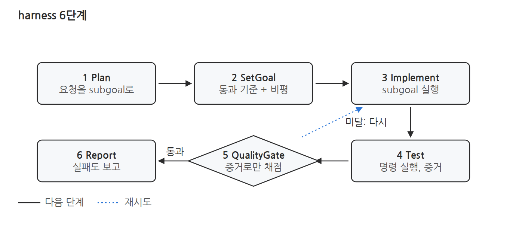
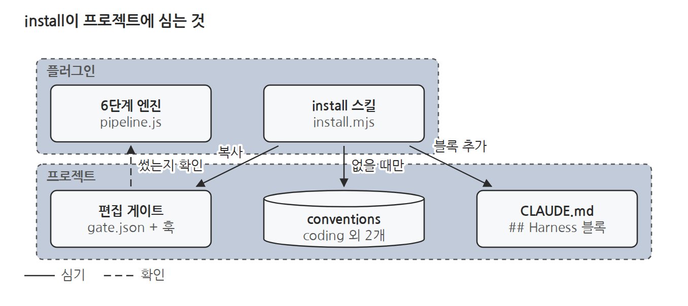

> - [하네스 엔지니어링: AI가 판단할 지점 줄이기](/ai/2026/10/01/harness-series-01a-하네스-엔지니어링.html)에서 정리한 순서를 플러그인으로 옮긴 과정을 이어서 쓴다.
> - 아직 공부 중인 개념입니다. 조금 틀려도 너른 이해 부탁드립니다!
> - 이 글은 개인적인 의견을 다룹니다.

# 다루는 내용
- 계획 → 검사 → 작업 → 검사라는 순서를 6단계로 고정한 `harness` 플러그인을 만들고, v0를 걷어내 지금 모양으로 다시 만들면서

---
## 목차
### 1. 6단계는?
### 2. install하면?
### 3. 일을 맡기면?
### 4. v0를 걷어내면서
### 5. 결과적으로?

---
## 1. 6단계는?
- 앞의 정리를 옮긴 것이 [claude-skills](https://github.com/newkayak12/claude-skills)의 `harness`다.
- 큰 요청 하나를 고정된 6단계로 통과시킨다.

*그림 1. harness는 요청을 고정 6단계로 통과시키고, 미달이면 Implement로 돌아간다*

1. Plan: 요청을 subgoal로 쪼갠다.
2. SetGoal: subgoal마다 통과 기준(goal-spec)을 쓰고, 비평 패스가 그 기준의 빈틈을 찌른다.
3. Implement: subgoal에 맞는 스킬을 붙여 실행한다.
4. Test: 별도 에이전트가 명령을 돌리고 파일을 읽어 증거를 만든다.
5. QualityGate: 또 다른 채점자가 그 증거만 보고 통과 여부를 정한다. 미달이면 3으로 돌아가고, 재시도 횟수에 상한이 있다.
6. Report: 결과를 쓴다. 실패한 subgoal도 숨기지 않는다.

- 끝에 조립된 전체를 목표와 비교해 0~100으로 매기는 검사가 한 번 더 있다. 90 이상이어야 통과다.
- 계획과 채점은 Opus가 맡고, 실행과 결정적 검증은 로컬 Codex CLI로 보낼 수도 있다([다른 모델에게 검증을 맡기는 이유](/ai/2026/10/05/harness-series-02-다른-모델에게-검증.html)).
- 핵심은 만드는 쪽, 증거를 내는 쪽, 채점하는 쪽을 서로 다른 에이전트로 나눈 것이다.

## 2. install하면?
- 마켓플레이스에서 플러그인을 설치한다.

```bash
/plugin install harness@newkayak12-claude-skills
```

- 설치만으로는 강제되는 것이 없다. 프로젝트 안에서 `install` 스킬을 돌려야 상시로 걸린다.

```
이 프로젝트에 하네스 설치하고 게이트 켜줘. Kotlin 소스만 게이트 대상으로.
```

- 돌리면 프로젝트에 아래 파일이 생긴다.
	- `.claude/harness-gate.json`: 편집 게이트를 걸 경로 패턴
	- `.claude/hooks/goal-gate.mjs`와 `settings.json`의 PreToolUse 항목: 그 경로를 하네스 없이 고치려 하면 막는 훅
	- `.claude/conventions/`의 `coding`, `verification`, `boundaries`: 엔진이 읽는 기본 규약. SetGoal은 통과 기준을 쓸 때, Implement는 지킬 규칙으로 읽는다.
	- `CLAUDE.md`의 `## Harness` 블록
	- `.gitignore`의 실행 기록 줄
- 이미 있는 파일은 덮어쓰지 않는다. 심은 뒤의 사본은 프로젝트 소유다.

*그림 2. 엔진은 플러그인에 남고, 게이트와 규약은 프로젝트가 가진다*

## 3. 일을 맡기면?
- 요청 원문을 넘긴다.

```
하네스 돌려줘: 주문 동기화 잡이 업스트림 페이지 크기가 바뀌면 행을 흘려. 제대로 고치고 각 부분 독립적으로 검증한 다음 보고해줘.
```

- 돌아오는 것은 보고서, 전체 통과 여부, 실패한 subgoal 목록, 목표 대비 점수다.
- 사소한 수정이나 단순 질문에는 쓰지 않는다. 6단계를 도는 비용이 더 크다.
- 편집 게이트의 성격은 아래와 같다.
	- opt-in: `harness-gate.json`에 적은 경로만 본다.
	- fail-open: 훅에 오류가 나면 막지 않고 통과시킨다.
	- 기록 기준: 하네스를 썼는지는 실제로 실행된 도구 호출, 디스크에 남은 계획과 goal-spec으로만 본다. 대화 속 문자열은 인정하지 않는다.
- 보안 장치로 만든 것은 아니다. 하네스를 거치도록 미는 장치다.

## 4. v0를 걷어내면서
### v0는 장치가 많았다
- 첫 버전(v0)은 사이클, 단계, 규칙 계층을 두고 여러 스킬과 훅, 스크립트로 이를 지키게 했다.
- 기능은 충분했는데 발동이 문제였다.
	- 켜져야 할 때 켜지지 않거나, 엉뚱한 때 켜졌다.

### 손잡이는 goal-spec 하나
- 장치를 하나씩 놓고 보니 컨벤션도, 게이트도, 단계도 결국 "목표를 어떻게 쪼개고 어떤 기준으로 통과를 볼지"로 모였다.

> 결과적으로 **v0를 걷어내고, goal-spec 하나를 손잡이로 둔 가벼운 엔진으로 다시 만들었다.**

### v1.0.0부터 안정판까지
- 7월 7일 v1.0.0에서 v0를 통째로 걷어내고, 쪼개기 → 실행 → 독립 검사 → 루프만 남긴 가벼운 엔진으로 새로 만들었다.
	- 커밋 메시지에 남긴 표현은 "개념은 남기고 코드는 남기지 않는다"였다.
- 7월 15일 v1.1.0에서 Plan, SetGoal, Test를 따로 떼어 지금의 6단계가 됐다. 스펙 비평과 목표 대비 검사도 이때 들어갔다.
- 같은 날 `install` 스킬(v1.2.0)이 생겼다.
	- 플러그인이 계속 깔려 있지 않아도 프로젝트가 규칙을 가지게 하려는 것이다.
	- v0에서 상황별로 쓰던 규칙 묶음은 install의 기본 규약으로 옮겼다.
- 강제는 v0 훅의 부작용 때문에 한 번 미뤘다. 이후 opt-in 경로의 편집만 막고 오류에는 통과시키는 형태로 넣었다.
- 11월 2일 v1.38.2를 안정판으로 표시했다. 이후 새 작업은 teams 플러그인에서 진행한다.

## 5. 결과적으로?
1. `harness`는 계획 → 검사 → 작업 → 검사라는 순서를 6단계로 박았다. 만드는 쪽, 증거를 내는 쪽, 채점하는 쪽은 서로 다른 에이전트다.
2. 엔진은 플러그인에 두고, 게이트와 규약은 install로 프로젝트에 심는다. 게이트는 opt-in, fail-open이고 기록으로만 확인한다.
3. 손잡이는 goal-spec 하나다. v0의 장치를 걷어내고 그 하나로 모아 지금의 6단계가 됐다.

> [이전 글: 하네스 엔지니어링: AI가 판단할 지점 줄이기](/ai/2026/10/01/harness-series-01a-하네스-엔지니어링.html) / [다음 글: 다른 모델에게 검증을 맡기는 이유](/ai/2026/10/05/harness-series-02-다른-모델에게-검증.html)
