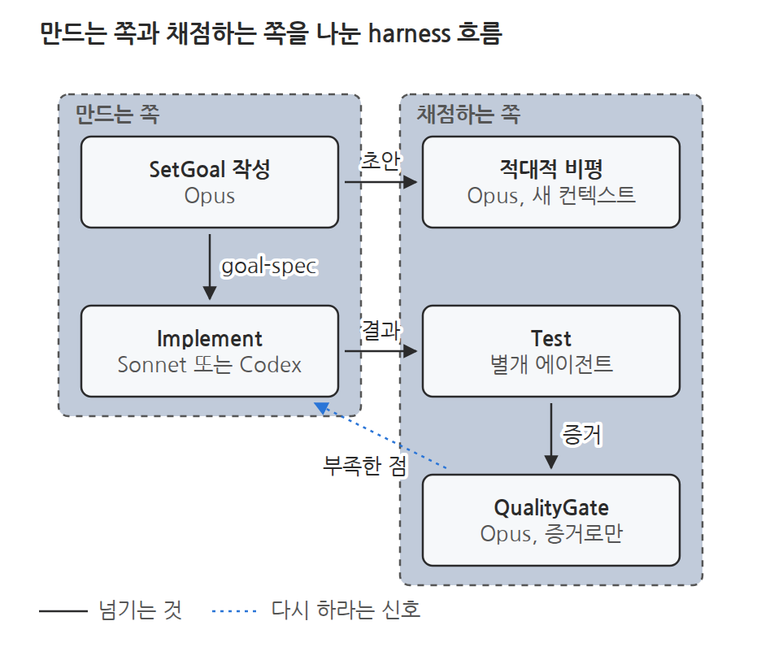

> - 작업한 모델에게 "한 번 더 확인해 줘"라고 해서는 잘 고쳐지지 않아, harness에서 만드는 일과 채점하는 일을 나눈 이유를 정리했다.
> - LLM 평가는 아직 공부 중인 영역이다. 논문은 초록과 본문에서 확인한 범위까지만 옮겼다.
> - 이 글은 개인적인 의견을 다룹니다.

# 다루는 내용
- 만들기와 채점을 나누는 이유와, harness에서 SetGoal 비평·QualityGate·Codex 라우팅으로 그걸 나눈 방법

---
## 목차
### 1. 같은 모델이 채점까지 하면?
### 2. LLM 채점자의 편향
### 3. 역할? 모델? 벤더?
### 4. harness에서 채점하는 세 단계
### 5. 기본값을 off로 돌리기까지
### 6. 결과적으로?

---
## 1. 같은 모델이 채점까지 하면?
- 알고리즘 문제를 Claude와 같이 풀던 때의 일이다.
	- 원형 수열 문제에서 `elements.size - 1 + i`와 `elements.size + i - 1`을 두고 모델이 둘은 다르다고 했다.
	- 덧셈 순서만 바뀐 같은 식인데도 모델은 처음 낸 판단을 쉽게 내려놓지 않았다.
	- 그때 남긴 말이 "이는 당신이 확증편향에 가득차 있음을 반증한다"였다.
- 이때는 사람이 옆에서 직접 계산했으니 잡혔다.
- 하네스는 계획, 작업, 검사를 사람 손을 덜 타고 돌리려고 만든 구조다.
	- 그렇다면 옆에서 계산해 주던 사람의 자리는 누가 채울까?
	- 작업한 모델에게 "한 번 더 확인해 줘"라고 하면 충분할까?

## 2. LLM 채점자의 편향
- LLM에게 답을 채점시키는 방식을 보통 LLM-as-a-judge라고 부른다.
- 이 방식의 편향을 다룬 연구가 몇 편 있다. 확인한 것만 옮긴다.

1. [Judging LLM-as-a-Judge with MT-Bench and Chatbot Arena](https://arxiv.org/abs/2306.05685) (Zheng 외, 2023)
	- LLM 채점자의 한계로 위치 편향, 장황함 편향, 자기 강화(self-enhancement) 편향을 꼽는다.
	- 답의 순서, 길이, 자기가 쓴 답인지에 따라 점수가 흔들린다는 뜻으로 보인다.
2. [LLM Evaluators Recognize and Favor Their Own Generations](https://arxiv.org/abs/2404.13076) (Panickssery 외, 2024)
	- 사람이 보기에 품질이 같은 답이어도 LLM 채점자는 자기가 쓴 답을 더 높게 쳤다.
	- 모델은 자기 글을 우연보다 잘 알아봤고, 알아보는 능력이 클수록 자기 선호도 커졌다고 한다.
3. [Large Language Models Cannot Self-Correct Reasoning Yet](https://arxiv.org/abs/2310.01798) (Huang 외, 2023)
	- 외부 피드백 없이 모델이 스스로 추론을 고치는 것(intrinsic self-correction)은 잘 되지 않았다.
	- 어떤 경우에는 고친 뒤 성능이 오히려 떨어졌다.

- 세 편을 겹쳐 보면 아래와 같이 읽힌다.
	- 같은 모델이 만들고 같은 모델이 채점하면 점수가 후해질 수 있다.
	- "한 번 더 봐"만으로는 잘 안 고쳐지고, 바깥에서 들어오는 근거가 필요하다.
- 물론 이 연구들은 특정 모델과 벤치마크 위의 결과다. 지금 쓰는 모델에도 같은 크기로 나타나는지는 확인하지 않았다.

## 3. 역할? 모델? 벤더?
- [하네스 엔지니어링: AI가 판단할 지점 줄이기](/ai/2026/10/01/harness-series-01a-하네스-엔지니어링.html)에서 하네스를 MCP 서버 중심으로 옮기는 안은 접었다. 토큰이 급증하고, MCP는 판단을 맡기는 도구보다 최종단에 가깝다는 이유였다.
	- 다만 MCP로 다른 언어 모델을 불러 편향을 벗어나는 구조라면 의미가 있을 수 있다는 예외를 남겼다.
	- 이 글의 Codex 라우팅은 MCP 대신 CLI로 붙였지만, 다른 모델을 불러 편향을 벗어난다는 생각은 같다.
- 둘을 떼는 방법은 세 겹으로 정리된다.

| 나누는 것 | 방법 | 비용 |
|---|---|---|
| 역할 | 같은 모델이라도 새 컨텍스트에서 "네가 쓴 것이 아니다"라고 두고 채점 | 호출 한 번 |
| 모델 | 실행은 Sonnet, 채점은 Opus | 모델 가격 차이 |
| 벤더 | 실행은 Codex, 채점은 Claude | 다른 CLI 설치, 별도 프로세스 |

- 세 겹 모두 공통으로 지키는 것이 하나 있다.
	- 채점자는 실행자의 설명을 믿지 않고, 따로 모은 증거로 채점한다.
	- 2절의 세 번째 논문이 말한 "외부 피드백"을 테스트 명령의 결과로 채우는 것이다.

## 4. harness에서 채점하는 세 단계
- harness는 요청 원문을 받아 Plan → SetGoal → Implement → Test → QualityGate → Report를 돈다.
- 이 중 채점하는 자리에 선 단계는 셋이다.

*그림 1. 만드는 쪽과 채점하는 쪽을 나눈 harness 흐름*

### SetGoal 비평
- SetGoal이 목표와 수용 기준(goal-spec)을 쓰면, 같은 Opus를 새 컨텍스트로 불러 적대적으로 비평시킨다.
	- 프롬프트 첫 줄은 "You did NOT write it"이다.
	- 찾는 것: 잘못 쪼갠 하위 목표, 검증할 수 없는 기준, 결과와 상관없이 종료 코드가 0인 테스트, 저장소 전체 상태에 기대는 기준
- 결과는 `{ sound, problems[] }`다. `sound: false`면 SetGoal이 문제 목록을 받아 한 번 고친다.

### Test와 QualityGate
- Test는 Implement와 다른 에이전트다.
	- 구현 파일을 고치지 못한다.
	- Implement의 서술은 명령이나 파일 근거가 없으면 믿지 않는다.
- QualityGate는 Opus가 맡는다. 하위 목표마다 "실행자의 설명보다 독립 테스트 증거를 무겁게 보라"는 문장으로 채점한다.
- 하위 목표가 다 통과해도 끝이 아니다. 조립된 전체를 목표에 비춰 0~100으로 매기고, 90 미만이면 보수 작업 후 점수를 새로 매긴다.

### Codex는?
- 호출할 때 `codex_provider`를 준다.

```js
Workflow({
  scriptPath: "harness/engine/pipeline.js",
  args: {
    request: "CSV 내보내기에 날짜 필터를 추가해 줘",
    codex_provider: "auto"   // 기본은 "off"
  }
})
```

- 켜면 Implement와 Test가 각각 별개의 `codex exec` 프로세스로 간다.
	- Plan, SetGoal, QualityGate, Report는 Claude에 남는다. 만드는 쪽은 Codex, 채점하는 쪽은 Claude가 된다.
	- 중간의 Sonnet 컨트롤러는 Codex 출력을 평소 형식(HANDOFF, 증거 JSON)으로 바꾸기만 한다. 성공한 작업을 자기가 반복하지 않는다.

| 값 | Implement·Test | Codex가 실패하면 |
|---|---|---|
| `off` | Claude(Sonnet) | 해당 없음 |
| `auto` | Codex | `DEGRADED`를 남기고 Sonnet으로 내려간다 |
| `required` | Codex | 내려가지 않고 `PROVIDER_FAILURE`로 보고한다 |

- 실행 중에는 `/harness-status`로 비평 라운드와 지적 사항을 심각도별로 볼 수 있다.

## 5. 기본값을 off로 돌리기까지
- 독립 비평부터 넣었다.
	- 2026-06-26 목표 분해 단계에 Critic 패스를 붙였다. 같은 모델이지만 작성자와 컨텍스트를 나눈 단계다.
- 다음은 벤더를 나눴다.
	- 2026-08-16 Codex CLI를 provider로 붙였고, 08-20 Workflow의 Implement와 Test를 Codex에 넘기게 했다.
	- 이때 기본값은 `auto`였다.
- 열흘 뒤 기본값을 바꿨다.
	- 2026-08-30 커밋의 내용은 "외부 provider를 고르던 기본값을 모두 Claude에 둔다"였다.
	- provider 인자 없이 돈 실행은 어떤 외부 provider에도 연락하지 않는다.

> 결과적으로 **기본은 off로 두고, 다른 벤더가 필요한 실행만 auto나 required로 켜기로 했다.**

- off에서도 역할과 모델 분리는 남는다. 끄는 것은 세 겹 중 마지막 한 겹이다.
- harness 밖에도 같은 생각을 옮겼다.
	- 2026-11-10 `agents:use-codex`를 만들었다. Codex에게 읽기 전용으로 두 번째 의견을 묻는 스킬이다.
	- 규칙의 첫 줄은 "브리프에 우리 답, 가설, 순위를 넣지 않는다"다. 결론을 읽은 두 번째 의견은 그 결론에 동의하기 때문이다.
	- 의견이 갈리면 어느 의견도 바로 받지 않고, 파일·테스트·명령으로 확인한 뒤 정한다.
	- 같은 날 `think:brainstorming`의 토론 모드와 `think:devils-advocate`도 첫 라운드에 다른 모델을 쓰게 했다.

## 6. 결과적으로?
1. 같은 모델이 만들고 채점하면 자기 답에 후해질 수 있다. harness는 그 둘을 역할, 모델, 벤더 세 겹으로 나눈다.
2. 나누는 것만큼 중요한 것은 채점의 재료다. 채점자는 실행자의 설명보다 따로 돌린 테스트의 증거를 본다.
3. 다른 벤더는 켤 때만 쓴다. 기본 실행은 외부에 연락하지 않는다.

> [이전 글: harness 플러그인: 계획과 검사를 고정하는 6단계](/ai/2026/10/03/harness-series-01b-harness-플러그인.html) / [다음 글: AI에게 규칙을 지키게 하는 세 가지 방법](/ai/2026/10/07/harness-series-03-규칙을-지키게-하는-세-가지-방법.html)
