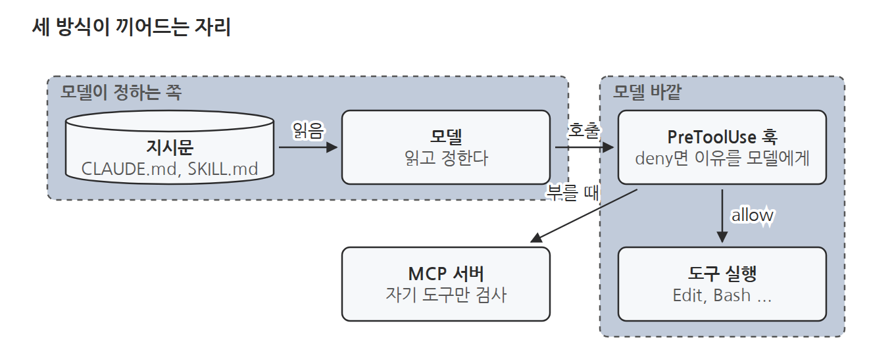
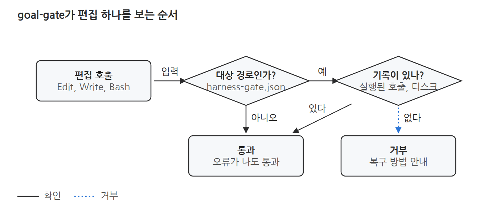

> - harness에 편집 게이트를 붙이면서, 규칙마다 지시문·훅·MCP 중 어디에 둘지 갈라 볼 필요가 생겨 정리했다.
> - 이 글은 개인적인 의견을 다룹니다.

# 다루는 내용
- 지시문, 훅, MCP를 "모델이 협조해야 동작하는가"로 나눠 보고, 그 기준으로 harness의 편집 게이트를 만들면서

---
## 목차
### 1. 규칙을 써 두면?
### 2. 지시문은 모델이 읽는 글
### 3. 훅? MCP?
### 4. harness의 편집 게이트
### 5. 훅 10개에서 네 줄 규칙으로
### 6. 결과적으로?

---
## 1. 규칙을 써 두면?
- 2026년 6월, 내 레포의 `harness/` 디렉터리가 실질적인 의미가 있는지 물었다.
	- 돌아온 답은 SKILL.md 묶음이라 실행 시점에 강제하는 힘은 없다는 것이었다.
- 규칙을 어디에 두어야 지켜질까?
	- CLAUDE.md에 "이 파일은 하네스를 거쳐서만 고친다"고 쓸 수 있다.
	- 같은 규칙을 훅으로 걸 수도 있고, MCP 서버의 도구 검사로 넣을 수도 있다.
- [하네스 엔지니어링: AI가 판단할 지점 줄이기](/ai/2026/10/01/harness-series-01a-하네스-엔지니어링.html)에서 강제력을 층으로 나눴다. 이번에는 그중 Claude Code 안에서 직접 손댈 수 있는 세 가지를 실제 동작 단위로 본다.
- 기준은 하나다. 모델이 협조해야 동작하는가?

*그림 1. 지시문은 모델이 읽어야 하고, 훅은 모든 도구 호출 앞에 선다*

## 2. 지시문은 모델이 읽는 글
- CLAUDE.md는 세션이 시작될 때 컨텍스트로 올라간다.
- [공식 문서](https://code.claude.com/docs/en/memory)는 이렇게 쓴다.

> Claude treats them as context, not enforced configuration. To block an action regardless of what Claude decides, use a PreToolUse hook instead.

- CLAUDE.md는 설정 파일과 달리 모델이 읽는 글이다. 읽고 따를지는 모델이 정한다.
- SKILL.md는 협조가 두 번 필요하다.
	- 한 번은 description을 보고 그 스킬을 고를 때
	- 또 한 번은 고른 뒤 본문의 단계를 따를 때
- 그래도 지시문만 담을 수 있는 규칙이 있다.
	- "실패한 subgoal도 숨기지 않는다", "설계가 바뀌면 계획부터 다시 쓴다"처럼 판단이 들어가는 규칙이다.
	- 도구 입력만 보고는 이런 규칙을 어겼는지 알 수 없다.
- 지시문은 힘이 약한 대신 담을 수 있는 범위가 가장 넓다.
- 같은 문서도 지시가 구체적이고 짧을수록 더 일관되게 지켜진다고 한다.

## 3. 훅? MCP?
### 훅은?
- [훅](https://code.claude.com/docs/en/hooks)은 Claude Code가 정해진 시점에 직접 돌리는 명령이다. 모델이 부르지 않는다.
- 자주 쓰는 이벤트는 아래와 같다.

| 이벤트 | 언제 | 막을 수 있나 |
|---|---|---|
| `SessionStart` | 세션 시작, 재개 | 못 막는다. 컨텍스트를 더할 수 있다 |
| `UserPromptSubmit` | 프롬프트가 모델에 가기 전 | 프롬프트를 막을 수 있다 |
| `PreToolUse` | 도구 호출 직전 | 호출을 막을 수 있다 |
| `PostToolUse` | 도구가 성공한 뒤 | 이미 실행됐다. 피드백만 준다 |
| `Stop` | 모델이 응답을 끝낼 때 | 끝내지 못하게 할 수 있다 |

- 규칙을 지키게 하는 데 가장 직접적인 것은 PreToolUse다.
	- `matcher`로 `tool_name`을 고른다.
	- 표준 입력으로 도구 이름과 입력 JSON을 받는다.
- 막을 때는 아래처럼 돌려준다.

```json
{
  "hookSpecificOutput": {
    "hookEventName": "PreToolUse",
    "permissionDecision": "deny",
    "permissionDecisionReason": "이 파일은 하네스를 거쳐야 고칠 수 있다"
  }
}
```

- 문서 기준으로 짚을 점이 두 가지 있다.
	- 거부 이유는 Claude에게 보인다. 막힌 뒤에 할 일은 이 문장을 읽은 모델이 정한다.
	- exit 2는 막는다. 그 밖의 0이 아닌 종료 코드는 막지 않고 실행이 계속된다.
- 훅이 보는 것은 도구 이름과 입력이 전부다.
	- "이 파일에 쓰려 한다"는 알지만 "왜 쓰려 하는지"는 모른다.
	- 2절의 판단이 들어가는 규칙은 훅에 담기 어렵다.

### MCP는?
- MCP 서버는 자기 도구가 불릴 때만 검사한다.
- 그 안에서는 꽤 강하게 막을 수 있다.
	- graph 플러그인의 `graph_run`은 의존성이 안 채워진 노드, 이미 끝난 노드를 거부한다.
	- README에 쓴 말로는 "순서는 권고가 아니라 강제"다.
- 다만 그 도구를 부를지는 모델이 정한다.
	- 모델이 MCP를 건너뛰고 `Edit`를 부르면 서버는 그 호출을 보지 못한다.
- [하네스 엔지니어링: AI가 판단할 지점 줄이기](/ai/2026/10/01/harness-series-01a-하네스-엔지니어링.html)에서 MCP에 강제를 몰아넣는 안을 접은 이유 중 하나가 이것이다.

### 셋을 나란히 놓으면?

| 방식 | 누가 돌리나 | 모델 협조 | 담기 좋은 규칙 |
|---|---|---|---|
| 지시문 | 모델이 읽는다 | 필요하다 | 판단이 들어가는 규칙 |
| MCP | 모델이 부를 때 서버가 | 부르는 데 필요하다 | 단계 순서, 필수 값 |
| 훅 | Claude Code가 매번 | 필요 없다 | 어떤 도구로 무엇을 쓰는지 |

- 하나로 다 되지 않으니 섞는다. 훅으로 "엔진이나 MCP를 거쳤는가"를 확인하면, MCP를 부를지 말지의 판단도 훅 쪽으로 끌어올 수 있다.

> 결과적으로 **막는 일은 훅에, 순서는 엔진과 MCP에, 판단은 지시문에 두기로 했다.**

## 4. harness의 편집 게이트
- harness를 프로젝트에 `install`하면 [harness 플러그인: 계획과 검사를 고정하는 6단계](/ai/2026/10/03/harness-series-01b-harness-플러그인.html)에서 본 파일들이 생긴다. 그중 강제를 맡는 것이 편집 게이트다.
- 이 훅은 opt-in이다. 프로젝트가 `.claude/harness-gate.json`을 만들기 전에는 아무것도 하지 않는다.

```json
{ "patterns": ["src/.*\\.kt$"], "window_hours": 2 }
```

- `patterns`에 맞는 파일은 goal-gate 훅이 본다.
	- `Write`, `Edit`, `MultiEdit`, `NotebookEdit`로 쓸 때
	- 그 파일에 쓰는 `Bash`를 부를 때

*그림 2. goal-gate는 대상 파일만 보고, 기록이 없을 때만 거부한다*

### "거쳤다"의 기준
- 하네스를 거쳤는지는 기록으로만 본다. 인정하는 기록은 네 가지다.
	1. 실제로 실행되고 오류 없이 끝난 엔진, `graph_open`, `tm_open` 같은 도구 호출
	2. broker 원장에 열려 있는 노드
	3. 계획, goal-spec, 통과한 비평이 디스크에 있고 보고서는 아직 없는 fallback 실행
	4. 병렬 서브에이전트용 마커
- 대화에 엔진 이름을 쓰거나 이 훅의 거부 문구를 인용해도 열리지 않는다. 트랜스크립트에서는 실제로 실행된 도구 호출만 읽는다.
- 훅 자신의 설정과 등록 파일은 `patterns`와 상관없이 항상 대상이다.
	- `harness-gate.json`, `settings.json`, `.claude/hooks/`가 그렇다.
	- 막는 장치를 끄는 것도 막힌다.

### 막히면?
- 하네스 없이 대상 파일을 고치려 하면 아래 문장으로 거부된다.

```
src/order/OrderSync.kt is gated by the harness (.claude/harness-gate.json).
Engage the harness before editing it: invoke the harness skill and follow its Process ...
A mention in text does not engage it.
```

- 거부 문구는 막힌 쪽이 읽고 따르는 지시문이다. 읽는 쪽에 따라 문구를 나눈 이유다.
	- 메인 세션에는 하네스를 여는 방법을 알려 준다.
	- 서브에이전트나 실행 중인 노드에는 하네스를 열지 말고 멈춰서 호출자에게 보고하라고 한다.
	- 둘은 훅 입력의 `agent_id`로 구분한다.

### fail-open
- 훅에 오류가 나면 막지 않는다. 설정을 못 읽거나 예외가 나도 0으로 끝난다.
- 못 보는 쓰기도 README에 목록으로 남겼다. 변수에 담은 파일 이름, 경로로 실행한 스크립트 파일 같은 것이다.
- 이 훅은 보안 장치로 만든 것이 아니다. 과정을 건너뛰지 않게 미는 난간이다.

## 5. 훅 10개에서 네 줄 규칙으로
### v0의 훅 10개
- 첫 버전(v0)에도 훅이 10개 있었다.
	- SessionStart, UserPromptSubmit, PreToolUse에 걸쳐 단계와 규칙을 지키게 하는 장치였다.

### 걷어냈다가 좁혀서
- 7월 7일 v1.0.0으로 새로 만들면서 훅은 모두 걷어냈다. 커밋에 남긴 이유는 "v0 훅에 부작용이 있어 강제는 미룬다"였다.
- 8일 뒤인 7월 15일, 범위를 좁혀 강제를 넣었다. README에 v0에서 얻은 설계 규칙으로 남긴 것은 네 줄이다.
	- PreToolUse만 쓴다.
	- 모든 오류와 애매한 경우에는 통과시킨다.
	- opt-in한 파일에 대한 쓰기만 막는다.
	- 거부 문구는 푸는 방법을 알려 준다.

### 그 뒤로 넓히고 좁힌 것
- 9월 말에는 "거쳤다"의 근거를 기록으로 한정했다.
- 10월에는 스크립트(sh, py)로 대상 파일을 쓰는 것도 같은 쓰기로 보게 했다.
- 반대로 좁힌 것도 있다. heredoc 본문은 데이터로 보고 리다이렉트 대상만 보게 했다.
	- 무해한 명령까지 막으면 막는 장치를 피해 가도록 학습되기 때문이다.
- 11월에 harness는 안정판이 됐다. 같은 생각은 teams로 이어진다.
	- 스크립트 래퍼 대신 플러그인을 설치하면 훅이 진입 스킬을 거치게 하는 방식이다.

## 6. 결과적으로?
1. 지시문과 MCP는 모델이 협조해야 동작한다. 훅만 모델의 판단과 상관없이 매번 돈다.
2. 훅은 도구 입력만 보므로 판단이 들어가는 규칙은 지시문에, 단계 순서는 엔진과 MCP에 둔다.
3. harness의 편집 게이트는 opt-in한 파일만 보고, 엔진을 거쳤는지는 기록으로만 확인하고, 오류에는 길을 막지 않는다.

> [이전 글: 다른 모델에게 검증을 맡기는 이유](/ai/2026/10/05/harness-series-02-다른-모델에게-검증.html) / [다음 글: 에이전트를 팀처럼: 그래프로 묶기](/ai/2026/10/09/harness-series-04a-에이전트를-팀처럼.html)
