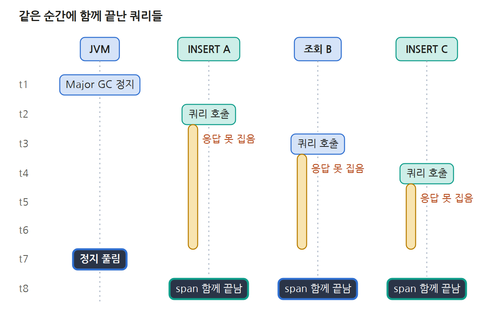

> - 이 글은 개인적인 의견을 다룹니다.
> - 서비스·테이블·작업 이름은 일반 명칭으로 바꿨고, 시각과 건수는 뭉갰습니다.

# 다루는 내용
- 앱 쪽 관측과 DB 쪽 관측이 서로 다른 말을 할 때, 같은 시간 구간에 맞대 보고 지연의 출처를 정한 이야기

---
## 목차
### 1. DB가 느렸나, 아니었나?
### 2. 두 관측은 각각 무엇을 재나?
### 3. 어느 쪽을 믿을까?
### 4. 앱만 느렸다면?
### 5. DB만 느렸다면?
### 6. 어긋남에도 모양이 있나?
### 7. 결과적으로?

---

## 1. DB가 느렸나, 아니었나?
- APM과 DB 지표를 한 달치 놓고 보던 중이었다.
- 그런데 같은 DB를 두고 두 관측이 서로 다른 말을 하는 구간이 두 번 나왔다.
	- 어느 날 오전, 평소 금방 끝나는 짧은 INSERT가 APM에서 길게는 20초 넘게 찍혔다. APM만 보면 "DB가 느렸다".
	- 그런데 같은 시각 DB 쪽 지표는 평온했다. CPU 최대 19%, 막힌 트랜잭션은 거의 0, DML 지연은 62ms 한 번이 전부였다.
	- 반대로 매일 새벽 같은 두 시간대에는 DB 쪽 DML 지연이 50~140ms로 튀었다. 평소에는 2ms 안팎이다.
	- 그런데 그 시간대 APM에는 그만한 쓰기가 보이지 않았다.
- 한쪽은 DB가 느리다고 하고, 다른 쪽은 아니라고 한다. 어느 쪽 말을 믿고 원인을 찾아야 할까?

## 2. 두 관측은 각각 무엇을 재나?
- 먼저 두 숫자가 같은 것을 재고 있는지부터 봤다. 결론부터 말하면 아니었다.

| | 앱 쪽 (APM 쿼리 span) | DB 쪽 (클라우드 DB 지연 지표) |
|---|---|---|
| 재는 지점 | 앱 스레드가 드라이버 호출에 들어가서 나올 때까지 | DB 엔진이 문장을 처리한 시간 |
| 단위 | 호출 하나 | 클러스터·인스턴스 단위, 구간 평균 |
| "누가"를 아나 | 안다 (서비스, 엔드포인트, 컨테이너) | 모른다 |
| 못 보는 것 | 계측이 안 붙은 실행 경로, 인덱싱되지 않은 span | 앱 안에서 쓴 시간 |

- 앱 쪽 span은 결국 **앱이 기다린 시간**이다.
	- 그 사이에 JVM이 멈추면 멈춘 시간도 쿼리 시간으로 들어간다. 응답이 와 있어도 스레드가 그것을 집어 들 수 없기 때문이다.
- DB 쪽 지표는 **DB가 일한 시간**에 가깝다. 대신 누가 그 일을 시켰는지는 말해 주지 않는다.
- 추가로, APM에는 인덱싱된 span만 남는다. 그래서 "APM에 없다"는 "없었다"가 아니라 "계측 밖이거나 남지 않았다"에 가깝다.

> 같은 "DB 지연"이라는 이름을 달고 있어도, 앱 쪽은 기다린 시간이고 DB 쪽은 일한 시간이다.

## 3. 어느 쪽을 믿을까?
1. 앱 쪽을 믿는다.
	- 사용자가 겪는 시간에 가깝다.
	- 하지만 GC 같은 앱 내부 시간이 섞이고, 계측 밖 경로는 아예 안 보인다.
2. DB 쪽을 믿는다.
	- DB가 실제로 한 일에 가깝다.
	- 하지만 누가 만든 부하인지 모르고, 앱이 멈춘 시간은 보이지 않는다.
3. 두 관측을 같은 시간 구간에 나란히 놓고, 어긋나는 모양에 따라 제3의 지표로 확인한다.

- 1, 2번은 둘 다 한쪽 눈을 감는 선택이다. 그리고 이번 두 사례는 정확히 그 감은 쪽에서 원인이 나왔다.

> 결과적으로 **3번을 선택했다.** 어느 쪽이 맞냐보다, 같은 구간에서 둘이 어떻게 어긋나는지가 다음에 볼 곳을 알려 줬다.

## 4. 앱만 느렸다면?
- 오전 사례는 APM만 느리고 DB는 정상인 모양이었다. 이 모양이면 앱 쪽 정지를 먼저 의심했다.
- 확인한 순서는 아래와 같다.

1. **어디서 느렸나?** 1초를 넘긴 INSERT 6건이 모두 7분 남짓한 구간 안에, 같은 컨테이너 하나에서 났다.
2. **그 쿼리만 느렸나?** 같은 컨테이너에서 서로 관련 없는 쿼리들(임시 테이블 조회, 목록 조회, 다른 테이블 INSERT)도 약 10초씩 걸렸다.
3. **어떻게 끝났나?** 6건 중 5건이 0.1초 안의 같은 순간에 함께 끝났다. 하나씩 풀린 게 아니라 동시에 풀려난 것이다.
4. **DB는?** CPU 최대 19%, 막힌 트랜잭션 거의 0.
5. **제3의 지표, JVM은?** 그 15분 동안 시간의 93~99%를 Major GC에 쓰고 있었다. 힙은 99.7%, 서비스 p99는 10초대였다.

*그림 1. 호출 시점은 제각각인데, JVM 정지가 풀리자 함께 끝난다 (개념도)*

- 2번과 3번이 핵심이었다고 생각한다.
	- DB 락이었다면 같은 자원을 기다리는 쿼리만 느렸을 것이다. 서로 무관한 쿼리가 같은 프로세스에서 함께 느려지는 건 DB보다 그 프로세스를 가리킨다.
	- 같은 순간에 함께 끝났다는 건, 멈춰 있던 무언가가 한 번에 풀렸다는 뜻이다.
- 결국 DB가 아니라 앱이 멈춘 것이었다. 그날 힙 알람이 왜 조용했는지는 다른 글에서 다룬다.

## 5. DB만 느렸다면?
- 새벽 사례는 반대 모양이었다. DB 지연은 튀는데 APM은 조용했다. 이 모양이면 계측 밖 부하를 먼저 의심했다.
- DB 쪽 지표는 클러스터 단위라 누가 만든 지연인지 알려 주지 않는다.
	- 그래서 쿼리 단위 DB 모니터링에서 구간별로 "무엇이 얼마나 썼나"(영향받은 행 수, 실행 시간)를 뽑았다.
	- 그리고 같은 밤을 30분 단위로 나란히 놓았다.

| 구간 | DB 쪽 DML 지연(최대) | 그 구간의 대량 쓰기 | APM span |
|---|---|---|---|
| 자정 전후 | 1.8ms | 없음 | |
| 새벽 첫 구간 | **58.0ms** | 야간 프로시저 | 없음 |
| 그 사이 | 1.8ms | 없음 | |
| 새벽 둘째 구간 | **49.6ms** | 별도 배치 런타임의 대량 INSERT | 없음 |
| 이후 | 1.8~1.9ms | 없음 | |

*표 1. 지연이 튄 두 구간에만 대량 쓰기가 있었고, 둘 다 APM에는 span이 없었다*

- 지연이 튄 두 구간에만 대량 쓰기가 있었고, 나머지 구간은 1.8ms대로 평탄했다.
	- 하나는 DB 안에서 도는 야간 프로시저였다. 대상을 찾는 조회 하나가 1시간에 약 600초를 썼다. `SQL_CALC_FOUND_ROWS`에 anti-join이 붙어 사실상 풀스캔이었다.
	- 다른 하나는 애플리케이션 서버가 아닌 별도 런타임에서 도는 배치였다.
- 둘 다 APM이 계측하지 않는 경로였다. 계측은 앱에 붙어 있는데, 부하는 DB에 바로 걸리고 있었다.
- 여기서 하나 조심한 것이 있다.
	- 처음에는 "그 시간대 APM span 최대는 42ms인데 DB 지표는 50~140ms라 안 맞는다"는 식으로 숫자를 비교했다.
	- 그런데 APM 쪽은 개별 호출의 최대이고, DB 쪽은 구간 평균의 최대다. 값을 묶는 방식이 다르니 숫자 크기로는 맞다 틀리다를 말할 수 없다.

> 비교할 것은 숫자의 크기가 아니라 **같은 구간에 양쪽이 함께 움직였는가**였다. "APM에 없다"를 "계측 밖이다"로 말하려면 DB 쪽에서 그 쿼리를 직접 찾아야 했다.

- 영향도 같이 봤다. 새벽 지연은 50~140ms 수준이었고, 그동안 난 장애들은 모두 낮 업무 시간이었다.
- 시각이 겹치지 않으니 장애와는 별개의 패턴으로 정리했다.

## 6. 어긋남에도 모양이 있나?
- 두 사례를 놓고 보니 어긋남의 모양마다 다음에 볼 곳이 달랐다.

| 앱 쪽 span | DB 쪽 지연 | 먼저 의심할 곳 | 확인할 지표 |
|---|---|---|---|
| 느림 | 정상 | 앱 쪽 정지(GC, 스레드) | 같은 프로세스의 무관한 span, 동시 종료, JVM GC 비율 |
| 정상 | 느림 | 계측 밖 부하(프로시저, 별도 런타임 배치, 콘솔 작업) | 쿼리 단위 DB 통계를 시간 구간으로 |
| 느림 | 느림 | DB 자체(락, 무거운 쿼리) | 락 대기, 쿼리별 실행 시간 |
| 정상 | 정상 | DB 밖 구간 | 이 글에서는 다루지 않음 |

*표 2. 두 관측이 어긋나는 모양이 다음에 볼 지표를 정한다*

- 이 표를 쓰면서 같이 정리한 주의점은 아래와 같다.

1. **구간을 먼저 맞춘다.** 시간대 표기(UTC/KST)와 rollup 간격이 다르면 같은 사건이 다른 구간에 찍힌다.
2. **숫자 크기보다 같이 움직였는지를 본다.** 개별 호출의 최대와 구간 평균의 최대는 비교할 수 없다.
3. **"없다"는 결론이 아니다.** APM에 없는 건 계측 밖이거나 샘플링으로 빠진 것이다. 어느 쪽인지는 반대편 관측에서 찾아야 정해진다.
4. **판단은 제3의 지표로 닫는다.** 어긋남은 방향만 알려 준다. "앱이 멈췄다"는 GC 지표가, "계측 밖 부하"는 쿼리 단위 통계가 확인해 줬다.

### +⍺ 대조로 닫지 못한 것?
- 출처는 정했지만, 그 안쪽까지 다 본 것은 아니다.
	- 앱 사례에서 무엇이 힙을 채웠는지는 특정하지 못했다. 그날 로그는 보존 기간이 지나 있었다. 다음을 위해 OOM 때 heap dump를 남기는 설정(`-XX:+HeapDumpOnOutOfMemoryError`)이 필요하다고 남겨 뒀다.
	- 야간 프로시저를 누가 부르는지(DB의 EVENT인지 외부 스케줄러인지)는 DB 쪽에서 확인할 일로 남겼다.
- 둘 다 관측만으로는 닿지 않는 곳이다. 지표는 "어디"까지 알려 주고, "왜"는 그 안을 열어 봐야 한다.

## 7. 결과적으로?
1. 앱 쪽 관측은 기다린 시간이고 DB 쪽 관측은 일한 시간이었다. 어느 한쪽만 믿었다면, 이번 두 사례는 둘 다 엉뚱한 곳을 봤을 것이다.
2. 지연의 출처는 두 관측을 같은 구간에 맞대 보고, 어긋나는 모양이 가리키는 제3의 지표로 확인해서 정했다.
3. 다만 표의 셋째 줄(둘 다 느림)은 이번에 직접 맞대 본 사례가 없다. 그 칸은 아직 빈칸에 가깝다.

> 평소에도 rollup이 순간 peak를 깎아 버리는 게 불편했는데, 이번에는 같은 문제가 두 관측을 비교하는 자리에서 다시 걸렸다. 숫자를 비교하기 전에, 그 숫자가 어떻게 묶인 값인지부터 확인해야 했다.
