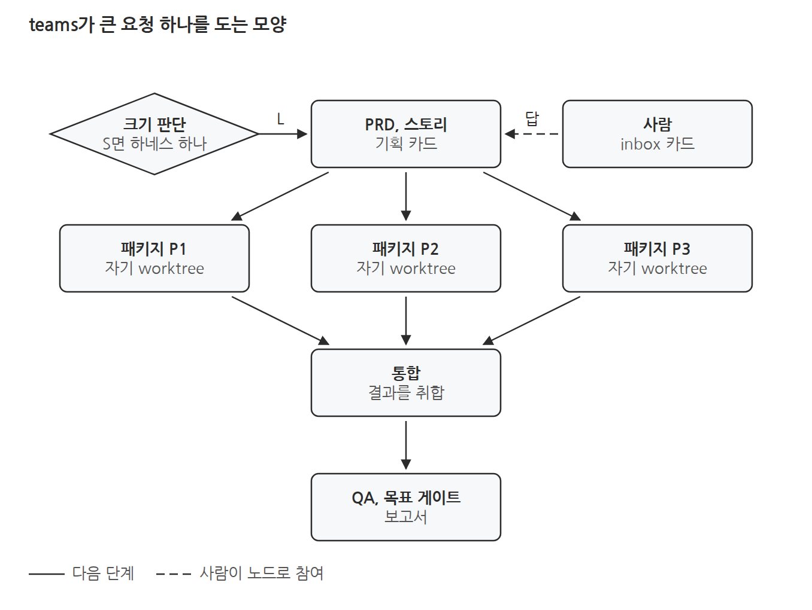

> - teams 설계를 LangGraph 문서와 대조하다가 Leader가 reducer 자리에 있는 것을 보고 정리했다.
> - 그래프 오케스트레이션은 아직 공부 중인 개념입니다. LangGraph 문서에서 확인한 범위까지만 옮겼습니다.
> - 이 글은 개인적인 의견을 다룹니다.

# 다루는 내용
- 노드, 엣지, 상태, reducer, interrupt로 에이전트 여럿을 묶는 방법을 정리하고, 그 개념을 teams에 대 보면서

---
## 목차
### 1. 기획하고, 만들고, QA까지?
### 2. 그래프로 보면?
### 3. Human도 Node?
### 4. 결과적으로?

---
## 1. 기획하고, 만들고, QA까지?
- harness는 요청 하나를 Plan부터 Report까지 6단계로 돌린다. 코드 한 덩어리를 고치는 일에는 이걸로 충분하다.
- 요청이 "기획하고, 만들고, QA까지"라면 사정이 다르다.
	- PRD와 유저 스토리가 앞에 있어야 하고,
	- 서로 다른 부분을 동시에 만들어야 하고,
	- 다 만든 것을 합친 뒤에 한 번 더 검사해야 한다.
- 10월에 플러그인이 여럿 깔리면서 정한 기준은 아래와 같다.

> harness, graph, teams가 있을 때 단순 개발만이 아니면 teams로 처리

- 그 무렵 LangGraph 같은 그래프 이론과 teams 설계를 대조하다가 두 문장이 나왔다.
	- "TeamLeader가 Reducer가 될거 같은데"
	- "Human도 Node로 포함하게"

## 2. 그래프로 보면?
### 노드, 엣지, 상태?
- [LangGraph 문서](https://docs.langchain.com/oss/python/langgraph/graph-api)는 그래프를 세 가지로 설명한다.
	- State: 애플리케이션의 공유 스냅샷. 보통 타입이 있는 스키마다.
	- Node: 상태를 읽고, 일을 하고, 갱신을 돌려주는 함수다.
	- Edge: 다음에 돌릴 노드를 정한다. 늘 같은 곳으로 가는 엣지와, 함수가 고르는 조건부 엣지가 있다.

### reducer?
- 여러 노드가 같은 상태 키에 결과를 돌려줄 때, 합치는 방법을 정하는 것이 reducer다.
	- reducer가 없으면 갱신이 이전 값을 덮어쓴다.
	- `operator.add` 같은 reducer를 달면 리스트에 덧붙여 합친다.
- 항목 수를 실행 중에 알게 되면 `Send`로 같은 노드를 항목마다 돌린다. 문서는 이걸 map-reduce, orchestrator-worker 패턴이라고 부른다.

### teams에 대 보면?
- teams에 옮기면 아래와 같다.

| 개념 | teams에서 |
|---|---|
| Node | 카드. 기획 카드, 패키지, QA 카드, 심사 단계 |
| Edge | `deps`(앞 노드가 통과해야 함), `after`(끝나기만 하면 됨) |
| State | 디스크의 `task.json`과 실행 원장 |
| Send | 패키지마다 worktree를 하나씩 띄워 하네스를 돌린다 |
| reducer | 통합. 받아들인 브랜치를 하나의 트리로 합친다 |

- 대조하면서 확인한 원래 그림은 아래와 같다.
	- "Leader -> sub * n 이 리턴하는 구조"
	- "task -> 카드고 이걸 sub가 가져가는 개념", 취합 노드는 더 상위에서 정한다.
- Leader가 카드를 나눠 주고 돌아온 결과를 모으니, reducer 자리에 Leader가 있다.

*그림 1. teams는 기획에서 패키지로 퍼졌다가 통합에서 모이고, 사람은 답을 넣는 노드로 참여한다*

- 기획에서 패키지마다 퍼지는 곳이 `Send`, 통합에서 하나로 모이는 곳이 reducer다.

## 3. Human도 Node?
- LangGraph는 사람이 끼는 지점을 [interrupt](https://docs.langchain.com/oss/python/langgraph/interrupts)로 설명한다.
	- 그래프 실행을 특정 지점에서 멈추고 바깥의 입력을 기다린다.
	- 그동안 상태를 저장하고 기한 없이 기다린다.
	- `Command(resume=...)`로 넘긴 값이 interrupt 호출의 반환값이 된다.
- 사람도 "입력을 받아 상태를 바꾸는 노드" 하나로 볼 수 있다는 뜻으로 보인다. 내가 원한 것도 같은 구조였다.

> Human도 Node로 포함하게 Claude에서 selectbox 주듯 제안할 수 있게 하는게 나을듯

- teams에서는 이렇게 들어간다.
	- `ask` 질문, 사람이 가져간 단계, 사람이 심사할 단계(`human_gates`)가 생기면 태스크가 `waiting_human`이 된다.
	- `teams:inbox`로 내 차례인 카드를 보고, `teams:submit`으로 답을 넣는다. `teams:take`로 카드 하나를 직접 가져올 수도 있다.
	- 사람이 낸 결과도 벤더가 낸 결과와 같은 worktree 대조를 거친다.
- 사람이 없을 때도 멈추지 않는다.
	- `interactive`가 꺼져 있으면 질문은 기본값으로 정하고 넘어간다. 그렇게 정한 질문은 보고서와 inbox에 남는다.
	- 끝내지 못한 스토리는 보고서가 `retro.json`에 담고, 다음 스프린트가 이어받는다.

> 결과적으로 **사람은 필요할 때 들어오는 노드 하나로 두기로 했다.** teams가 노리는 것은 사람이 없어도 고리가 스스로 도는 선순환이다.

- 이 그래프를 실제로 돌리는 graph와 teams 플러그인은 [graph와 teams: 기다리는 일은 데몬에게](/ai/2026/10/11/harness-series-04b-graph와-teams.html)에서 다룬다.

## 4. 결과적으로?
1. 에이전트 여럿은 그래프로 보면 정리가 된다. 일은 노드로, 상태는 디스크 한곳에 두고, Leader의 통합이 reducer 자리에서 결과를 모은다.
2. 항목 수를 실행 중에 알게 되는 일은 `Send`처럼 패키지마다 worktree를 띄워 나눠 돌린다.
3. 사람도 노드 하나다. 있으면 inbox로 답을 넣고, 없으면 기본값으로 정하고 기록한다.

> [이전 글: AI에게 규칙을 지키게 하는 세 가지 방법](/ai/2026/10/07/harness-series-03-규칙을-지키게-하는-세-가지-방법.html) / [다음 글: graph와 teams: 기다리는 일은 데몬에게](/ai/2026/10/11/harness-series-04b-graph와-teams.html)
