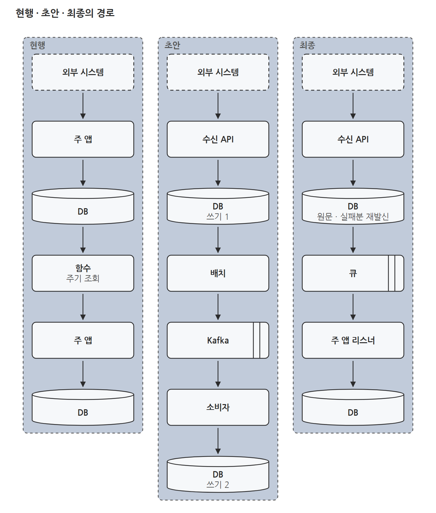
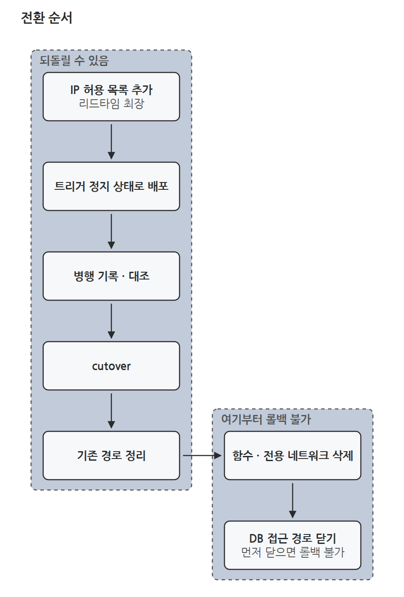

> - 서버리스 함수로 돌던 외부 연동을 상주 애플리케이션으로 옮긴 과정을 구조 위주로 정리한 연재다.
> - 무엇을 하는 시스템인지는 일반화했다. 이 글은 개인적인 의견을 다룹니다.

# 다루는 내용
- 이관 설계 초안이 리뷰를 거치며 어떻게 바뀌었고, 최종 구조를 무엇으로 정했는지

---
## 목차
### 1. 왜 옮기려 했나?
### 2. 처음 그린 초안은?
### 3. 리뷰는 무엇을 짚었나?
### 4. 그래서 무엇이 바뀌었나?
### 5. 리뷰 제안은 다 받았나?
### 6. 끝까지 남은 원칙은?
### 7. 결과적으로?

---
## 1. 왜 옮기려 했나?
- 출발점이 된 기존 구조는 아래와 같다.
	- 스케줄 트리거가 주기적으로 서버리스 함수를 깨운다.
	- 함수는 "연동처로 요청 보내기"와 "연동처가 보낸 결과를 주 애플리케이션에 반영하기"를 한 코드 안에서 분기해 처리한다.
	- 조회와 삭제 로직은 DB 프로시저에 있다.
- 옮기려던 이유는 네 가지다.

1. 함수가 애플리케이션과 다른 네트워크에 있어서 **DB로 들어오는 길을 따로 열어 둬야 한다.**
2. 함수, 전용 네트워크, NAT, 고정 IP, 스케줄 규칙까지 관리할 것이 따로 논다.
3. 팀 기술 스택과 다르고 로직이 프로시저에 있어 손대기 어렵다.
4. 연동처의 콜백이 몰리면 주 애플리케이션이 동기 호출로 전부 받아 낸다.

- 사업 과제는 아니고 기술 부채였다. 그래도 1번 때문에 마냥 미룰 수는 없었다.

## 2. 처음 그린 초안은?
- 가장 먼저 고민한 건 롤아웃 단위였다. 기존 처리가 ID 기준 4분할로 진행되고 있어서, 그 분할을 롤아웃 단위로 쓰면 되겠다고 생각했다.
- 초안의 구성은 아래와 같다.
	- 결과 전달: Kafka로 발행/구독. 초안에 목표로 둔 것은 생산·소비 속도 분리와 backpressure였다. 전달 방식 후보로는 REST, 관리형 Kafka, Redis Streams가 올라와 있었다.
	- 롤아웃: 분할을 주차별로 하나씩 옮기는 25→50→75→100%. 롤백 단위는 분할 하나(영향 25%)이고, 스케줄만 조작하면 원복된다.
	- 테이블: 기존 작업 테이블에 상태 컬럼을 붙여 Outbox로 쓴다.
	- 배치: 기존 배치 서비스에 편입. "별도 인프라 증설 없음"이라는 Non-Goal에 맞췄다.

> Outbox: 보낼 메시지를 DB 테이블에 먼저 기록하고, 별도 과정이 그걸 읽어 발행하는 패턴이다. 발행이 실패해도 테이블에 남아 있으니 다시 보낼 수 있다.

## 3. 리뷰는 무엇을 짚었나?
- 리뷰 결론은 **조건부 보류**였다.
- 이관이 필요하다는 데는 동의하지만, 세 가지를 풀고 나서 다시 보자는 이야기였다.

### Kafka가 꼭 필요한가?
- 리뷰의 요지는 요청이 동시다발적인지, 양이 많은지부터 보자는 것이었다.
- 초안이 스스로 세운 Non-Goal과도 부딪혔다. 브로커를 새로 세우면 "인프라 증설 없음"을 어기게 된다.
- 그래서 비용으로 다시 따져 봤다.
	- 고정비: SQS는 0이고, 관리형 Kafka는 프로비저닝형이든 서버리스형이든 월 수백 달러대에서 시작한다.
	- 손익분기: 메시지 크기와 보존 기간에 따라 결론이 갈린다. Standard 큐, 배치 적용, 복제 3을 가정하면 아래와 같다.
		- 1KB 메시지, 보존 1일: 약 1,600 TPS부터 Kafka가 더 싸다.
		- 10KB 이상 메시지, 보존 3일 이상: 어떤 볼륨에서도 Kafka가 더 비싸다.
		- SQS로 fan-out하면 소비처 수만큼 비용이 곱해진다.
	- 가격은 작성 시점의 공개 가격 기준이다.
- 이 연동은 소비처가 하나이고, replay가 꼭 필요한 업무도 아니다.
	- offset replay나 consumer group은 쓸 일이 없다.
	- 반면 broker sizing, partition, 버전 업그레이드는 고스란히 운영할 일이 된다.

### 분할 롤아웃이 검증인가?
- 분할 롤아웃은 문제가 났을 때 영향 범위를 줄여 줄 뿐이다. 새 코드가 옛 코드와 같은 결과를 내는지는 알려 주지 않는다.
- 첫 설계는 분할 단위 롤아웃이었다. 그런데 분할끼리 결과를 비교하는 건 서로 다른 데이터의 합계를 맞대는 일이라, 로직을 옮기며 생긴 건 단위 차이는 잡히지 않는다.
- 롤백 단위로 봐도 Feature Flag 하나가 더 빠르고 단순하다.

### 현행 구조는 제대로 봤나?
- 세 번째는 더 기본적인 문제였다. 문서 판본마다 "콜백을 누가 받는가"가 다르게 적혀 있었다.
	- 실제로는 주 애플리케이션이 콜백을 받고, 함수는 그걸 주기적으로 조회해 다시 넘기는 폴링 워커다.
	- 함수를 중계자로 그린 표 위에 개선 논리를 쌓았으니 그 논리도 같이 흔들렸다.
- 홉을 다시 세어 보니 초안은 **DB를 두 번 쓰면서 홉도 오히려 늘어** 있었다.

*그림 1. 초안은 현행보다 홉이 늘고 DB를 두 번 썼다. 최종안은 원문을 한 번 기록하고 큐로 넘긴다.*

## 4. 그래서 무엇이 바뀌었나?
- 지적을 받고 설계를 네 군데 고쳤다.

1. SQS
	- 소비처가 하나이고 replay가 필요 없으며, 로컬 에뮬레이터로 테스트할 수 있다.
	- 성격이 "작업 큐"인 일에 맞는다.
2. 병행 기록 + Feature Flag
	- 같은 입력을 기존 쪽과 새 쪽에 함께 흘려 결과를 건별로 대조하고, 일치를 확인한 뒤 cutover한다.
	- 기존 쪽은 새 코드를 검증하는 기준이자, 새 코드가 안 돌 때 돌아갈 fallback으로 남긴다.
3. 범용 Outbox 테이블
	- 기존 테이블을 넓히지 않고, cutover 뒤에는 기존 테이블을 쓰지 않는 방향으로 정했다.
	- 보내는 쪽에서는 재시도 큐, 받는 쪽에서는 원문 원장(Inbox) 역할을 겸한다.
	- 스키마 변경은 additive라 코드를 되돌려도 스키마는 남겨 둬도 된다.
4. 배치 신설
	- 흩어진 배치를 모아 받을 전용 리소스가 없어서 편입 대신 새로 만들었다.

> 결과적으로 **SQS와 병행 기록을 선택했다.** 소비처 하나짜리 작업 큐에는 replay보다 같은 결과를 내는지 확인할 방법이 더 필요했다.

### 구현에서 한 번 더?
- 처음 고민한 콜백 흐름은 "수신 API → DB → 배치 → 큐"처럼 배치를 거치는 구조였다.
	- 재처리할 길을 남겨 두고, 양방향 로직을 한 곳에서 관리하자는 생각이었다.
- 추가 피드백의 요지는 아래와 같다.
	- 배치는 관리할 대상을 하나 더 만든다.
	- 큐는 pull 모델이라, 소비 측이 spike에 쓰러진다는 걱정은 이미 풀려 있다.
- 그래서 콜백 흐름에서 배치를 뺐다.
	- 수신 API가 원문을 기록하고 큐로 바로 발행하면, 주 애플리케이션 리스너가 소비한다.
	- 새로 만든 배치는 요청 전송과, 수신 API가 큐로 넘기지 못한 건의 재발신만 맡는다.
| 축 | 초안 | 리뷰 반영 후 |
|---|---|---|
| 결과 전달 | Kafka | SQS |
| 롤아웃 | 4분할 주차별 25→100% | 병행 기록 + Feature Flag 후 cutover |
| 대조 | 분할 간 합계 비교 | 같은 입력의 건별 비교 |
| 테이블 | 기존 작업 테이블 확장 | 범용 Outbox, 기존 테이블은 폐기 예정 |
| 배치 | 기존 배치에 편입 | 신설 (역할은 구현에서 축소) |

## 5. 리뷰 제안은 다 받았나?
- 그렇지는 않다. 다르게 간 곳은 아래와 같다.

1. FIFO 큐 → Standard + 소비 측 중복 제거 (3편)
2. 병행 기록 없이 플래그로 발행만 제어 → 병행 기록 + Shadow 대조 (2편)
	- 플래그 안은 운영에서 양쪽 결과를 대조할 방법이 없다는 한계를 안고 있었다.
	- 회의 정리도 병행 기록 쪽으로 결론 났다.
3. 수신 핸들러는 발행만 → 원문을 DB에 먼저 기록하고 발행
	- 리뷰도 연동처의 재시도가 약하면 이쪽이어야 한다는 조건을 달았다.
4. 실패 상태를 DLQ로 대체 → 보내는 쪽 Outbox에는 상태를 유지
5. 큐 리스너를 배치에 → 주 애플리케이션에

> DLQ(Dead Letter Queue): 정해진 횟수만큼 처리에 실패한 메시지를 따로 옮겨 두는 큐다.

## 6. 끝까지 남은 원칙은?
- 초안부터 최종안까지 바뀌지 않은 건 순서에 관한 원칙이다.
	- 되돌릴 수 없는 작업은 맨 마지막: 함수·전용 네트워크·NAT 삭제와 DB 접근 닫기는 끝에 둔다. DB 쪽을 먼저 닫으면 기존 방식으로 돌아갈 길이 끊긴다.
	- 배포와 활성화 분리: 새 작업은 모두 꺼 둔 상태로 배포하고, 켜는 건 따로 한다.
	- 오래 걸리는 일부터: 연동처의 IP 허용 목록 등록이 가장 오래 걸려서 맨 먼저 시작했다. 기존 IP는 둔 채로 추가 등록했다.
- 한가지 더! 초기 문서에는 "재시도 큐 도입"이 안 하기로 한 대안 목록에 이유 없이 들어가 있었다.
	- 최종안에서는 Outbox가 그 역할을 맡았다.
	- 처음에 왜 뺐는지 적혀 있지 않으니, 다시 꺼냈을 때 참고할 맥락이 없었다.

*그림 2. 오래 걸리는 일부터 시작하고, 되돌아갈 길을 끊는 삭제 작업은 맨 뒤에 둔다.*

## 7. 결과적으로?
1. 초안은 replay와 25% 단위 롤백을 얻으려고 브로커 하나와 분할 운영을 들이려 했다.
2. 그런데 이관에서 정작 확인해야 할 것, "옛 코드와 같은 결과를 내는가"에는 답이 없었다.
3. 리뷰를 거쳐 남은 구성은 SQS, 병행 기록, 범용 Outbox다. 고정비와 운영할 대상은 줄었고, 결과를 대조할 방법이 하나 생겼다.
