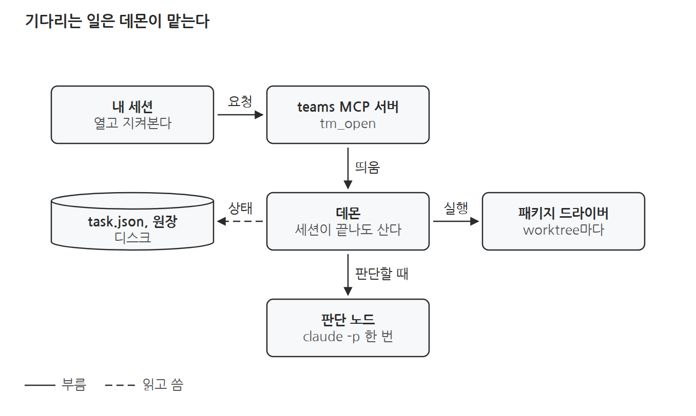

> - [에이전트를 팀처럼: 그래프로 묶기](/ai/2026/10/09/harness-series-04a-에이전트를-팀처럼.html)에서 대 본 그래프를 실제로 돌리는 graph와 teams 플러그인을 이어서 정리했다.
> - 그래프 오케스트레이션은 아직 공부 중인 개념입니다. LangGraph 문서에서 확인한 범위까지만 옮겼습니다.
> - 이 글은 개인적인 의견을 다룹니다.

# 다루는 내용
- 그래프 상태를 MCP 서버에 둔 graph와, 요청 하나를 작은 개발팀처럼 돌리는 teams를 만들고, 기다리는 일을 모델에서 데몬으로 옮기면서

---
## 목차
### 1. graph?
### 2. teams?
### 3. 기다리는 일도 모델이?
### 4. 결과적으로?

---
## 1. graph?
- graph는 로컬 MCP 서버(브로커) 하나가 그래프 상태를 가진다. 메인 세션은 루프만 돈다.

```
graph_open({ request, cwd, ... })   -> run_id, 첫 노드
graph_next({ run_id })              -> 준비된 노드와 누가 돌릴지
graph_run({ run_id, node_id })      -> 벤더 CLI가 노드 실행, 한 줄 결과
graph_submit({ run_id, node_id, payload })  -> 세션이 직접 돌린 노드 기록
```

- 노드는 Codex·Claude CLI로 보내거나 세션이 새 에이전트로 돌린다.
- payload는 디스크에 둔다.
	- goal-spec, 인계, 거절 피드백, 증거가 모두 디스크의 그래프에 남는다.
	- 도구는 `{node_id, stage, vendor, state, stage_ok}`와 짧은 이유만 돌려준다.
	- `graph_run`은 프롬프트를 받지 않는다. 노드 프롬프트는 브로커가 그래프 상태로 조립한다.
- 결과는 worktree와 대조한다. 노드가 고쳤다고 한 파일을 `git status`와 비교하고, 브로커는 `stage_ok`를 낮출 수만 있다.

## 2. teams?
- teams는 요청 하나를 작은 개발팀처럼 돌린다. 진입 스킬은 일의 종류로 고른다.

| 스킬 | 쓰는 경우 |
|---|---|
| `teams:orchestrate` | 무엇이든. flow는 엔진이 고른다 |
| `teams:develop` | 코드 |
| `teams:plan` | PRD |
| `teams:qa` | 기존 결과물에 테스트 케이스 작성과 실행 |

```
> 알림 설정 화면, 기획부터 QA까지 teams로 돌려줘
  ◆ teams:orchestrate
```

- 도는 모양은 [에이전트를 팀처럼: 그래프로 묶기](/ai/2026/10/09/harness-series-04a-에이전트를-팀처럼.html)의 그림 1과 같다.
- 크기부터 잰다. 작으면(S) 하네스 실행 하나로 넘기고 끝난다.
- 크면(L) 기능 영역마다 기획 카드가 PRD 섹션과 유저 스토리를 쓰고, 합친 PRD를 소유권 기준으로 나눠 패키지를 만든다.
- 패키지마다 자기 git worktree에서 전체 하네스를 돌고, 심사를 거쳐야 받아들여진다.
- 받아들인 브랜치를 통합 트리에 합치면 QA 카드가 그 위에서 실제로 써 본다. 마지막 목표 게이트가 원래 요청과 비교한다.
- 진행은 백그라운드 데몬이 맡는다. 세션을 닫아도 계속 돈다.
- 현황은 `teams:board`, 나를 기다리는 카드는 `teams:inbox`로 본다.

## 3. 기다리는 일도 모델이?
### 서브에이전트가 기다리면?
- harness의 Workflow 엔진에서 다른 벤더 CLI로 노드를 돌릴 때는, 서브에이전트가 CLI를 띄우고 끝나길 기다렸다.
- 그 서브에이전트는 "끝났나?"를 묻는 것 말고 할 일이 없다. 판단이 필요 없는 일이니 모델이 맡을 이유도 없다.

### 브로커로
- 8월 30일, MCP 서버(브로커)가 노드를 실행하는 것을 기본으로 바꾸고 graph 플러그인으로 떼어 냈다.
	- MCP 호출은 한 턴이고 끝날 때까지 블로킹된다. 노드는 구조적으로 폴링을 할 수 없다.
	- 규칙도 하나 남겼다. "전달용 서브에이전트를 다시 들이지 않는다."
- 9월에 teams를 올리면서 같은 구조가 한 층 위에서 또 보였다.
	- 매니저와 리더 세션이 다음 노드를 묻고, 받은 결과를 나르는 일을 맡고 있었다.
	- 결과를 해석하는 일은 이미 코드(`finish()`)가 하고 있었다.

### 데몬으로
- 리더 세션을 그냥 없애지는 않았다. 리더는 사용자 세션보다 오래 사는 유일한 프로세스였다.
- 9월 21일 teams 0.13.0에서 리더를 코드로 바꿨다. `tm_open`이 리더 대신 Node 데몬을 띄운다.
	- 데몬은 디스패치를 진행시키고, 판단이 필요한 노드마다 `claude -p`를 한 번 부른다.
	- 기다릴 때는 드라이버의 종료 기록과 자식 실행 폴더를 지켜보는 이벤트로 깬다.
	- 쓰는 쪽이 데몬 하나가 되니 세션 사이를 중재하던 코드도 지웠다.

*그림 1. 기다리고 나르는 일은 데몬이 하고, 모델은 판단이 필요한 노드에서만 불린다*

> 결과적으로 **판단이 필요 없는 일은 코드가 맡고, 모델은 판단하는 노드에서만 부르기로 결정했다.**

- 11월 2일 harness와 graph를 안정판으로 표시했고, 이후 작업은 teams가 이어받았다.

## 4. 결과적으로?
1. graph는 그래프 상태와 payload를 MCP 서버와 디스크에 둔다. 세션은 루프만 돌고, 결과는 worktree와 대조한다.
2. teams는 크기를 재고, 기획에서 패키지로 나눠 각자 worktree에서 하네스를 돌린 뒤, 통합과 QA와 목표 게이트로 닫는다.
3. 기다리기, 나르기, 상태 보관을 서버와 데몬으로 옮기니 모델이 불리는 곳이 판단 노드로 좁혀졌다.

> [이전 글: 에이전트를 팀처럼: 그래프로 묶기](/ai/2026/10/09/harness-series-04a-에이전트를-팀처럼.html) / [다음 글: '다 했어요'를 믿지 않는 법](/ai/2026/10/13/harness-series-05-다-했어요를-믿지-않는-법.html)
