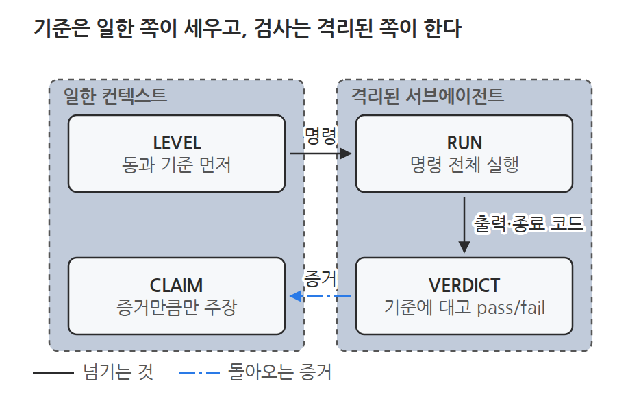

> - "직접 돌려 봤어?"를 매번 묻다가, 그 질문을 스킬에 넘기려고 정리했다.
> - 이 글은 개인적인 의견을 다룹니다.

# 다루는 내용
- 완료 보고 대신 증거로 완료를 닫기 위해, 통과 기준을 먼저 세우고 검사를 격리된 서브에이전트에 맡기는 방법

---
## 목차
### 1. 직접 돌려 봤어?
### 2. 보고와 완료 사이
### 3. 기준은 검사보다 앞에
### 4. completion과 planning
### 5. superpowers에서 레포 규칙까지
### 6. 결과적으로?

---
## 1. 직접 돌려 봤어?
- Claude에게 일을 맡기고 가장 자주 하는 말이 있다.
	- "직접 돌려 봤어?"
	- "확실해?"
- 한 번은 Claude가 "다 만들었다"고 보고했는데, 서버는 아직 올리지도 않은 상태였다.
	- 그때 한 말이 "근데 뭔데 다 만들었다는거야?"였다.
	- 내가 생각하는 완료는 실제로 쓸 수 있는 상태다. 코드가 써진 상태가 아니다.
- 사람이 옆에 있으면 이 질문을 매번 던지면 된다.
	- 하지만 하네스는 사람 손을 덜 타고 돌리려고 만든 구조다.
	- 그렇다면 "직접 돌려 봤어?"는 누가 묻나?

## 2. 보고와 완료 사이
### 보고하는 쪽이 끝내고 싶은 쪽이다
- 완료 보고는 일을 한 그 컨텍스트가 쓴다.
	- 그 컨텍스트는 코드를 썼고, 왜 그렇게 썼는지 알고, 이제 끝내고 싶다.
	- 이때 애매한 신호는 통과 쪽으로 기운다. "아마 될 것이다"가 "됐다"로 바뀐다.
- "다른 모델에게 검증을 맡기는 이유"에서 다룬 자기 선호 편향과 같은 구조다.
	- 같은 모델이 만든 답을 같은 모델이 채점하면 후해질 수 있다.
	- 완료 보고는 그 채점을 한 컨텍스트 안에서, 한 문장으로 끝낸 것이다.

### 녹색 테스트면 끝?
- "테스트 통과"도 범위가 있다.
	- 서비스 테스트는 보통 Mock이나 Spy로 가볍게 여러 번 돌린다. 이 테스트는 상호작용이 맞는지를 증명한다.
	- 실제 DB에 쿼리가 맞게 나가는지는 증명하지 않는다. 그건 통합 테스트나 실제 실행이 할 일이다.
- 모델이 낀 파이프라인은 이 차이가 더 크다.
	- 단위 테스트는 노드 수, 의존 관계 같은 배선을 본다.
	- 배선이 맞아도 노드 안의 모델은 시킨 종류와 다른 일을 할 수 있다. 예를 들어 PRD를 쓰라고 했는데 코드를 쓴다.
- 결국 완료 보고에는 빈틈이 두 군데 있다.
	1. 보고하는 쪽의 이해관계
	2. 녹색이 증명하는 범위와 실제 실행 사이의 거리

## 3. 기준은 검사보다 앞에
- 결과를 보고 나서 기준을 정하면, 기준이 결과에 맞춰진다.
- 따라서 "어떤 결과가 나오면 통과인가"를 명령을 돌리기 전에 한 줄로 쓴다. 이걸 verify-level, 또는 pass bar라고 부른다.
- 프로젝트에 정해 둔 기준이 없으면 그 자리에서 하나 세운다.

| 주장 | 통과 기준 | 통과로 치지 않는 것 |
|---|---|---|
| 버그 고침 | 원래 실패하던 그 시나리오가 지금 exit 0 | 코드를 바꿨으니 고쳐졌을 것 |
| 테스트 통과 | 전체 스위트, 실패 0, exit 0 | 일부만 돌린 결과("partial"이다) |
| 빌드 성공 | exit 0, `error:` 줄 없음 | 린터가 깨끗했음 |
| 회귀 테스트 유효 | 수정을 빼면 실패하고, 넣으면 통과 | 한 번 통과함 |
| 서브에이전트 완료 | VCS diff를 직접 확인 | 서브에이전트의 "성공" 메시지 |

- 기준을 대 봤는데도 결과가 애매하면 실패로 본다. 입증 책임은 통과 쪽에 있다.

### 검증자에게 넘기는 것
- 기준을 세운 다음, 검사는 일한 맥락을 모르는 쪽에 맡긴다.
	- 새 서브에이전트를 띄우고 브리프에는 세 가지만 넣는다. 주장, 기준, 실행할 명령.
- 이 분리에는 조건이 하나 있다.
	- "거의 되는 것 같은데 확인만 해 줘"가 브리프에 들어가는 순간, 검증자는 내 기대를 같이 받는다.
	- 그러면 컨텍스트만 새것이고 편향은 같이 넘어간다. 격리는 브리프가 깨끗할 때만 의미가 있다.

## 4. completion과 planning
### verification-before-completion?
- `completion` 플러그인에 든 스킬 하나다. "다 됐어"라고 말하기 직전에 쓴다.
- 부르는 말은 평소 말이면 된다.

```
> 재시도 백오프 구현했고 테스트도 다 통과한 것 같은데, PR 올리기 전에 제대로 검증해줘.
  ◆ completion:verification-before-completion
```

- "테스트 통과", "빌드 성공", "버그 고쳤어", "커밋할게", "PR 올릴게" 같은 말에도 걸린다.
- 단계는 여섯이고 건너뛸 수 있는 단계는 없다.
	- 0 LEVEL: 기준이 있나? 없으면 지금 세운다.
	- 1 ISOLATE: 주장마다 새 서브에이전트. 브리프는 주장, 기준, 명령뿐.
	- 2 RUN: 명령을 전체로 돌리고 출력 원문과 종료 코드를 받는다.
	- 3 VERDICT: 기준에 대고 pass/fail을 정하고 증거를 붙인다.
	- 4 GATHER: 주장이 여럿이면 서브에이전트를 병렬로 띄우고, 서로 컨텍스트를 나누지 않는다.
	- 5 CLAIM: 증거가 뒷받침하는 것만 주장한다.

*그림 1. 기준은 일한 쪽이 세우고, 검사는 격리된 쪽이 한다*

- 돌아오는 결과는 브리프 한 줄과 표 하나다.

```
Verifier brief: claim: 재시도 테스트 통과; verify-level: 전체 스위트 실패 0, exit 0; command: ./gradlew test

| claim | verify-level | command | exit code | raw evidence excerpt | verdict |
|---|---|---|---|---|---|
| 재시도 테스트 통과 | 전체 스위트 실패 0, exit 0 | ./gradlew test | 0 | BUILD SUCCESSFUL ... 0 failed | pass |

Claim: 재시도 테스트 전체 스위트 통과
```

- 마지막 `Claim:` 줄은 증거만큼만 쓴다. 하나라도 fail이면 실제 상태를 쓴다.

### 계획 단계에서는?
- 기준은 계획을 넘길 때 미리 붙일 수도 있다. `planning:executing-plans`가 그 일을 한다.

```
> docs/plans/billing-retry.md 지난주에 쓴 건데, 지금 코드 기준으로 아직 유효한지 보고 단계별 통과 기준 잡아서 넘겨줘.
  ◆ planning:executing-plans
```

- 계획을 끝까지 읽고 아래 셋 중 하나라도 있으면 멈춘다.
	- Gap: 앞 단계에서 나오지 않는 파일이나 결정이 필요하다.
	- Ambiguity: 모르는 사람에게 넘기면 추측해야 하는 단계가 있다.
	- Drift: 계획이 전제한 파일, API, 스키마가 이미 바뀌었다.
- 통과하면 단계마다 관찰할 수 있는 기준을 하나씩 붙인다.
	- "엔드포인트 X 추가" → X에 요청하면 정한 형태가 오고 exit 0
	- "실패하는 테스트 고치기" → 그 테스트가 통과하고, 수정을 빼면 실패
- 각 단계의 완료는 실행자의 말 대신 이 기준에 대고 `verification-before-completion`이 닫는다.

### 하네스와는?
- 하네스 6단계가 돌 때는 Test 단계가 이 일을 자동으로 한다.
- 혼자 쓸 때는 이 두 스킬이 하네스의 SetGoal(기준 세우기)과 Test·QualityGate(격리된 검사)를 한 세션으로 내린 것이다.

## 5. superpowers에서 레포 규칙까지
- 처음 본문은 공개된 superpowers 스킬을 바탕으로 했다.
	- "증거 먼저, 주장은 나중"이라는 방향은 같았다. 다만 어떤 기준으로, 누가 검사하는지는 정해져 있지 않았다.
- 2026-08-04 본문을 새로 썼다.
	- 검사 전에 verify-level을 세우는 것, 주장마다 격리된 서브에이전트에 검사를 넘기는 것. 이 두 장치를 중심에 뒀다.
	- 하네스의 "채점하는 쪽은 실행한 쪽이 아니다"를 한 세션 크기로 줄인 것이다.
- 다음 날 `executing-plans`를 계획 사전 점검으로 고쳐 썼다.
	- 완료 시점에만 기준을 세우면 늦을 때가 있다. 계획을 넘길 때 단계마다 기준을 같이 넘기게 했다.
	- 9월 말에는 단계를 의존 순서의 레이어로 나누고, 앞 레이어가 기준을 통과해야 다음 레이어를 시작하게 했다.
- 10월에는 레포 규칙에도 같은 생각을 넣었다.
	- 검사는 본 횟수와 함께 보고한다. 숫자 없는 "tests pass"는 검사로 치지 않는다.
	- 단위 테스트가 녹색인 채로 실제 실행에서만 드러나는 문제가 있었다. 동작을 바꿨다면 실제 실행을 한 번 돌린다.
	- 실제 실행에서는 자식 실행의 노드 id를 읽어서, 모델이 시킨 종류의 일을 했는지 본다.

> 결과적으로 완료 조건으로 **"횟수가 붙은 검사 결과 + 실제 실행 1회"를 선택했다.**

- 스킬은 한 세션의 완료를, 레포 규칙은 플러그인 변경의 완료를 같은 방식으로 닫는다.

## 6. 결과적으로?
1. 완료 보고는 일한 컨텍스트가 쓴다. 완료는 보고 대신 따로 모은 증거로 닫는다.
2. 기준은 검사보다 앞서 한 줄로 세우고, 결과가 애매하면 실패로 본다.
3. 검사는 주장, 기준, 명령만 받은 서브에이전트가 돌린다. 녹색 테스트가 닿지 않는 곳은 실제 실행 1회로 확인한다.

> [이전 글: graph와 teams: 기다리는 일은 데몬에게](/ai/2026/10/11/harness-series-04b-graph와-teams.html) / [다음 글: 병렬 에이전트와 백엔드 동시성](/ai/2026/10/15/harness-series-06-병렬-에이전트와-동시성.html)
