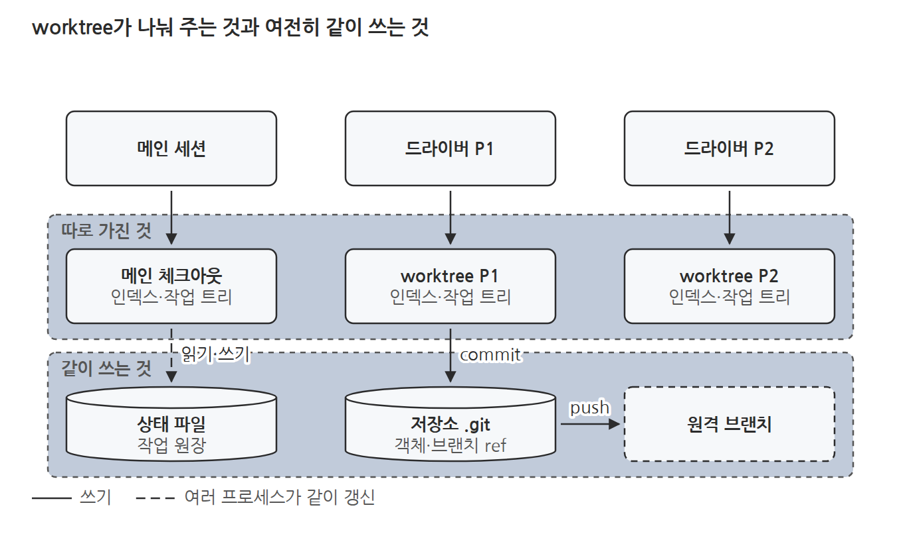

> - 한 머신에서 같이 도는 에이전트가 늘면서, 서버 동시성에서 묻던 질문을 에이전트에도 던져 봤다.
> - 이 글은 개인적인 의견을 다룹니다.

# 다루는 내용
- 병렬 에이전트를 서버 동시성과 같은 질문으로 보고, teams의 패키지별 worktree와 session의 안전장치로 공유 자원을 나눈 방법

---
## 목차
### 1. 독립 작업은 병렬?
### 2. 서버였다면?
### 3. worktree가 나눠 주는 것
### 4. teams와 session
### 5. 한 줄 규칙에서 레포 규칙으로
### 6. 결과적으로?

---
## 1. 독립 작업은 병렬?
- 2월에 쓴 "AI와 함께한 개발 워크플로우 회고"에서 orchestration 설계를 한 줄로 정리했다.
	- "독립 작업은 병렬, 의존 작업은 순차"
- 그 뒤로 한 머신에서 같이 도는 것이 늘었다.
	- 내가 붙어 있는 메인 세션
	- 맡겨 놓고 기다리지 않는 백그라운드 서브에이전트
	- teams가 요청마다 띄우는 데몬과, 데몬이 화면 없이 띄우는 드라이버(`claude -p`)
	- 같은 저장소를 연 다른 터미널의 세션
- 이 상황에서 "독립"을 작업 내용으로 정하면 빈틈이 생긴다.
	- A는 결제 모듈을, B는 알림 모듈을 고친다. 내용으로는 독립이다.
	- 하지만 둘이 같은 체크아웃에서 `git add`를 하면 같은 인덱스에 쌓인다.
- 질문을 바꿨다. 이 둘은 어떤 자원을 같이 쓰나?

## 2. 서버였다면?
- 요청 여러 개가 같은 행을 건드릴 때 서버에서 묻는 질문은 셋이다.
	1. 같이 쓰는 것은? (공유 자원)
	2. 각자 어디까지 따로 가지나? (격리 단위)
	3. 끝난 뒤 누가 정리하나? (누수)
- 에이전트에 대 보면 아래와 같다.

| 질문 | 서버 | 병렬 에이전트 |
|---|---|---|
| 공유 자원 | 행, 테이블, 캐시 키 | git 인덱스, 작업 트리, 상태 파일, 원격 브랜치 |
| 격리 단위 | 트랜잭션, 격리 수준 | worktree(인덱스와 작업 트리를 따로) |
| 직렬화 | 행 락, 조건부 UPDATE | 상태 파일 락, 한 작업 트리에 커밋하는 에이전트는 하나 |
| 부수효과 시점 | 커밋 후 이벤트 발행 | 상태를 쓴 뒤 프로세스 띄우기 |
| 정리 | 커넥션 반납, 누수 감지 | 고아 프로세스 중지, 끝난 worktree 제거 |

- 다른 점은 강제력이다.
	- DB는 격리 수준을 엔진이 지킨다. "남의 파일은 건드리지 마"는 부탁에 가깝고, 지킬지는 모델이 정한다.
	- 따라서 격리는 가능하면 파일 시스템과 git에 맡기고, 글로 된 규칙은 그 위에 얹는다.

## 3. worktree가 나눠 주는 것
- [git worktree](https://git-scm.com/docs/git-worktree)는 저장소 하나에 작업 트리를 여러 개 붙이는 기능이다.
	- 붙인 worktree마다 HEAD, 인덱스, 작업 트리를 따로 가진다.
	- 객체와 브랜치 ref는 저장소 전체가 같이 쓴다.
	- 한 브랜치는 한 worktree에서만 체크아웃된다. 다른 worktree가 이미 쓰고 있으면 git이 거부한다.
- 트랜잭션에 대면 이렇게 읽힌다.
	- 인덱스와 작업 트리는 트랜잭션마다 가진 작업 공간이다. 커밋 전의 변경은 다른 worktree에 보이지 않는다.
	- 커밋은 공유된 `.git`에 쓰인다. 브랜치를 한 worktree에만 허락하는 것은 브랜치 단위의 배타 락과 비슷하다.

*그림 1. worktree가 나눠 주는 것과 여전히 같이 쓰는 것*

### worktree 밖은?
- worktree가 나눠 주지 않는 것이 둘 있다.
- 첫째는 teams의 작업 상태 파일이다. 저장소 밖에서 여러 프로세스가 같이 읽고 쓰므로 서버에서 하던 방법을 가져왔다.
	- 쓰기는 락 하나 뒤에서만 한다. 락은 디렉터리 생성으로 잡고 주인의 pid와 토큰을 남긴다.
	- 주인이 죽은 락만 회수한다.
	- 락 안의 함수는 동기 함수여야 한다. 락 안에서 `await`를 하면 그 사이 다른 쪽이 쓴 내용을 오래된 스냅샷으로 덮을 수 있다.
	- 파일은 임시 파일에 쓰고 rename한다. 반쯤 쓴 파일을 다른 프로세스가 읽지 않는다.
	- 프로세스는 트랜잭션이 커밋되고 락을 놓은 뒤에 띄운다. Spring의 커밋 후 훅과 같은 자리다.
- 둘째는 원격 브랜치다. 이 레포에서는 열린 작업이 있는 동안 git 훅이 push를 보류한다.

## 4. teams와 session
### teams의 패키지
- 큰 요청은 패키지(작업 단위) 여러 개로 나뉜다.
	- 패키지마다 자기 worktree, 자기 브랜치, 자기 드라이버 세션이 붙는다.
	- 의존이 풀린 패키지끼리는 병렬로 돈다. 동시에 도는 수는 `max_parallel_teams`이고 기본은 `"auto"`다.
- 합치는 곳도 따로 있다.
	- 받아들여진 브랜치는 별도의 통합 worktree에서 합친다. teams는 내 브랜치에 머지하지 않는다.
	- 두 패키지가 같은 것을 고쳐 충돌하면 `tm_retry({repackage})`로 패키지를 새로 나눈다.
- 사용자는 진입 스킬 하나만 부르면 된다.

```
> 알림 설정 화면 만들어줘, 기획부터 QA까지 그래프로
  ◆ teams:orchestrate
  (패키지마다 worktree에서 하네스 → 통합 worktree에서 합치기 → QA)
```

### session의 안전장치
#### 남은 자식 프로세스는?
- `/session`의 Orphans 보기가 이 세션 아래에서 아직 도는 `claude -p`를 pid, 명령, 경과 시간과 함께 보여 준다.
- `[stop]`은 신호 하나(`SIGTERM`)만 보낸다. 보내기 전에 아래를 확인한다.
	- 여전히 이 세션 아래에 있는지
	- 명령과 시작 시각이 방금 본 것과 같은지(재사용된 pid는 거부)
	- 전체 명령이 보이는 확인 창에서 승인했는지
	- 신호 직전에 한 번 더
- `kill -9`, 프로세스 그룹, 패턴 kill, "전체 중지"는 없다.

#### teams가 남긴 것은?
- `/reap-list`는 이 저장소의 드라이버, 데몬, worktree를 끝남과 살아 있음으로 나눠 보여 준다.
- 끝난 프로세스와 제거할 수 있는 worktree만 정리한다.
	- 병합 안 된 브랜치, 커밋 안 된 변경이 있는 worktree, 아직 도는 작업의 worktree는 건드리지 않는다.

#### 위험한 명령은?
- Bash 명령이나 Write/Edit가 실행되기 전에 규칙으로 검사해 확인을 받는다. 주요 규칙은 아래와 같다.

| 규칙 | 걸리는 경우 | 기본 |
|---|---|---|
| `recursive-delete` | `rm -rf`가 `/`, `~`, 저장소 루트, cwd의 상위를 가리킬 때 | 확인 |
| `force-push-protected` | `main`, 원격 기본 브랜치 등에 force push | 확인 |
| `worktree-dirty-remove` | 커밋 안 된 변경이 있는 worktree에 `git worktree remove --force` | 차단 |
| `running-script` | 지금 실행 중인 `.sh` 파일에 Write/Edit | 차단 |

- `hard-reset`, `secret-write` 같은 규칙도 있다.
- 명령을 나눠서 검사하므로 `cd x && rm -rf /`는 잡히고 `rm -rf node_modules`는 잡히지 않는다.
- bypass 모드에서도 묻는다. 다만 샌드박스는 아니어서 `python -c`나 같은 일을 하는 스크립트는 보지 않는다.

#### main이 움직이면?
- 한 세션에서 `main`으로 push가 성공하면, 같은 저장소에서 최근 30분 안에 움직인 다른 세션마다 메시지가 간다.

```
main moved to <sha> … Fetch before editing or bumping versions.
```

- 서버로 치면 다른 트랜잭션이 커밋했다는 알림이다. 받은 세션은 낡은 기준 위에서 고치거나 버전을 올리기 전에 fetch한다.

## 5. 한 줄 규칙에서 레포 규칙으로
- 처음 규칙은 한 줄이었다.
	- `agents:dispatching-parallel-agents`는 나누기 전에 독립인지 확인한다. 같은 파일을 건드리지 않고, 인과 관계가 없을 것.
	- 내용으로 본 독립이라, 같은 체크아웃과 인덱스는 질문에 없었다.
- 2026-09-30 파일을 쓰는 병렬 에이전트마다 worktree를 주게 했다.
- 10월에는 공유 자원이 겹칠 수 있어서, 레포를 같이 고치는 에이전트 규칙으로 올렸다.
	- 레포 파일을 고치는 에이전트는 기본으로 자기 worktree에서 돈다. 메인 체크아웃은 지휘하는 세션의 것이다.
	- 한 작업 트리에서 커밋하는 에이전트는 한 번에 하나다.
	- 파일을 고치지 않는 에이전트는 병렬로 돌려도 된다.
	- 스테이징은 경로를 적어서 한다. 다른 작업이 진행 중일 때 루트에서 `git add -A`는 쓰지 않는다.

> 결과적으로 **쓰는 에이전트는 자기 worktree에서, 읽는 에이전트는 병렬로 진행했다.**

- 동시에 몇 개를 돌릴지도 정했다.
	- 고정 상한은 두지 않는다. 내가 한 말은 "나는 동시에 두개만 돌리라고 제한주지 않음"이었다.
	- 대신 새로 열기 전에 부하 평균과 살아 있는 드라이버 수를 읽고, 부하 평균이 코어 수보다 높으면 기다린다.
- 정리하는 시점도 정했다.
	- 결과를 가져오는 단계에서 정리한다. 에이전트의 커밋을 체리픽한 뒤 그 worktree와 브랜치를 지운다.
	- 세션은 자기가 띄운 드라이버, 데몬, 심사 프로세스가 없고, `git worktree list`에 main만 남은 상태로 끝낸다.
- session의 안전 중지와 가드(10-08), main 변경 알림(10-10), `/reap-list`(10-23)는 이 규칙을 글 밖으로 옮긴 것이다.

## 6. 결과적으로?
1. 에이전트 작업이 독립인지는 작업 내용보다 건드리는 자원으로 본다. 띄우기 전에 공유 자원, 격리 단위, 정리 책임을 묻는다.
2. 격리 단위는 worktree다. worktree가 나누지 않는 상태 파일과 원격 브랜치는 락, 원자적 쓰기, push 보류로 지킨다.
3. 정리는 결과를 가져오는 단계에서 하고, session은 확인을 거친 것만 정리한다.

> [이전 글: '다 했어요'를 믿지 않는 법](/ai/2026/10/13/harness-series-05-다-했어요를-믿지-않는-법.html) / [다음 글: Claude 스킬 마켓플레이스 만들기](/ai/2026/10/17/harness-series-07-스킬-마켓플레이스.html)
