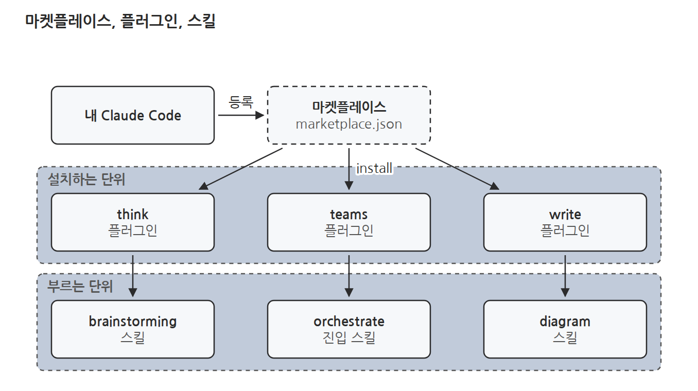

> - 스킬을 플러그인으로 묶어 들고 다니게 되자, 다음은 이름을 외우지 않고 부르는 문제였다.
> - 이 글은 개인적인 의견을 다룹니다.

# 다루는 내용
- 직접 만든 스킬을 플러그인 마켓플레이스로 묶으면서, 들고 다니는 문제와 찾아 쓰는 문제를 어떻게 나눠 풀었는지

---
## 목차
### 1. 스킬을 들고 다니려면?
### 2. 스킬, 플러그인, 마켓플레이스?
### 3. 휴대성? 발견성?
### 4. 설치와 부르는 말
### 5. 묶음을 어떻게 나눌까?
### 6. 결과적으로?

---
## 1. 스킬을 들고 다니려면?
- 2026년 3월, 자주 쓰는 작업 패턴을 스킬로 만들어 두고 있었다.
	- 문제는 그 스킬이 한 머신, 한 프로젝트에만 있다는 점이었다.
	- 그때 던진 질문이 "skills 등록 셋 플러그인으로 들고 다닐 수 있지?"였다.
- GitHub 레포(`newkayak12/claude-skills`)에 올리고 플러그인으로 묶으니 어디서든 같은 스킬을 쓸 수 있었다.
	- 모바일 claude.ai에서 `/brainstorming`이 도는 것도 직접 확인했다.
- 들고 다니는 문제가 풀리자 다음 고민이 생겼다.
	- "근데 스킬을 다 외우고 다니는게 아니니까"
	- 스킬이 늘수록 이름을 기억해서 부르는 방식은 버티지 못한다.

## 2. 스킬, 플러그인, 마켓플레이스?
- 셋은 크기가 다른 단위다. 정의는 공식 문서를 따른다.

| 단위 | 내용 | 사용자가 하는 일 |
|---|---|---|
| [스킬](https://code.claude.com/docs/en/skills) | `SKILL.md` 하나. 언제 쓸지 적은 frontmatter와 지침 본문 | `/이름`으로 부르거나, 말로 하면 Claude가 고른다 |
| [플러그인](https://code.claude.com/docs/en/plugins) | 스킬, 에이전트, 훅, MCP 서버를 한 단위로 묶은 디렉터리 | 플러그인 단위로 설치한다 |
| [마켓플레이스](https://code.claude.com/docs/en/plugin-marketplaces) | `.claude-plugin/marketplace.json`이 있는 레포. 플러그인 목록과 가져올 위치 | 한 번 등록한다 |

- 공식 문서 기준으로 짚을 점은 아래와 같다.
	- 마켓플레이스는 상점이 아니라 카탈로그다. 레포를 등록하면 목록에 있는 플러그인을 이름으로 설치한다.
	- 플러그인 안의 스킬은 `/플러그인:스킬`로 이름공간이 붙는다. 다른 사람의 스킬과 이름이 겹치지 않는다.
	- 스킬의 description은 켜져 있는 동안 매 턴 컨텍스트에 있다. 본문은 부를 때만 올라간다.

*그림 1. 마켓플레이스는 한 번 등록하고, 플러그인은 설치하고, 스킬은 부른다*

## 3. 휴대성? 발견성?
### 휴대성은?
- 마켓플레이스를 한 번 등록하고 user 범위로 설치하면 그 머신의 모든 프로젝트에서 같은 스킬이 뜬다.
- 고치면 레포에 올리고, 쓰는 쪽은 업데이트만 받는다.
- 스킬을 머신마다 복사해 다닐 일이 없다. 이 부분은 플랫폼이 거의 다 풀어 준다.

### 발견성은?
- 발견성은 플랫폼이 대신 풀어 주지 않는다.
- 이름을 외우지 않아도 불리려면 Claude가 description을 보고 골라야 한다.
	- 따라서 description에는 사람이 실제로 할 법한 말을 넣는다.
	- 예: `think:brainstorming`의 description에는 "어떻게 만들지?", "기능 설계해줘"가 있다.
- 하지만 description은 매 턴 컨텍스트를 차지한다.
	- 2월에 쓴 "AI와 함께한 개발 워크플로우 회고"에서 MCP와 Commands를 줄이고 Skills로 옮긴 이유가 "쓰든 안 쓰든 토큰 차지"였다.
	- 스킬은 본문을 필요할 때만 올리니 그 문제를 덜었다. 다만 description 자체는 남는다.
	- [공식 문서](https://code.claude.com/docs/en/plugins)도 켜 둔 플러그인은 쓰지 않는 세션에도 들어가고, 스킬 이름과 description이 사용량에 잡힌다고 적고 있다.
	- 밖에 보이는 스킬이 많을수록 고를 후보도, 매 턴의 비용도 는다.
- 결국 발견성을 푸는 방법은 두 가지다.
	1. description을 부르는 말로 쓴다.
	2. 밖에 보이는 스킬 수를 줄인다.
- 두 번째는 5절에서 다룬다.

## 4. 설치와 부르는 말
### 들어 있는 것
- 주제별로 플러그인을 나눴다.

| 묶음 | 플러그인 | 예시 스킬 |
|---|---|---|
| 개발 | `develop`, `completion`, `planning` | `develop:bug-diagnoser`, `completion:verification-before-completion` |
| 사고 | `think`, `cognition` | `think:brainstorming`, `cognition:assumption-extractor` |
| 글 | `write` | `write:prd`, `write:diagram` |
| 지식 | `knowledge` | 링크된 Markdown, 그래프, RAG 준비 |
| 에이전트·흐름 | `agents`, `harness`, `graph`, `teams` | `agents:use-codex`, `teams:orchestrate` |
| 관리·편의 | `skill`, `session`, `trophy` | `skill:audit`, `trophy:list` |

### 설치는 세 줄
- 세션 안에서 마켓을 한 번 등록하고, 필요한 플러그인만 설치한다.

```
/plugin marketplace add newkayak12/claude-skills
/plugin install think@newkayak12-claude-skills
/plugin install write@newkayak12-claude-skills
```

- 플러그인마다 `trophy`를 의존성으로 걸어 두어, 하나만 설치해도 trophy가 같이 깔린다.
- `teams`는 `harness`에 기대므로 teams를 설치하면 harness도 따라온다.

### 이름을 모르면?
- 평소 말로 시작하면 된다.

```
> 알림 기능 어떻게 만들지? 옵션 더 뽑아줘
  ◆ think:brainstorming
  (판단 전에 선택지 3개 이상 → 버릴 기준으로 좁히기 → write:plans로 넘김)
```

- 이름을 알면 `/think:brainstorming`처럼 바로 불러도 된다.
- 어떤 스킬이 있는지 모를 때를 위한 스킬도 두었다.
	- `skill:audit`: "뭘 더 설치하면 좋아?"라고 하면 지금 워크스페이스에 깔린 것부터 보고 빈 곳을 말한다.
	- `trophy:list`: 최근 7일 동안 자주 맞은 스킬, 불렸어야 했는데 놓친 스킬, 한 번도 안 쓴 스킬을 보여 준다.

## 5. 묶음을 어떻게 나눌까?
- 처음은 한 덩어리였다.
	- 2026-03-11 첫 커밋은 스킬 25개가 든 플러그인 하나였다.
	- 같은 날 마켓플레이스 형식(`marketplace.json`)으로 옮겼다.
- 일주일 뒤 주제별로 쪼갰다.
	- 2026-03-18 한 플러그인을 9개 주제 플러그인으로 나눴다.
	- 이제 필요한 묶음만 설치할 수 있다. 설치하지 않은 묶음의 description은 컨텍스트에 올라오지 않는다.
- 10월에는 노출 원칙을 정했다.
	- 백로그를 정리하면서 남긴 말은 "외부에 노출되는 스킬을 줄이고 내부적으로 진행하면 좋을 듯"이었다.
	- 이어서 백로그 카드의 원칙에 한 줄을 더했다. "사용자는 내부를 모르고 편하게 써야만한다"

> 결과적으로 **밖에는 진입 스킬 하나만 두고, 단계는 그 안에서 돌리기로 결정했다.**

- 이 원칙이 잘 보이는 예가 teams다.
	- 사용자는 진입 스킬만 고른다. 무엇이든 `teams:orchestrate`, 코드면 `teams:develop`, PRD면 `teams:plan`이다.
	- 요청 크기 판단, PRD와 스토리, 패키지별 하네스, QA, 최종 검사는 그 안에서 돈다.

```
> 알림 설정 화면 만들어줘, 기획부터 QA까지 그래프로
  ◆ teams:orchestrate
  (크기 판단 → PRD·스토리 → 패키지마다 worktree에서 하네스 → 통합 → QA)
```

- 사용자는 이 안의 단계 이름을 하나도 몰라도 된다.
- 막히는 지점이 생기면 `teams:inbox`로 내 차례인 카드만 본다.
- 11월에는 MCP 서버 셋을 하나로 합쳤다.
	- 요청은 "teams의 mcp 하나의 서버로 통합 및 노출 내부 mjs 코드 스플릿"이었다.
	- 밖으로는 서버 하나, 안에서는 모듈을 관심사별로 나눴다.
- 반대로 안쪽은 더 잘게 나누기도 했다.
	- `write:plans` 하나가 맡던 일을 PRD, ADR, 요구사항 분석으로 나눠 각각 다듬고, teams 안에 넣기로 했다.
	- 밖에서 고를 일은 줄이고, 안에서 쓰는 스킬은 목적에 맞춘다. 두 작업은 같은 방향이다.

## 6. 결과적으로?
1. 휴대성은 마켓플레이스가 풀어 준다. 레포 하나를 등록하면 어느 프로젝트에서나 같은 스킬을 쓴다.
2. 발견성은 직접 풀어야 했다. description을 부르는 말로 쓰고, 밖에 보이는 스킬 수를 줄였다.
3. 밖에는 진입 스킬 하나, 단계는 안에서 돌린다. 사용자는 내부를 몰라도 된다.

> [이전 글: 병렬 에이전트와 백엔드 동시성](/ai/2026/10/15/harness-series-06-병렬-에이전트와-동시성.html) / [다음 글: 스킬이 알아서 불리게 하려면](/ai/2026/10/19/harness-series-08-스킬이-알아서-불리게.html)
