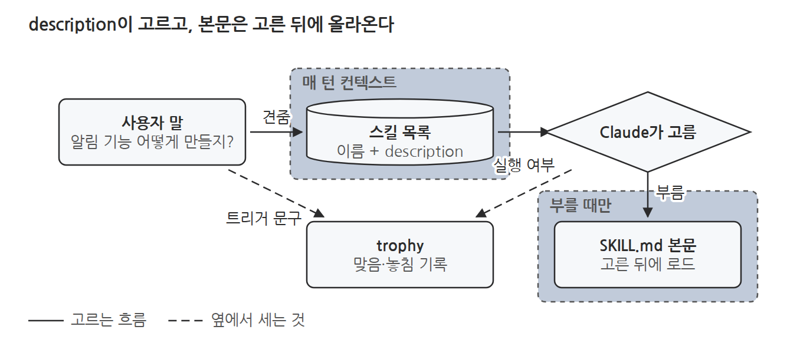

> - `/`로 부르지 않았는데 brainstorming이 뜨는 걸 보고, Claude가 고르는 기준이 어디 있는지 정리했다.
> - 이 글은 개인적인 의견을 다룹니다.

# 다루는 내용
- 스킬의 description이 라우팅을 맡는 구조와, 트리거 문구를 쓰고 확인하는 방법

---
## 목차
### 1. 부르지 않았는데 떴다?
### 2. description과 본문?
### 3. Use when? Triggers on?
### 4. 맞게 불렸는지는?
### 5. 스킬을 늘릴까, 줄일까?
### 6. 결과적으로?

---
## 1. 부르지 않았는데 떴다?
- 세션에서 이렇게만 쳤다.

```
> 알림 기능 어떻게 만들지? 옵션 더 뽑아줘
  ◆ think:brainstorming
```

- `/think:brainstorming`이라고 부르지 않았는데 brainstorming이 떴다.
- 스킬을 만들기 시작할 때부터 이 부분이 중요했다.
	- 3월에 남긴 말이 "근데 스킬을 다 외우고 다니는게 아니니까"였다.
	- 이름을 외워서 부르는 방식은 스킬이 늘면 버티지 못한다.
- 그렇다면 Claude는 어디를 보고 이 스킬을 골랐을까?

## 2. description과 본문?
- [Claude Code 스킬 문서](https://code.claude.com/docs/en/skills) 기준으로 정리하면 아래와 같다.
	- 세션에는 스킬 목록이 들어간다. 목록에는 스킬 이름과 description이 있다.
	- Claude는 이 description을 보고 언제 스킬을 쓸지 정한다.
	- 본문(`SKILL.md`의 나머지)은 스킬을 부를 때만 올라온다.

*그림 1. description은 매 턴 목록에 있고, 본문은 고른 뒤에 올라온다*

- 따라서 description은 스킬 소개문보다 라우팅 규칙에 가깝다.
	- 본문을 아무리 잘 써 두어도, 고르는 시점에 Claude가 보는 것은 description이다.
	- [스킬 작성 모범 사례](https://platform.claude.com/docs/en/agents-and-tools/agent-skills/best-practices)도 description이 수많은 스킬 중 맞는 것을 고르는 데 쓰인다고 적고 있다.
- 비용도 같은 구조에서 나온다.
	- 문서에는 목록에 있는 스킬은 쓰든 안 쓰든 매 턴 컨텍스트를 차지한다고 나온다.
	- 2월 회고에서 Skills로 옮긴 이유도 "쓰든 안 쓰든 토큰 차지"였다.
	- 스킬은 본문을 미뤄 그 문제를 덜었지만, description은 매 턴 들어간다.

## 3. Use when? Triggers on?
### 틀은 하나
- 레포의 description은 모두 같은 틀이다. `think:devils-advocate`를 예로 들면 아래와 같다.

```yaml
description: >-
  Use when someone wants their idea, plan, or decision attacked with the strongest objections
  before acting on it. Triggers on: "반론 던져줘", "약점 찾아줘", "이 계획 문제점이 뭐야?", "비판해줘",
  "치명적 약점", "devil's advocate", "steel-man this", "punch holes in".
```

- 쓰는 규칙은 네 가지다.
	1. `Use when`으로 시작해 상황을 앞에 쓴다. 하는 일보다 필요한 때가 앞이다.
	2. 따옴표 안에는 사람이 실제로 칠 법한 말을 넣는다. 한국어는 영어 키워드를 옮긴 말 대신 대화체로 쓴다.
	3. 가까운 스킬이 있으면 `Not for`로 경계를 적는다. 예를 들어 `think:back-to-basics`는 문제를 잘못 정의한 경우를 `think:redefine-problem`으로 보낸다.
	4. 같은 문구를 두 스킬에 넣지 않는다. 같은 말에 두 스킬이 걸리면 어느 쪽이 뜰지 알 수 없다.
- 문서의 문제 해결 절도 비슷한 말을 한다.
	- 안 불리면 description에 사용자가 자연스럽게 할 말이 있는지 보라고 한다.
	- 너무 자주 불리면 description을 더 구체적으로 쓰거나, `disable-model-invocation: true`로 직접 부를 때만 뜨게 하라고 한다.

### 250자?
- 공식 문서의 숫자는 두 가지다.
	- 항목 하나: `description`과 `when_to_use`를 합쳐 1,536자에서 자른다.
	- 목록 전체: 컨텍스트 창의 1%가 예산이다. 넘치면 덜 쓰는 스킬부터 description이 빠지고 이름만 남는다.
- 레포는 이보다 짧게, description 250자 이하를 기준으로 둔다.
	- 4월에 목록에서 250자 뒤가 잘린다고 보고 검증기에 경고를 넣었고, 그때 description을 모두 250자 이하로 줄였다.
	- 지금 문서의 항목 상한은 그보다 넉넉하다.
	- 그래도 목록 예산은 모든 스킬이 나눠 쓰니 짧게 두는 것이 여전히 맞아 보인다.
- 줄일 때는 상황(`Use when`)과 트리거 문구를 앞에 남기고, 배경 설명과 예시는 본문으로 보낸다. 문서도 핵심 사용처를 앞에 두라고 한다.

## 4. 맞게 불렸는지는?
- description은 써 놓고 끝나지 않는다. 고친 뒤 확인하는 도구를 셋 두었다.

| 도구 | 하는 일 | 부르는 말 |
|---|---|---|
| `trophy` | 스킬이 돌 때 토스트, 업적, 트리거 문구가 있었는지와 스킬이 돌았는지를 기록 | `/achievements`, "업적 보여줘", "어떤 스킬을 놓쳤지?" |
| `skill:trigger-validator` | description 하나를 질의 20개로 재고 고쳐 쓴다 | "스킬이 트리거 안 돼", "description 개선해줘" |
| `skill:audit` | 지금 깔린 것과 마켓 목록을 맞대어 빈 곳을 말한다 | "뭘 더 설치하면 좋아?", "워크스페이스 점검" |

### trophy는?
- 마켓의 스킬이 돌 때마다 `◆ plugin:skill` 토스트가 뜨고, 업적이 풀리면 프롬프트 위에 카드가 뜬다.
- 라우팅 쪽에서 쓸모 있는 것은 **트리거** 탭이다.
	- 각 스킬 description의 `Triggers:` 뒤 따옴표 문구를 뽑아 색인으로 만들어 둔다.
	- 프롬프트에 그 문구가 있었는지, 그 턴에 스킬이 돌았는지를 같이 센다.
- 대화창에서는 `trophy:list`로 본다.

```
> 어떤 스킬을 놓쳤지?
  ◆ trophy:list
  가장 많이 맞은 스킬 (7일): …
  가장 많이 놓친 스킬 (7일): …   ← 문구는 있었는데 스킬이 안 돈 것
  한 번도 안 쓴 스킬: …
```

- 놓친 목록은 고칠 후보다.
- 문구를 바꿀지는 사람이 정한다. trophy는 아무것도 고치지 않는다.

### trigger-validator는?
- description 하나에 질의 20개를 만든다.
	- 불려야 할 10개: 격식 영어, 구어 영어, 한국어 대화체, 이름을 말하지 않는 암시형, 이웃 스킬과 겹치는 경우
	- 불리면 안 될 10개: 키워드는 겹치는데 다른 일을 원하는 near-miss
- 기본은 Claude가 읽고 예측한 점수다.
- "실제로 돌려봐"라고 하면 질의마다 `claude -p`를 세 번 돌려 두 번 이상 불린 것만 맞음으로 센다.
- 고쳐 쓸 때는 8개를 빼 두고 12개로만 고친다. 고를 때는 빼 둔 8개 점수로 고른다.
	- 본 질의에만 맞춘 description이 처음 보는 질의에서 지는 일을 막으려는 것이다.

### audit는?
- 새로 만들기 전에 이미 있는지부터 본다.
- 깔린 스킬, 플러그인, MCP 이름을 읽고, 마켓 목록의 트리거 문구를 출처 파일과 같이 인용한다.
- 출처 파일이 없는 추천은 쓰지 않는다. 기억으로 "이런 플러그인이 있을 것"이라고 말하지 않게 한 규칙이다.

## 5. 스킬을 늘릴까, 줄일까?
- 처음에는 키워드 나열이었다.
	- 2026-03-20 description을 전부 의도 기반 문구(`Use when` + 실제로 할 말)로 고쳐 썼다.
	- 4월에 250자 기준을 넣고 전부 줄였다. 이때 "Best for" 같은 부연은 본문으로 옮겼다.
- 10월에는 문구를 실제로 돌려서 쟀다.
	- 같은 문구가 두 스킬을 가리키던 충돌을 찾아 모두 없앴다.
	- 예: "스킬 만들어줘"는 `skill:create`, "계획 실행해줘"는 `planning:executing-plans`로 한쪽에 몰았다.
	- `develop:bug-diagnoser`는 실제 저장소 픽스처에서 한국어 질의를 돌렸다. 고치기 전 15번 중 1번이던 것이 고친 뒤 **6번**이 됐다.
- 스킬 수를 두고는 규칙을 정했다.
	- 8월 말에 "기존 스킬을 쪼개거나 넓힐 수 있으면 새 스킬은 만들지 않는다"를 레포 규칙으로 넣었다.
	- 겹치는지는 이름 대신 입력, 절차, 결과물을 나란히 놓고 본다. 이름에 같은 명사가 있어도 하는 일이 다르면 겹치지 않는다.
	- 쪼갠 예가 `write:plans`다. 10월에 PRD와 ADR을 떼어 `write:prd`, `write:adr`로 나눴다.
	- 이제 "PRD 작성", "ADR 남겨줘"는 각자 다른 스킬의 description에 있다.

> 결과적으로 **스킬을 늘리기보다 있는 스킬을 합치고 쪼개고, 개수 대신 길이와 설명을 줄이는 것을 선택했다.**

- 11월에는 이 방향을 전체에 적용했다.
	- 요청은 "전체적으로 최적화가 필요해보임 모든 스킬"이었고, 순서는 "teams가 주 대상인데"로 정했다.
	- 그날 잰 description 합계는 매 세션 약 2만 6천 자였다.
	- 기준은 플러그인마다 같다. 본문은 지금 평균보다 30% 정도 줄이고, description과 플러그인 설명도 줄인다.
	- description을 바꿀 때마다 불려야 할 말과 불리면 안 될 말을 한국어와 영어로 넣어 고치기 전후를 센다.
- 사용 기록을 보고 스킬을 지우자는 안은 받지 않았다. 스킬은 남기고, 기록은 플러그인 안에서 손볼 순서를 정하는 데만 쓴다.

## 6. 결과적으로?
1. Claude가 스킬을 고를 때 보는 것은 description이다. 본문은 고른 뒤에야 올라온다.
2. 트리거 문구는 `Use when` 상황과 사람이 실제로 할 말로 쓰고, 이웃 스킬과의 경계를 적는다. 고친 뒤에는 불려야 할 말과 불리면 안 될 말로 확인한다.
3. description은 매 턴 컨텍스트에 들어간다. 스킬 수를 늘리기보다 있는 것을 합치고 쪼개고, 길이를 줄인다.

> [이전 글: Claude 스킬 마켓플레이스 만들기](/ai/2026/10/17/harness-series-07-스킬-마켓플레이스.html) / [다음 글: 생각을 돕는 스킬 설계](/ai/2026/10/21/harness-series-09-생각을-돕는-스킬.html)
