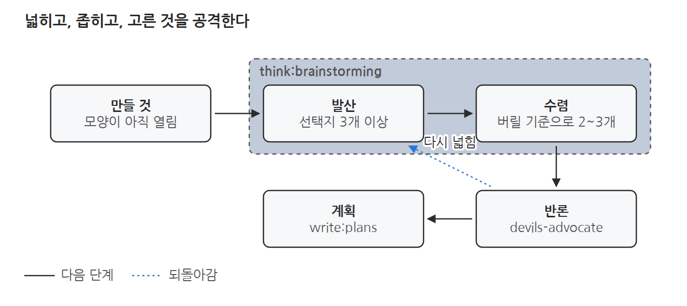

> - 회고를 쓰며 AI를 코드보다 생각 상대로 더 자주 썼다는 걸 보고, 그 쓰임을 스킬로 묶었다.
> - 인지 편향과 집단 의사결정은 공부 중인 영역이다. 논문은 초록에서 확인한 범위까지만 옮겼다.
> - 이 글은 개인적인 의견을 다룹니다.

# 다루는 내용
- 판단 전에 넓히고, 고른 것에 반론을 세우고, 밑에 깔린 가정과 편향을 꺼내는 스킬을 어떻게 나눠 만들었는지

---
## 목차
### 1. 코드보다 자주 쓴 것?
### 2. 넓히고 나서 좁히기
### 3. 반론을 세우려면?
### 4. think? cognition?
### 5. 다른 모델에게도 반론을?
### 6. 결과적으로?

---
## 1. 코드보다 자주 쓴 것?
- 2025년 9월, 추론을 돕는 MCP 서버를 붙여 쓰고 있었다.
	- sequential-thinking, mcp-reasoner, think-tool을 조합해 언제 어떤 것을 쓸지 지침으로 만들었다.
	- 그때 한 말이 "이걸로 정책 잡을 수 있으면 잡게"였다.
- 2026년 2월에 쓴 회고 글 "AI와 함께한 개발 워크플로우 회고"의 결론은 아래와 같다.
	- 코드나 문서를 뽑는 것보다 더 자주 쓴 것은 브레인스토밍 상대, 선택지를 다 펼치는 도구였다.
	- 그리고 "내 생각이 맞는지 틀린지 부딪혀보는 검증 장치"였다.
- 3월, 스킬 아이디어를 뽑으면서 방향을 하나 더 줬다. "사고, 논리, 자아 발견 방향으로"
- 그렇게 생긴 것이 `think`와 `cognition` 두 플러그인이다.
- 고민은 "생각을 도와줘"를 스킬로 만들 때 어디를 고정하느냐였다.

## 2. 넓히고 나서 좁히기
- `think:brainstorming`은 나쁜 설계의 대부분이 넓히는 단계를 건너뛴 데서 나온다고 본다.
	- 잘 정리된 안 하나가 나오면, 다른 선택지를 보지 못한 채 그 안이 승인된다.
- 따라서 두 동작을 떼어 둔다.
	1. 발산: 선택지를 3~5개 만든다. 비판은 하지 않고, 질 것 같은 안도 하나 넣는다.
	2. 수렴: 미리 적은 버릴 기준으로 2~3개까지 좁히고, 남은 것끼리 트레이드오프를 표로 보여 준다.
- 버릴 기준은 취향 대신 적힌 조건이다.
	- 꼭 지켜야 할 제약(시간, 예산, 팀 역량)을 어기는가?
	- 말한 문제를 실제로 푸는가?
	- 우리가 손댈 수 없는 시스템이나 사람에 기대는가?
	- 되돌릴 수 없는 결정인데 그 위험을 감당할 준비가 있는가?
- 발산할 때 쓰는 수도 정해 두었다.
	- 예: 가장 뻔한 답을 앞에 적어 닻 치우기, 제일 어려운 제약 빼 보기, 다른 분야에서 빌려 오기, 반대로 뒤집기

*그림 1. 발산과 수렴을 떼고, 고른 설계에는 반론을 세운다*

## 3. 반론을 세우려면?
### devil's advocate? steel-man?
- devil's advocate는 일부러 반대편에 서서 약점을 찾는 역할이다.
- steel-man은 순서가 반대다. 상대 주장을 가장 강한 형태로 다시 말하는 데서 시작한다.
	- 약한 형태(허수아비)를 때리는 반론은 쓸모가 없다.
	- `think:devils-advocate`도 첫 단계에서 "이 안이 가장 잘 통하는 조건"을 한 줄로 쓴다.

### 역할극 반론으로 충분할까?
- [Devil's advocate versus authentic dissent](https://doi.org/10.1002/ejsp.58) (Nemeth 외, 2001)
	- 역할로 맡은 devil's advocate보다 진짜로 다른 의견을 가진 소수가 해법의 양과 질을 더 끌어올렸다.
	- 앞선 연구에서는 역할극 반론이 새 생각을 넓히기보다 처음 입장을 다지는 방향으로 작동했다고 한다.
- 사람 집단 연구라 모델에도 같은 크기로 나타나는지는 확인하지 않았다.
	- 다만 같은 모델에게 "반대해 봐"라고 시키는 것도 역할극에 가까워 보인다.
	- 이 부분은 [다른 모델에게 검증을 맡기는 이유](/ai/2026/10/05/harness-series-02-다른-모델에게-검증.html)에서 다룬 다른 모델 검증과 이어진다.

### 가정과 편향은?
- devils-advocate는 가장 위험한 반론이 거의 늘 말하지 않은 가정을 겨눈다고 본다.
	- 반론을 쓰기 전에 숨은 가정 두세 개부터 꺼내는 이유다.
	- [premortem](https://hbr.org/2007/09/performing-a-project-premortem)(Klein, 2007)은 프로젝트가 이미 실패했다고 치고 그 이유를 적게 하는 방법이다. 계획을 의심하는 사람이 말을 꺼내기 쉬워진다.
- 판단 쪽에는 편향이 있다.
	- [Judgment under Uncertainty: Heuristics and Biases](https://doi.org/10.1126/science.185.4157.1124)(Tversky·Kahneman, 1974)는 대표성, 가용성, 기준점(앵커링) 같은 어림법이 대개는 효율적이지만 체계적이고 예측 가능한 오류로 이어진다고 정리한다.
	- 예측 가능한 오류라면 점검표로 만들 수 있다.

## 4. think? cognition?
- 두 플러그인은 역할을 나눴다.
	- `think`: 대화하며 같이 생각하는 상대
	- `cognition`: 실패 유형 하나씩을 맡는 점검 도구

| 스킬 | 언제 | 부르는 말 |
|---|---|---|
| `think:brainstorming` | 해법의 형태가 아직 열려 있을 때 | "어떻게 만들지?", "옵션 더 뽑아줘" |
| `think:devils-advocate` | 정한 안을 실행 전에 두들길 때 | "반론 던져줘", "약점 찾아줘", "steel-man this" |
| `think:grill` | 내 계획을 질문으로 털어야 할 때 | "설계하기 전에 질문으로 털어줘" |
| `think:redefine-problem` | 같은 문제가 계속 반복될 때 | "증상만 자꾸 잡는 느낌" |
| `cognition:assumption-extractor` | 자신 있게 세운 계획의 전제를 볼 때 | 계획을 붙이고 "깔린 가정 뽑아줘" |
| `cognition:bias-auditor` | 확신이 과하다 싶을 때 | "편향 점검", "확신이 과한 것 같아" |

- 반론을 부르면 아래처럼 나온다.

```
> 사내 공지를 이메일 대신 메신저 봇으로만 보내려고 해. 반론 던져줘
  ◆ think:devils-advocate
  steel-man: 모두가 메신저를 켜 두는 조직이면 도달률과 속도가 이메일보다 낫다
  숨은 가정: 모든 대상자가 메신저 계정이 있다 / 공지가 대화에 묻히지 않는다
  반론 1  [assumption · high] 외부 협력사, 휴직자는 메신저 밖에 있다
          선례: 뚜렷한 선례 없음(추측)
  핵심 약점: "모두가 메신저에 있다"는 가정 하나에 전부 걸려 있다
  되돌림: reversible, 이메일을 병행하다 끊으면 된다
```

- 반론마다 유형, 심각도, 선례를 붙인다.
	- 선례는 실제 실패 패턴만 쓰고, 없으면 "추측"이라고 쓴다. 지어낸 선례 하나가 비판 전체를 깎아 먹기 때문이다.
	- 마지막의 되돌림 판단이 반론의 무게를 정한다. 되돌릴 수 없는 결정이면 critical 반론부터 풀어야 들어간다.
- 나머지 스킬도 한 가지 동작을 고정한다.
	- grill: 저장소와 문서가 답하는 것은 묻기 전에 읽는다. 질문마다 추천 답과 이유 한 줄을 붙여, 사용자는 받거나 뒤집기만 하면 된다.
	- redefine-problem: "이 상태가 사라지면 끝나나, 다른 모습으로 다시 나타나나?"로 문제와 증상을 가른다.
	- mentor("선배처럼 조언"): 질문만 던지지 않고 자기 입장부터 말한 뒤, 그 입장을 뒤집을 관찰 하나를 같이 말한다.
	- assumption-extractor: 사실, 인과, 가치, 정의 네 갈래로 가정을 찾고, 틀리면 전부 무너지는 가정을 하나 꼽는다.
	- bias-auditor: 편향 이름을 붙이고 끝내지 않는다. 시간 압박, 매몰 비용 같은 유발 조건부터 확인하고 편향마다 보정 방법을 붙인다.
- 스킬끼리도 이어진다.
	- brainstorming에서 한 안에 강하게 끌리면 고르기 전에 bias-auditor를 돌린다.
	- 그 끌림이 확증 편향이 자리 잡는 곳이기 때문이다.

## 5. 다른 모델에게도 반론을?
- 처음은 아이디어 목록이었다.
	- 2026-03-19 스킬 아이디어를 뽑으면서 사고, 논리 쪽으로 방향을 잡았고, 이틀에 걸쳐 think와 cognition에 스킬을 채웠다.
	- 추론 MCP는 스킬 안으로 들어갔다. think-tool이나 mcp-reasoner를 어느 단계에서 쓸지가 각 SKILL.md에 있다.
	- 추론 MCP가 없어도 스킬은 돈다.
- 9월에는 두 스킬을 새로 썼다.
	- 2026-09-02 brainstorming과 devils-advocate를 고쳐 썼다. 옛 판을 사본으로 남겨 비교한 뒤, 같은 날 사본을 지웠다.
	- 9월 11일에는 `think:mentor`를 더했다. 따로 있던 자기계발 쪽 스킬들은 mentor 하나로 합쳤다.
- 10월에는 질문하는 스킬을 따로 세웠다.
	- 2026-10-06 `think:grill`을 넣었다.
	- brainstorming은 한 번에 한 질문씩 묻고 선택지를 넓힌다. grill은 계획을 주어진 것으로 두고, 열린 결정을 한 라운드에 번호를 붙여 모두 묻는다.
	- 이 차이를 SKILL.md의 "Not for"에 써서 두 스킬이 같은 말에 걸리지 않게 했다.
- 11월에는 반론을 다른 모델에게서도 받게 했다.

> 결과적으로 **반론과 토론의 첫 라운드는 다른 모델에게도 받기로 했다.**

- 2026-11-10 brainstorming의 토론 모드와 devils-advocate가 Codex(또는 Claude)를 자동으로 부르게 했다.
	- 다른 모델에게는 우리 가정이나 반론을 넣지 않은 채로 묻는다.
	- 결과는 반론마다 claude, codex, 둘 다로 표시하고 근거로 가린다.
	- 다른 모델이 없거나 실패하면 혼자 계속하고 그렇다고 말한다.

## 6. 결과적으로?
1. 생각을 돕는 스킬은 동작 하나를 고정한다. 넓히는 일과 좁히는 일을 떼고, 반론은 가장 강한 형태를 세운 뒤에 던진다.
2. 반론의 과녁은 대개 말하지 않은 가정이다. 가정과 편향은 점검표로 따로 꺼낸다.
3. 같은 모델의 역할극 반론에 그치지 않도록, 첫 라운드는 다른 모델에게도 받는다.

> [이전 글: 스킬이 알아서 불리게 하려면](/ai/2026/10/19/harness-series-08-스킬이-알아서-불리게.html) / [다음 글: 사람이 쓴 것 같은 글을 쓰게 하기](/ai/2026/10/23/harness-series-10-사람이-쓴-것-같은-글.html)
