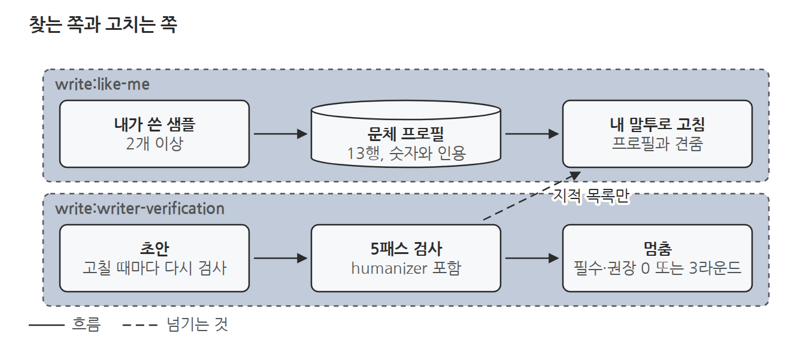

> - 네 가지 검토를 다 통과한 글도 모델이 쓴 글로 읽혀서, 흔적을 찾는 스킬과 내 말투로 고치는 스킬을 나눠 만들었다.
> - 기계가 쓴 글을 가려내는 연구는 공부 중인 영역이다. 확인한 범위까지만 옮겼다.
> - 이 글은 개인적인 의견을 다룹니다.

# 다루는 내용
- 모델이 쓴 글에 남는 흔적을 찾는 스킬과, 그 글을 내 말투로 고치는 스킬을 어떻게 나눠 만들었는지

---
## 목차
### 1. 맞춤법도 맞는데 티가 난다?
### 2. machine tell
### 3. 사람처럼? 나처럼?
### 4. writer-verification과 like-me
### 5. 찾는 일과 고치는 일을 나누기까지
### 6. 결과적으로?

---
## 1. 맞춤법도 맞는데 티가 난다?
- `write:writer-verification`은 원래 글 검토 패스 네 개로 돌았다.
	- 맞춤법·문법, 문장 패턴, 표현, 독자 관점
- 네 패스를 다 통과한 글도 읽으면 모델이 쓴 글로 보이는 경우가 있었다.
- 9월 커밋에 남긴 설명은 이렇다.
	- 네 패스는 정확성, 리듬, 단어, 이해를 본다.
	- 독자가 "모델이 썼네"라고 느끼게 만드는 것은 그중 어디에도 없다.
- 그렇다면 그 느낌은 어디서 올까?

## 2. machine tell
- 레포에서는 기계가 쓴 글의 흔적을 machine tell이라고 부른다. 자주 보이는 갈래는 아래와 같다.

| 갈래 | 예 |
|---|---|
| 대구 | "단순한 회의가 아니라 방향을 정하는 자리입니다"가 글마다 반복된다 |
| 격언형 맺음 | "결론적으로, 우리 모두에게 중요한 시간이 될 것입니다" |
| 습관적 3개 나열 | "효율적이고, 투명하며, 협력적인", 할 말이 둘이든 다섯이든 셋으로 맞춘다 |
| 결정문 투 한자어, 번역투 | "~에 대해 논의를 진행할 예정입니다", "~하는 것이 가능하다" |
| 근거 없는 소감 | 기록에 없는 "뿌듯했다", "의미 있는 시간이었다" |
| 이유 없는 설명 | 한 일만 있고 왜 했는지가 없다 |

- humanizer 패스는 이것을 세 갈래로 나눠 본다.
	- 구조: 짧은 글에 붙은 헤더, 한 줄짜리 불릿, 첫 문단을 되풀이하는 맺음, "이 글에서는 ~에 대해 알아보겠습니다" 같은 여는 문장
	- 말투: 대구 반복, 줄표 연쇄, 길이가 모두 같은 문장, 겹친 얼버무림, 아무도 소리 내 말하지 않는 단어
	- 내용: 이유와 트레이드오프가 없는 설명, 작성자가 확신하지 못하는 지점이 하나도 없는 글
- 바깥에도 비슷한 정리가 있다.
	- Wikipedia 편집자들의 [Signs of AI writing](https://en.wikipedia.org/wiki/Wikipedia:Signs_of_AI_writing)은 3개 묶음, "X가 아니라 Y" 꼴의 부정 대구, 줄표 남용, 특정 어휘 목록을 꼽는다.
	- [Kobak 외(2024)](https://arxiv.org/abs/2406.07016)는 2010~2024년 PubMed 초록에서 LLM이 나온 뒤 특정 스타일 단어의 빈도가 갑자기 늘었다고 한다.
	- 같은 연구는 2024년 초록의 **최소 13.5%**가 LLM을 거쳤다고 추정한다.

### 흔적 = 증거?
- 아니다. 어디까지나 신호다.
	- 위 Wikipedia 가이드도 이런 표시가 있다고 모두 AI가 쓴 글은 아니라고 못 박는다.
	- [Liang 외(2023)](https://arxiv.org/abs/2304.02819)는 GPT 탐지기들이 비원어민이 쓴 영어를 AI 글로 잘못 분류하는 경향이 있다고 보고한다.
- 따라서 찾는 쪽은 사람 글을 잘못 잡지 않는지도 같이 재야 한다. 이 부분은 5절에서 다룬다.

## 3. 사람처럼? 나처럼?
- 흔적을 지우면 "사람이 쓴 글"에 가까워진다. 그런데 그 사람이 누구인지는 정해지지 않는다.
	- 흔적을 고친 문장은 평균적인 사람의 말투다.
	- 내가 쓴 글로 읽히려면 내 말투의 기준이 따로 있어야 한다.
- `write:like-me`는 그 기준을 숫자로 적는다.
	- "편하고 친근함"은 프로필이 될 수 없다.
	- "종결 `~요` 70%, `~다` 20%, 문장 평균 18자"는 프로필이 된다.
- 샘플에서 13개 행을 센다. 행마다 허용 오차가 있어서, 고친 글이 범위를 벗어나면 고쳐 쓴다.

| 행 | 재는 것 | 허용 오차 |
|---|---|---|
| 문장 길이 | 문장당 평균 글자 수, 가장 짧은 것·긴 것 | 평균 ±25% |
| 종결어미 | `~다` / `~요` / `~습니다` / `~음·함` / 명사형 분포 | 가장 많은 것 ±15%p |
| 자주 쓰는 말 | 샘플 2개 이상에 나온 말("근데", "일단", "사실") | 샘플만큼 |
| 서식 | 불릿, 굵게, 헤더, 백틱을 쓰는지 | 정확히 |
| 얼버무림 | "~것 같아요", "아마"의 빈도 | ±50% |

- 표에는 13행 중 다섯 행만 옮겼다. 나머지는 문장 길이 분포, 문단 크기, 존댓말 수준, 여는 습관, 맺는 습관, 문장부호, 결론을 앞에 쓰는지, 영어 용어를 옮기는지다.
- 흔적 목록과 프로필이 부딪히면 프로필이 이긴다.
	- 샘플에서 내가 굵게를 쓰면, 굵게는 내 말투로 보고 남긴다.

## 4. writer-verification과 like-me

*그림 1. writer-verification은 찾고, like-me는 그 지적 목록만 받아 내 말투로 고친다*

### 찾는 쪽: writer-verification
- 검토 모드와 초안 모드가 있다.
	- 검토 모드: 이미 있는 글에 다섯 패스를 돈다. 300자가 넘으면 다섯 패스를 병렬로 돌리고 합친다.
	- 초안 모드: diff, 개요, "이거 써 줘"를 받아 초안을 쓰고, 그 초안에 다섯 패스를 돌려 고친다.
	- 초안 모드는 🔴🟡가 0이 되거나 3라운드가 돌면 멈춘다.
- 회의 공지로 예를 들면 아래와 같다.
	- 메모로 준 재료는 "목요일 2시, 배포 주기 논의, 지금 2주 주기가 QA 일정과 겹침"이다.

```
첫 초안
  ## 주간 회의 안내
  이번 회의에서는 효율적이고, 투명하며, 협력적인 배포 문화를 위한 다양한 안건에 대해
  논의를 진행할 예정입니다. 이는 단순한 회의가 아니라 팀의 방향을 함께 정하는 자리입니다.
  결론적으로, 이번 회의는 우리 모두에게 중요한 시간이 될 것입니다.

지적
  🟡 [shape]    세 문장 공지에 헤더 → 헤더 없이
  🟡 [padding]  "효율적이고, 투명하며, 협력적인" 습관적 3개 나열 → 뺀다
  🟡 [register] "~에 대해 논의를 진행할 예정입니다" → "정합니다"
  🟡 [padding]  "결론적으로 … 중요한 시간이 될 것" → 뺀다
  🟡 [why]      왜 모이는지 없음 → 재료의 "QA 일정과 겹침"을 쓴다

최종
  목요일 2시 회의에서 배포 주기를 다시 정합니다.
  지금 2주 주기가 QA 일정과 자주 겹쳐서입니다. 다른 안이 있으면 미리 남겨 주세요.

Draft loop: 2 rounds · caught: 헤더, 3개 나열, 결정문 투, 격언형 맺음, 이유 없음
```

- 이유를 채울 때는 재료에 있는 것만 쓴다.
	- 재료에 이유가 없으면 그럴듯한 원인을 지어내지 않고 작성자에게 한 번 묻는다.
- PR 설명도 같은 방식이다.
	- "이 diff로 PR 설명 써줘, AI 티 안 나게"라고 하면 파일 목록 대신 왜 바꿨는지로 시작한다.
	- 리뷰어가 볼 곳과 작성자가 확신하지 못하는 점을 남긴다.

### 고치는 쪽: like-me
- 부르는 말은 "내 말투로", "내가 쓴 것처럼"이다.
- 흐름은 아래와 같다.
	1. 같은 장르의 샘플을 2개 이상, 합쳐 300자 넘게 받는다. AI와 같이 쓴 글은 프로필이 모델을 닮아서 받지 않는다.
	2. 대상 글에 writer-verification을 돌리고 지적 목록만 받는다. 고친 문장은 평균적인 사람의 말투라서 버린다.
	3. 프로필을 다섯 줄로 보여 주고 사용자가 고친다. "요즘은 이모지 안 써요" 같은 것은 샘플보다 본인이 안다.
	4. 프로필이 설명하는 지적은 버리고, 남은 지적을 내 말투로 고친다. 마지막에 프로필과 행마다 견준다.

## 5. 찾는 일과 고치는 일을 나누기까지
- 9월 2일에 다섯 번째 패스(humanizer)와 초안 모드를 넣었다.
	- 첫 초안 모드 시험에서 한국어 요청에 영어로 답했고, 결제 쪽 diff에 나온 약어 "PG"를 "Postgres"로 풀어 썼다.
	- 이 때문에 두 규칙을 더했다. 요청한 언어로 쓴다. 재료가 정의하지 않은 약어는 풀어 쓰지 않는다.
- 다음 날 사람 글을 잘못 잡는지 쟀다.
	- LLM 이전에 머지된 오픈소스 PR 설명과 사람이 쓴 한국어 PR을, 모델이 쓴 대조군과 섞어 블라인드로 돌렸다.
	- 사람 글은 지적 없이 지나갔고 대조군은 모두 잡혔다.
	- 다만 흔들린 실행 한 번이 급하게 쓴 한국어 PR을 "예시 없음"으로, 진짜 세 항목을 "습관적 3개 나열"로 잡았다.
	- 그 뒤로 "흔적이 아닌 것"을 정했다. 오타, 인사, 실제로 셋인 목록, 저장소의 PR 템플릿은 잡지 않는다.
- 같은 날 읽기 쉬운지도 블라인드로 비교했다.
	- 첫 라운드는 내용에서 이기고 형식에서 졌다. 첫 문단이 길고 이유가 늦게 나왔다.
	- 반대쪽 흔적도 넣었다. 이유는 첫 30단어 안에, 문단은 80단어 안에, 나란한 항목이 셋 이상이면 목록으로 쓴다.
- 9월 28일에는 내 말투 쪽을 따로 세웠다.
	- 처음 초안은 프로필대로 고쳐 쓴 뒤 humanizer를 돌리는 순서였다.
	- 같은 날 순서를 바꿨다. writer-verification이 찾고, like-me는 그 지적 목록만 받는다.

> 결과적으로 **찾는 일은 writer-verification, 내 말투로 고치는 일은 like-me로 나눴다.**

- 고치는 문장까지 writer-verification에 맡기면 평균적인 사람의 말투가 들어온다.
- like-me가 지적의 위치와 종류만 받고, 문장은 프로필로 새로 쓰는 이유다.

## 6. 결과적으로?
1. 모델이 쓴 글의 티는 구조, 말투, 내용에 남는 반복 패턴에서 온다. 맞춤법과 리듬만 보는 검사로는 잡히지 않는다.
2. 흔적은 신호다. 사람 글을 잘못 잡지 않는지 같이 재고, 흔적이 아닌 것도 목록으로 둔다.
3. "사람처럼"과 "나처럼"은 다르다. 내 말투는 샘플에서 숫자로 뽑은 프로필로 맞춘다.

> [이전 글: 생각을 돕는 스킬 설계](/ai/2026/10/21/harness-series-09-생각을-돕는-스킬.html) / [다음 글: 그림을 그리는 스킬](/ai/2026/10/25/harness-series-11-그림을-그리는-스킬.html)
