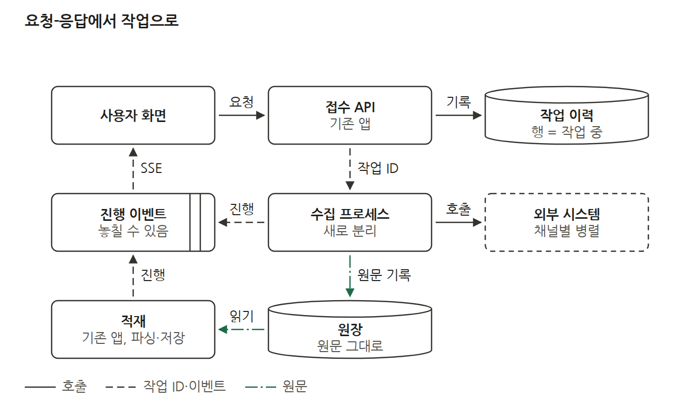
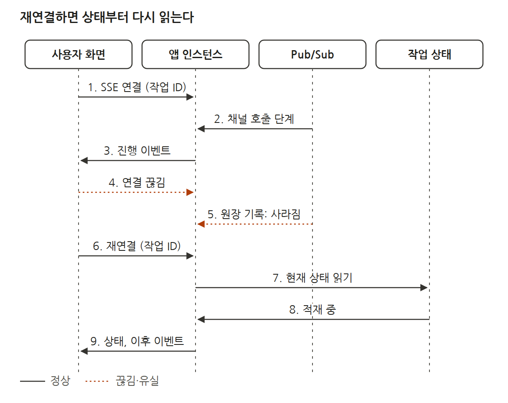

> - 도메인과 이름은 일반화했습니다.
> - 이 글은 개인적인 의견을 다룹니다.

# 다루는 내용
- 오래 걸리는 동기 요청을 작업으로 바꿀 때 두 프로세스 사이에 무엇을 약속으로 둘지

---
## 목차
### 1. 요청 하나가 몇 분씩 열려 있다면?
### 2. 무엇을 떼어 낼까?
### 3. 응답이 하던 일은 누가 맡나?
### 4. 왜 원문을 그대로 남길까?
### 5. 실패는 "어디서"로 남기면?
### 6. 진행률은 SSE? long-polling?
### 7. "행이 있으면 작업 중"이라면, 죽은 프로세스는?
### 8. 같은 요청이 또 오면?
### 9. 결과적으로?

---
## 1. 요청 하나가 몇 분씩 열려 있다면?
- 외부 시스템에서 주문을 수집하는 기능이 있다. 사용자가 화면에서 기간과 대상을 고르고 실행하면, **동기 HTTP 요청 하나**가 외부 호출부터 파싱, DB 적재까지 순서대로 전부 한다.
- 외부 시스템마다 걸리는 시간이 다르고, 화면을 긁어 와야 하는 곳도 있다. 그런 경우 요청 하나가 수 분, 길게는 10분 가까이 열려 있다.
- 이 구조에서 생기는 문제는 아래와 같다.
	- 일부 경로는 수집 내내 DB 트랜잭션을 물고 있다. 외부를 기다리는 동안 커넥션이 묶인다.
	- 실패했을 때 되돌릴 원본이 외부 시스템마다 다르고, 한 곳은 아예 남는 게 없다.
	- 외부 요청 중에 프로세스가 죽으면 "작업 중" 표시가 풀리지 않아 **다시 요청할 수도 없다.**
	- 외부 시스템 쪽도 요청을 받아 두고 나중에 결과를 내주는 경우가 있다. 기존 흐름은 그걸 기다리거나, 결과보다 먼저 다음 단계로 넘어가 문제가 생기기도 했다.
- 정리하면 요청 시간이 내 코드가 아니라 **외부 시스템에 묶여 있다.** 그래서 이 요청을 작업으로 바꾸는 설계를 고민했다.

## 2. 무엇을 떼어 낼까?
- 선택지는 둘이었다.
	1. 수집 전체(호출, 파싱, 적재)를 새 프로세스로 옮긴다
	2. **외부 호출 구간만** 새 프로세스로 옮기고, 파싱·적재는 기존 앱이 그대로 한다
- 1은 깔끔해 보이지만 파싱·적재 로직을 통째로 다시 옮겨야 한다. 오래 다듬어진 로직이고, 전면 리팩토링은 이번 목표가 아니었다.

> 결과적으로 **2를 선택했다.** 새 프로세스는 외부 연동에만 집중하고, 기존 앱은 "내부에 어떻게 적재할지"만 맡는다.

- 외부 시스템별 호출을 병렬로 돌릴 수 있다는 것도 덤이다. 순서대로 부르던 것을 나눠 부르면 전체 시간이 줄어든다.
- 그런데 이렇게 나누면 바로 질문이 생긴다. **두 프로세스는 무엇을 주고받을까?**

## 3. 응답이 하던 일은 누가 맡나?
- 동기 요청에서는 응답 하나가 여러 일을 같이 했다. 작업으로 바꾸면 그 일을 하나씩 다른 장치에 맡겨야 한다.

| 동기 응답이 하던 일 | 작업 구조에서 맡는 것 |
|---|---|
| 결과 전달 | 원장 + 적재 결과, 작업 ID로 상태 조회 |
| 진행 중임을 알림 | 진행 이벤트(SSE) |
| 실패 전달 | 작업 상태 + 실패 지점 |
| 동시 실행 막기 | 작업 이력 행 + 중복 요청 합치기 |

- 비동기로 바꾼다고 하면 큐를 무엇으로 쓸지부터 고르고 싶어진다. 그런데 표를 채워 보면 큐는 어느 칸도 혼자 채우지 못한다. 먼저 정할 건 두 프로세스 사이의 약속이라고 생각했다.
	- **원장**: 외부에서 받은 원문을 그대로 담는 곳. 두 프로세스가 만나는 지점이다.
	- **작업 ID**: 접수할 때 발급해서 원장, 진행 이벤트, 상태 조회를 모두 관통한다.
	- **실패 지점**: 실패했을 때 "어느 쪽을 봐야 하는지"를 가리킨다.

*그림 1. 접수는 작업 ID만 돌려주고, 수집과 적재는 원장을 사이에 두고 나뉜다*

## 4. 왜 원문을 그대로 남길까?
- 수집 프로세스는 외부에서 받은 것을 **파싱하지 않고 원문 그대로** 원장에 적재한다. 파싱은 기존 앱이 원장을 읽어서 한다.
- 파싱이나 적재에서 실패하면 외부를 다시 부르지 않고 원장을 기준으로 다시 돌리면 된다.
	- 외부 호출은 비싸다. 몇 분이 걸리고, 같은 결과가 다시 온다는 보장도 없다.
- 외부 시스템마다 달랐던 "되돌릴 원본"이 한 곳으로 모인다. 원본이 아예 없던 경로도 이제 원장이 남는다.
- 문제가 생겼을 때 "외부가 이렇게 줬다"를 보여 줄 기준점이 된다.

> 결과적으로 **원장을 두 프로세스 사이의 핸드오프 약속으로 두었다.** 재적재와 진단 모두 여기서 시작한다.

- 이건 Claim Check 패턴과 같은 모양이다.

> Claim Check: 큰 데이터를 메시지에 싣지 않고 저장소에 둔 뒤, 메시지에는 그것을 찾을 참조만 담아 보내는 패턴.

- 프로세스 사이를 오가는 건 작업 ID 정도의 참조뿐이고, 원문은 원장에 있다. 메시지가 유실되거나 중복돼도 원문 자체는 잃지 않는다.
- 다만 원장을 두면 같이 정할 것이 생긴다.
	- 원장을 언제까지 남길지
	- 재적재를 누가 시작할지. 적재에 실패한 주문을 다시 밀어 넣는 운영 복구 경로는 이미 있으니, 그 출발점을 외부 재호출이 아니라 원장으로 바꾸는 쪽이 자연스럽다.

## 5. 실패는 "어디서"로 남기면?
- 작업으로 바꾸면 실패가 더 이상 에러 응답으로 돌아오지 않는다. "실패했다"만으로는 부족하고, **어느 프로세스의 몫으로** 실패했는지가 남아야 사람이 바로 움직인다.
- 그래서 진행 단계(phase)와 실패 지점(stage)을 따로 두었다.
	- 진행 단계: 채널 호출, 원장 기록, 적재, 취소 반영. 화면의 진행률에 쓰인다.
	- 실패 지점: fetch, convert, persist 셋뿐이다.

| 실패 지점 | 뜻 | 봐야 할 곳 |
|---|---|---|
| fetch | 외부에서 가져오지 못함 | 수집 프로세스, 외부 시스템 |
| convert | 원문을 내부 형식으로 바꾸지 못함 | 기존 앱 |
| persist | 저장하지 못함 | 기존 앱 |

- 실패 지점을 진행 단계보다 적게 둔 건 **"어느 앱을 봐야 하는지"를 가리키는 것이 목적**이기 때문이다.
- 프로세스를 둘로 나누면 장애 지점 파악이 쉬워진다는 기대가 있었다. 그게 실제로 쓸모 있으려면 실패 표시가 이 경계를 그대로 따라야 한다.

## 6. 진행률은 SSE? long-polling?
- 몇 분 걸리는 작업이니 화면에 진행률을 보여 주는 것이 목표 중 하나였다. 선택지는 둘이다.

| | SSE | long-polling |
|---|---|---|
| 연결 | 작업 내내 연결 하나 유지 | 요청이 반복됨 |
| 여러 인스턴스 | 연결이 붙은 인스턴스로 이벤트를 보내야 함 | 아무 인스턴스나 상태를 읽으면 됨 |
| 놓친 이벤트 | 끊긴 사이 이벤트는 사라짐 | 매번 상태를 읽으므로 놓칠 것이 없음 |
| 지연 | 단계 전환 즉시 | 폴링 간격만큼 |

> 결과적으로 **SSE를 기본으로 두고, long-polling을 대안으로 남겼다.**

- SSE를 고르면 받아들여야 할 것이 있다.
	- 인스턴스가 여러 대면 이벤트를 만든 곳과 화면이 연결된 곳이 다를 수 있다. 그래서 인스턴스 사이에 Redis Pub/Sub을 둔다.
	- 배포하거나 인스턴스가 재시작되면 연결은 끊긴다.
- 그런데 Pub/Sub은 fire-and-forget이다. **그 순간 구독자가 없으면 메시지는 그냥 사라진다.**
	- 화면이 잠깐 끊겼다 다시 붙는 사이에 단계 전환 이벤트를 놓칠 수 있다.
- 그래서 진행 이벤트를 진실의 원천으로 두면 안 된다고 생각했다.
	- 진행 이벤트는 "놓쳐도 되는 알림"으로 둔다.
	- 현재 상태는 언제든 작업 ID로 다시 읽을 수 있어야 한다. 재연결하면 먼저 상태를 읽고, 이어서 이벤트를 받는다.

*그림 2. 끊긴 사이 사라진 이벤트는 되살리지 않는다. 재연결할 때 상태를 다시 읽으면 된다*

- 이렇게 두면 SSE와 long-polling이 배타적인 선택이 아니게 된다. 상태 조회가 있으니 SSE가 안 되는 환경에서는 그걸 반복해서 부르면 된다. 대안으로 남긴 long-polling이 실제로 대안이 되는 것도 이 덕분이다.

## 7. "행이 있으면 작업 중"이라면, 죽은 프로세스는?
- 동시 실행을 막는 장치는 작업 이력 테이블이다. 별도 락 테이블을 두지 않고, **행이 있으면 작업 중**으로 본다.
	- 단순해서 좋다. 작업 이력이 곧 락이니 따로 맞출 것이 없다.
- 그런데 1장의 문제가 그대로 남는다. 프로세스가 외부 호출 중에 죽으면 그 행은 누가 지울까?
	- 아무도 지우지 않으면 그 대상은 계속 "작업 중"이다. 다시 요청할 수도 없다.
	- 비동기로 바꾸면 작업이 요청 스레드 밖에서 더 오래 살기 때문에 이 문제는 오히려 커진다.
- 그래서 "행이 있으면 작업 중"이라는 약속에는 **그 행이 아직 살아 있는지 판단하는 기준**이 같이 붙어야 한다.

| 방법 | 어떻게 | 대가 |
|---|---|---|
| 만료 시각 | 행에 만료 시각을 두고 지나면 작업 중이 아닌 것으로 봄 | 가장 긴 작업보다 길게 잡아야 하고, 그만큼 늦게 풀림 |
| 단계별 갱신 시각 | 단계가 바뀔 때마다 갱신, 일정 시간 변화가 없으면 멈춘 것으로 봄 | 한 단계가 유난히 길면 살아 있는 작업을 멈춘 것으로 봄 |
| heartbeat | 작업 중 주기적으로 갱신 | 갱신 자체가 부하이고 구현할 게 늘어남 |
| 수동 해제 | 운영자가 풂 | 사람이 알아차려야 풀림 |

- 화면을 긁어 오는 경로처럼 한 단계가 몇 분씩 걸리면 만료 시각을 짧게 잡기 어렵다.
- 이건 분산락의 lease를 얼마로 잡을지와 같은 고민이다. 너무 짧으면 살아 있는 작업을 빼앗고, 너무 길면 죽은 작업이 오래 막는다.
- 솔직히 이 부분은 설계 문서에서 문제로 적어 두기만 했고, 어느 방법으로 풀지는 정하지 않았다. 구현에 들어가면 가장 먼저 정해야 할 항목이라고 생각한다.

## 8. 같은 요청이 또 오면?
- 작업으로 바꾸면 사용자는 결과를 기다리지 않고 화면을 떠날 수 있다. 그러면 같은 수집을 또 누르는 일이 자연스럽게 생긴다.

| | 거절 | 합치기 |
|---|---|---|
| 화면 | "이미 진행 중" 오류, 기다렸다 다시 누름 | 진행 중인 작업 ID를 받아 같은 진행률을 봄 |
| 구현 | 단순 | "같은 요청"의 기준이 필요 |
| 죽은 행이 남았을 때 | 계속 거절당함 | 멈춘 작업에 계속 붙음 |

> 결과적으로 **거절하지 않고 진행 중인 작업에 합치는 쪽으로 두었다.**

- 합치면 두 번째 요청은 새 작업을 만들지 않고 진행 중인 작업 ID를 돌려받는다. 같은 진행률을 보고 같은 결과를 받는다.
- 대신 "같은 요청"을 정해야 한다. 화면에서 고르는 건 기간과 대상이라 후보는 아래 정도다.
	1. 대상이 같으면 같은 요청
	2. 대상과 기간이 모두 같으면 같은 요청
	3. 대상이 같고 기간이 겹치면 같은 요청
	- 1은 단순하지만 다른 기간을 원한 요청까지 붙인다. 3은 정확하지만 겹친 구간만큼의 결과가 누구 것인지 따져야 한다.
- 그리고 표의 마지막 행이 중요하다. 7장의 문제가 풀려 있지 않으면 거절은 "계속 막힘"이 되고, 합치기는 "멈춘 작업에 계속 붙음"이 된다. 어느 쪽을 골라도 **죽은 행 처리가 먼저**다.

**한가지 더!**
- 이건 요청 단계의 중복 방지다. 데이터 단계에서는 주문 키에 유니크 제약을 걸고, 위반이 나면 "이미 수집된 주문"으로 본다.
	- 요청을 합치는 건 같은 일을 두 번 시키지 않으려는 것이다.
	- 유니크 제약은 그래도 두 번 들어왔을 때 데이터가 틀어지지 않게 하는 마지막 안전망이다.
- 둘은 다른 층에서 다른 것을 막는다. 어느 하나로 다른 하나를 대신할 수는 없다.

## 9. 결과적으로?
1. 오래 걸리는 요청을 작업으로 바꿀 때 먼저 정할 것은 큐가 아니라 **두 프로세스 사이의 약속**이었다. 원문을 담는 원장, 끝까지 따라가는 작업 ID, 어느 쪽을 봐야 하는지 알려 주는 실패 지점.
2. 진행률 채널은 놓쳐도 되는 것으로 두고, 상태는 작업 ID로 언제든 다시 읽을 수 있게 했다. 그러면 SSE를 쓰든 long-polling을 쓰든 같은 약속 위에 선다.
3. "행이 있으면 작업 중"은 단순하지만, 그 행을 남긴 프로세스가 죽었을 때를 같이 정해야 완성된다. 중복 요청을 거절하든 합치든 이게 먼저다.

- 이 글은 앞으로 진행할 방향을 정리한 설계 문서 단계의 고민이다.
- 그중 먼저 진행한 것은 외부 호출 쪽이다. 수집이 상대의 호출 제한에 막혀 길어지거나 멈추지 않도록 두 가지를 넣었다.
	- throttle: 보내기 전에 우리가 정한 속도를 넘는 호출을 잠깐 늦춘다.
	- cooldown: 상대가 "막혔다"고 알려 주면 그 시간만큼 아무것도 보내지 않는다.
- 요청을 작업으로 바꿔도 외부 호출은 그대로 남는다. 그래서 이 둘은 작업 구조보다 먼저 있어야 했다.
