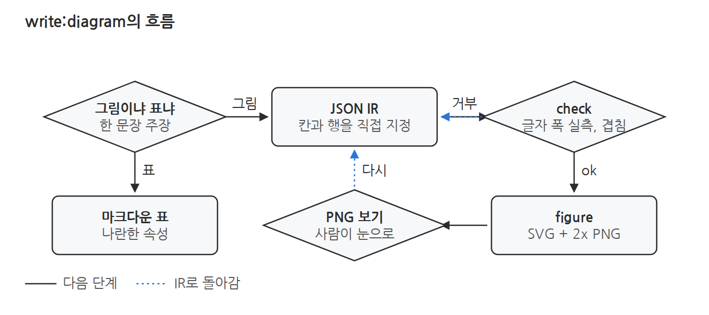
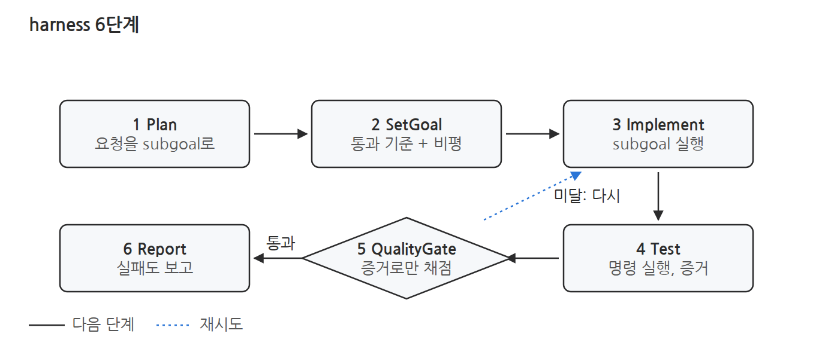

> - 책 쓰는 스킬을 다듬다 보니 그림도 필요해져서, 그림을 그리고 검사까지 하는 스킬을 따로 만들었다.
> - 이 글은 개인적인 의견을 다룹니다.

# 다루는 내용
- 그림과 표를 가르는 기준, 그리고 배치를 직접 정하고 검사기와 눈으로 확인하는 `write:diagram`을 만들면서

---
## 목차
### 1. 그림은 그려지는데?
### 2. 그림? 표?
### 3. mermaid 대신 검사된 SVG
### 4. write:diagram의 흐름
### 5. 설계 스킬에서 떼어 내기까지
### 6. 결과적으로?

---
## 1. 그림은 그려지는데?
- 2026년 10월, 공부할 주제를 책 단위로 쓰게 하는 스킬(tech-book)을 다듬고 있었다.
	- 글은 단계를 나눠 검수하고 퇴고하게 할 수 있다.
	- 책에는 그림도 들어가야 한다.
- 그 작업 중에 남긴 요청은 아래와 같다.

> 도식화 스킬도 좀 하자 단순 머메이드로 퉁치는거말고 / 책쓰기, 도식화(selfcontained svg,png) 로 퀄리티좋게

- 모델에게 그림을 맡기면 무언가 그려지기는 한다.
	- 글자가 상자 밖으로 넘치거나 선이 라벨을 가로지를 수 있다.
	- 모델은 SVG 코드를 썼고, 그려진 모습은 보지 않았다.
	- 확인하는 단계가 따로 없으면, 그 확인은 읽는 사람 몫이 된다.
- 이 스킬은 두 질문에서 시작한다.
	- 이 내용이 정말 그림이어야 하나?
	- 그렸다면, 그 결과는 어떻게 확인할까?

## 2. 그림? 표?
- 그림은 아래 네 경우에만 쓴다.
	- 공간: 어디에 놓였고 어디를 가리키는지 (페이지 레이아웃, 포인터)
	- 계층: 위아래가 있는 구조 (B-tree, 실행 계획)
	- 둘 이상의 행위자에 걸친 시간: 누가 기다리고 누가 풀어 주는지 (락 대기, 요청 순서)
	- 수치 비교: 측정한 숫자를 나란히 (전후 비교, 반복 실행)
- 나란한 속성, 즉 같은 항목을 여러 대상에 대해 비교하는 내용은 표가 낫다.
	- 상자 여러 개에 속성을 나눠 적으면, 읽는 사람이 머릿속에서 표를 새로 짜야 한다.
- harness를 다룬 두 편에도 둘이 같이 있다.
	- [harness 플러그인: 계획과 검사를 고정하는 6단계](/ai/2026/10/03/harness-series-01b-harness-플러그인.html)의 harness 6단계는 그림이다. 순서가 있고, 미달이면 앞으로 돌아가는 흐름이 핵심이라서다.
	- [하네스 엔지니어링: AI가 판단할 지점 줄이기](/ai/2026/10/01/harness-series-01a-하네스-엔지니어링.html)의 "일반 SE와 LLM 도구 대응", "강제력 층과 모델 협조"는 표다. 같은 열을 행마다 비교하는 내용이다.
- 스킬도 첫 단계에서 이 판단을 한다.
	- 나란한 속성이면 그림을 그리지 않고, 표를 권하고 열 이름만 내고 끝낸다.

## 3. mermaid 대신 검사된 SVG
### mermaid, ASCII는?
- mermaid는 텍스트로 쓰고 배치는 렌더러가 정한다. 설계 문서나 PR 안에서는 지금도 쓴다.
- 책이나 블로그에 들어갈 그림은 사정이 다르다.
	- 어디에 둘지가 곧 그림이 말하려는 내용이다. 시작점은 왼쪽이나 위, 봐야 할 것은 눈이 닿는 곳에 둔다.
	- 자동 배치는 이 판단을 대신 내린다. 렌더러가 바뀌면 배치도 바뀐다.
	- ASCII는 글꼴과 폭에 따라 줄이 어긋나고, 한글이 섞이면 더 그렇다.
- 배치는 IR에서 사람이 칸과 행을 직접 정하고, 검사기는 고치지 않고 거부만 한다.
	- 검사기는 넣은 글꼴로 라벨 폭을 재서, 넘침, 겹침, 상자를 지나는 선, 책 폭에서 7.5pt보다 작은 글자를 거부한다.
	- 거부 문구는 고칠 방법으로 나온다. 예를 들면 "이 라벨은 65px가 필요한데 36px뿐이다, 줄여라" 같은 식이다.
	- 검사를 통과해야 SVG와 PNG가 나온다. 실패하면 마지막으로 통과한 그림이 남는다.
- 그래도 검사기가 못 보는 것이 있다. 그림이 캡션의 주장을 보여 주는지는 PNG를 열어 봐야 안다.

### 색은?
- 색은 그림이 고르지 않고, 그림이 들어갈 문서에서 받는다.
	- 11월에 다른 그림 작업을 보며 정한 기준이 "색상은 문서 톤앤매너에 맞추는게 1순위"였다.
	- 그림만 자기 팔레트를 쓰면 글과 따로 논다.
- 문서의 바탕, 글자, 보조 글자, 강조색을 테마로 넘기고, 대기, 원인, 강조 같은 의미 역할은 그 위에 얹는다.
	- 이 연재 그림은 블로그 테마의 흰 바탕, 짙은 회색 글자, 파란 강조색을 받는다.
- 테마를 받으면 대비부터 본다.
	- 기준은 [WCAG 2.1의 1.4.3](https://www.w3.org/TR/WCAG21/#contrast-minimum)이다. 일반 글자는 바탕과 4.5:1 이상이어야 하고, 큰 글자는 3:1이다.
	- 스킬은 글자와 바탕 쌍이 4.5:1에 못 미치면 그 쌍을 이름으로 대고 거부한다.
	- 선은 [1.4.11](https://www.w3.org/TR/WCAG21/#non-text-contrast)처럼 3:1을 본다.
	- 문서 색을 따르되, 읽을 수 없는 조합까지 따르지는 않는다.

> 결과적으로 **색은 문서에서 받고, 대비가 모자라면 거부하기로 결정했다.**

## 4. write:diagram의 흐름
- 순서는 아래와 같다.

*그림 1. 검사기는 거부만 하고, 고치는 일은 IR로 돌아가서 한다*

1. 그림이냐 표냐를 정하고, 그림이 보여 줄 한 문장을 쓴다. 이 문장이 캡션이 된다.
2. 유형을 고르고 고른 이유를 한 줄로 쓴다.
3. JSON IR을 쓴다. 노드마다 행과 열을 직접 정하고, 출처는 `note`에 단다.
4. `check`를 돌리고, 나온 수정을 다 반영할 때까지 반복한다.
5. `figure`가 SVG(글꼴을 넣은 단일 파일)와 2배 PNG를 쓴다.
6. PNG를 열어 본다. 이상하면 IR로 돌아가고, 세 번까지 돈다.

- 유형은 일곱 가지다. 자주 쓰는 여섯 개는 아래와 같다.

| 유형 | 보여 주는 것 | 예 |
|---|---|---|
| `architecture` | 구성 요소와 데이터가 가는 길, 단계 | 서비스와 저장소, 워크플로 |
| `sequence` | 요청 하나의 시간 순서 | 로그인, 결제 흐름 |
| `timeline` | 둘 이상 세션의 대기와 해제 | 같은 행을 갱신하는 두 세션 |
| `layout` | 바이트가 놓인 자리 | 16KB 페이지 구조 |
| `tree` | 계층 | B-tree, 실행 계획 |
| `chart` | 측정한 숫자 | 전후 비교, 반복 실행 |

- 나머지 하나는 테이블과 관계를 그리는 `er`이다(주문, 주문 항목).
- `architecture` 자리에는 같은 격자를 쓰는 `dataflow`, `workflow`, `lifecycle`도 있다.

### 부르는 말
- 그릴 것과 들어갈 곳을 말로 넘긴다.

```
두 세션이 같은 행을 갱신할 때 잠금 대기를 그림으로 그려줘, 머메이드 말고
```

- 실제 IR은 [harness 플러그인: 계획과 검사를 고정하는 6단계](/ai/2026/10/03/harness-series-01b-harness-플러그인.html)의 그림 1로 보면 된다. 일부만 옮기면 아래와 같다.

```json
{
  "type": "workflow",
  "title": "harness 6단계",
  "theme": {"light": {"paper": "#ffffff", "ink": "#2b2b2b", "accent": "#2a7ae2", "...": "..."}},
  "nodes": [
    {"id": "plan", "label": "1 Plan", "sublabel": "요청을 subgoal로", "kind": "step", "row": 0, "col": 0},
    {"id": "gate", "label": "5 QualityGate", "sublabel": "증거로만 채점", "kind": "decision", "row": 1, "col": 1,
     "note": "별도 Opus 채점자, max_retries 상한"}
  ],
  "edges": [
    {"from": "gate", "to": "impl", "label": "미달: 다시", "style": "fail"},
    {"from": "gate", "to": "report", "label": "통과"}
  ]
}
```

- 여섯 단계를 두 줄로 접었다.
	- 윗줄은 Plan → SetGoal → Implement, 아랫줄은 Test → QualityGate → Report다. Report가 Plan 바로 아래에 온다.
	- 행과 열은 모두 IR에 적은 값이다. 검사기는 이 자리를 옮기지 않는다.
- 이렇게 나온 PNG가 아래다.

*그림 2. harness 6단계 그림. 위 IR에서 나온 PNG다*

- 끝나면 그림 이름, 유형과 이유, 파일, 몇 번째에 검사를 통과했는지, PNG에서 본 것, 출처를 짧게 보고한다.
- `.json`은 그림 옆에 같이 둔다. 다음에 고칠 때 거기서 시작한다.

## 5. 설계 스킬에서 떼어 내기까지
- 처음 그림은 설계 스킬 안에 있었다.
	- 9월 27일 `develop:architecture-designer`가 검증된 인터랙티브 다이어그램(HTML, 마우스를 올리면 연결이 켜진다)을 그리게 했다.
	- 화면에서 볼 때는 맞지만, 책 페이지에 넣을 정적 그림은 아니었다.
- 10월 11일 그림 그리는 부분을 `develop:diagram`으로 떼어 냈다.
	- 책 본문 폭(146mm)에 맞춘 SVG와 2배 PNG를 내고, 글꼴을 SVG 안에 넣었다.
	- 레이아웃, 트리, 타임라인, ER, 차트 같은 책용 유형이 이때 붙었다.
- 다음 날 write 플러그인으로 옮겨 `write:diagram`이 됐다.
	- 첫 사용처는 tech-book이다. 책의 장마다 들어갈 그림을 이 스킬로 그린다.
- 10월 말부터 11월 초까지 그림이 완성돼 보이게 다듬었다.
	- 캡션의 주장이 기대는 요소만 강조색으로 칠하고 나머지는 흐리게 둔다.
	- 대기, 원인, 해제 같은 의미마다 색 역할을 정했다.
	- 마지막으로 문서 테마를 받는 길과 대비 검사를 넣었다. 테마를 주지 않으면 전과 같은 기본 색이 나온다.

## 6. 결과적으로?
1. 그림은 공간, 계층, 여러 행위자의 시간, 수치 비교일 때만 쓴다. 나란한 속성은 표가 더 잘 읽힌다.
2. 배치는 사람이 정하고, 검사기는 거부만 하고, 마지막은 PNG를 눈으로 본다. mermaid 대신 검사된 SVG를 쓰는 이유다.
3. 색은 문서에서 받고, 글자 대비는 4.5:1을 넘어야 그린다.

> [이전 글: 사람이 쓴 것 같은 글을 쓰게 하기](/ai/2026/10/23/harness-series-10-사람이-쓴-것-같은-글.html) / [다음 글: 컨텍스트가 차면 답이 흐려진다](/ai/2026/10/27/harness-series-14-컨텍스트가-차면.html)
