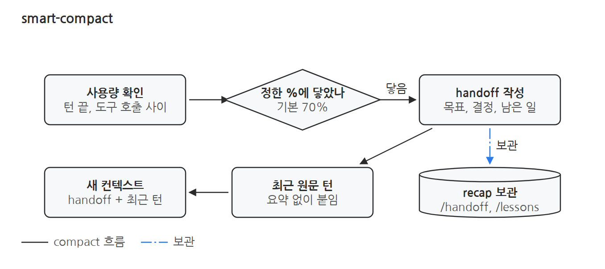

> - 긴 세션에서 답이 흐려지는 시점이 있어서, compact 때 남길 recap을 직접 쓰는 `session` 플러그인을 만들었다.
> - 이 글은 개인적인 의견을 다룹니다.

# 다루는 내용
- 컨텍스트가 찰수록 답이 흐려지는 이유와 compaction의 핵심인 요약 품질, 그리고 정한 비율에서 recap 후 compact하는 `session` 플러그인을 만들면서

---
## 목차
### 1. 긴 세션은 왜 흐려질까?
### 2. 컨텍스트 창 안에는?
### 3. compact 뒤에 남는 것
### 4. session 플러그인
### 5. 0.2.0에서 0.10.0까지
### 6. 결과적으로?

---
## 1. 긴 세션은 왜 흐려질까?
- 한 세션에서 오래 일하면 어느 순간부터 답이 흐려진다.
	- 앞에서 정한 것을 또 묻는다.
	- 이미 고친 실수를 반복한다.
	- 지금 하던 작업보다 오래전 이야기를 끌어온다.
- 언제부터인지는 측정해 본 적이 없다. 체감으로는 이렇다.

> 보통 30%이상 쌓이면 그때부터 품질이 수직하강하던데

- smart-compact 기준을 30%로 잡자는 이야기에 Claude가 "공격적"이라고 했을 때 한 말이다.
- 같은 날 recap과 smart-compact 중 어느 쪽이 나은지를 두고는 이렇게 정리했다.

> 그니까 recap을 잘하면 되잖아

- 이 글은 그 두 문장을 따라간다. 컨텍스트가 차면 흐려진다는 것, recap을 잘하면 된다는 것이다.

## 2. 컨텍스트 창 안에는?
- [공식 문서](https://code.claude.com/docs/en/context-window)는 컨텍스트 창을 "세션에 대해 Claude가 아는 모든 것"으로 설명한다.
- 내가 아무것도 치기 전에 이미 들어가는 것이 있다.
	- 시스템 프롬프트, CLAUDE.md, 자동 메모리
	- MCP 도구 이름, 스킬 description
- 일하는 동안에는 계속 쌓인다.
	- 읽은 파일, 도구 호출 결과, 훅 출력, 모델 자신의 답
- 요청마다 이 대화 전체가 같이 간다.
	- 오래 연 세션일수록 한 줄 질문도 무겁다([비용 문서](https://code.claude.com/docs/en/costs#reduce-token-usage)).

### 많이 들어가면?
- Anthropic 엔지니어링 블로그의 [Effective context engineering for AI agents](https://www.anthropic.com/engineering/effective-context-engineering-for-ai-agents)(2025-09)는 이것을 context rot이라고 부른다.
	- 컨텍스트 창의 토큰이 늘수록 그 안의 정보를 정확히 떠올리는 능력이 떨어진다고 한다.
	- 모델에게는 "주의 예산(attention budget)"이 있고, 새 토큰 하나하나가 그 예산을 조금씩 쓴다는 설명이다.
- 내가 느낀 "흐려짐"도 이 설명에 가까운 것으로 보인다.
	- 창이 다 차지 않아도, 쌓인 양만큼 앞쪽 내용이 덜 정확하게 쓰인다.
	- 다만 30%라는 숫자는 내 체감이다. 모델과 작업에 따라 다를 수 있다.

## 3. compact 뒤에 남는 것
- Claude Code는 창 한계에 다가가면 자동으로 compact한다.
	- 앞의 대화를 요약하고, 그 요약으로 새 컨텍스트를 시작한다.
- 직접 `/compact`를 칠 수도 있다. 뒤에 지시를 붙이면 요약이 그 부분을 남긴다.

```
/compact focus on the auth bug fix
```

- compact 뒤에 남는 것은 [공식 문서](https://code.claude.com/docs/en/context-window#what-survives-compaction)에 표로 있다. 줄이면 아래와 같다.

| 구분 | compact 뒤 |
|---|---|
| 프로젝트 루트 CLAUDE.md, 자동 메모리 | 디스크에서 새로 읽어 싣는다 |
| 스킬 description | 새로 만들어 싣는다 |
| 읽거나 고친 파일 | 최근에 바뀐 것부터 다섯 개까지 새로 읽는다 |
| 부른 스킬 본문 | 상한 안에서 새로 싣는다 |
| 대화, 훅이 넣은 내용 | 요약된다 |

- 결국 대화에서 나온 결정, 하던 작업, 남은 일은 요약 한 번에 달려 있다.
- 앞의 엔지니어링 글은 이 부분을 이렇게 설명한다.
	- compaction의 기술은 무엇을 남기고 버릴지 고르는 데 있다.
	- 처음에는 빠짐없이 담도록(recall) 쓰고, 그다음 불필요한 것을 덜어 내며(precision) 다듬으라고 권한다.
- 언제 압축하느냐도 중요하지만, 그 시점에 남는 내용이 다음 답의 품질을 정한다.

> 결과적으로 **압축 시점은 사용자가 정하게 두고, 플러그인은 recap의 품질을 맡기로 했다.**

## 4. session 플러그인
- [claude-skills](https://github.com/newkayak12/claude-skills)의 `session`이다. 다른 플러그인 없이 혼자 동작한다.

```bash
/plugin install session@newkayak12-claude-skills
```

### smart-compact
- 정한 컨텍스트 %에 닿으면 smart-compact가 `/compact`를 돌리고, 그 compact의 요약을 직접 쓴다.

*그림 1. 정한 비율에 닿으면 recap을 먼저 쓰고, 그 recap과 최근 원문으로 새 컨텍스트를 만든다*

- handoff에는 다음 단계에 필요한 것만 담는다.
	- 목표, 다음 방향, 하던 작업과 파일:줄, 결정, 남은 일, 교정
	- 끝난 작업은 한 줄로 줄인다.
- 새 컨텍스트는 handoff 뒤에 가장 최근 원문 턴을 요약 없이 붙인 것이다.
	- 방금 하던 말은 원문으로 남는다.
- 기준은 기본 70%이고 바꿀 수 있다.

```
/smart-compact 40
/smart-compact log
```

- `log`는 점검마다 원래 %, 기준, 판단, 결과를 한 줄씩 보여 준다.
- 기준은 내장 auto-compact 지점보다 낮게 잡는다.
	- 높으면 auto-compact가 먼저 돈다.
	- auto-compact도 같은 handoff를 받는다.

### recap 보관
- smart-compact나 `/handoff`가 만든 recap은 프로젝트마다 마지막 하나를 보관한다.

| 명령 | 하는 일 |
|---|---|
| `/handoff` | 지금 recap을 만들어 보관하고 보드의 Recap 탭으로 연다 |
| `/handoff <session>` | 같은 일을 하고, 그 recap을 다른 세션으로 보낸다 |
| `/last-recap` | 이 프로젝트의 마지막 recap을 연다 |
| `/lessons` | recap에서 모은 "두 번 이상 고친 것" 목록을 연다 |

- 다음 세션을 시작하면 지난 recap이 한 줄 밴드로 뜬다. 눌러서 이어 가면 된다.
- lessons는 어디에도 자동으로 쓰지 않는다. 오래 지킬 것은 직접 CLAUDE.md로 옮긴다.

### compact 뒤에도 남길 규칙은?
- `/memo`는 짧은 메모를 모델 컨텍스트에 고정한다.

```
/memo add 이번 작업은 session/ 아래만 고친다
/memo add --global 커밋은 내가 말할 때만
```

- 메모는 대화마다 한 번 실리고, `/compact`나 `/clear` 뒤에는 다음 프롬프트에 한 번 더 실린다.
- 범위는 프로젝트와 전역 둘이고, 개수와 길이에 상한이 있다.
- 14일이 지나면 패널에서 나이가 노란색으로 바뀐다. CLAUDE.md로 옮기라는 신호다.

### 세션 전체 보기
- `/session`은 이 세션이 남긴 것을 보여 준다. 고친 파일, 만든 커밋, 거부된 호출, 도구 호출 사이 가장 긴 간격이다.
- `/board`는 열린 세션 전부를 한 화면에 모은다.
	- 세션마다 브랜치, 컨텍스트 %, 비용, 진행 중인 작업이 한 줄이다.
	- harness, graph, teams 실행 상태도 같은 줄에 나온다.
	- 탭은 Sessions, Recap, Lessons, Today, Worktrees다.

## 5. 0.2.0에서 0.10.0까지
- 10월 8일 0.2.0에서 `/smart-compact`를 넣었다.
	- 정한 %에서 세션을 recap하고, 그 recap을 넘겨 compact하는 구조였다.
	- 사흘 뒤 0.4.1에서 점검마다 판단을 남기는 로그를 붙였다.
- 이때는 recap과 엔진의 요약이 따로 돌았다.
	- recap을 써 놓고도 compact가 자기 요약을 한 번 더 만들었다.
- 0.5.5에서 recap을 다음 단계에 필요한 것만 남기게 다듬었다.
	- compact가 따로 요약하지 않고 recap을 요약으로 쓰게 했다.
- 11월 10일 0.10.0에서 smart-compact가 자기 `/compact`에 직접 답하게 했다.
	- handoff에 최근 원문 턴을 붙여, 모델 호출 한 번으로 끝난다. 엔진 요약기는 돌지 않는다.
	- auto-compact도 같은 handoff를 받는다.
- 이름도 하나 바뀌었다.
	- Claude Code 2.1.292에 내장 `/recap`이 생겨서, 플러그인 쪽 명령은 `/last-recap`이 됐다.

## 6. 결과적으로?
1. 컨텍스트는 찰수록 앞의 내용을 덜 정확히 쓰는 것으로 보인다. 내 체감으로는 30%쯤부터다.
2. compact의 품질은 남기는 내용에 달려 있다. 압축 시점보다 recap을 잘 쓰는 것이 우선이다.
3. `session`은 정한 비율에서 다음 단계용 recap을 쓰고, 그 recap과 최근 원문으로 새 컨텍스트를 만든다. 남겨야 할 짧은 규칙은 `/memo`로 고정한다.

> [이전 글: 그림을 그리는 스킬](/ai/2026/10/25/harness-series-11-그림을-그리는-스킬.html) / [다음 글: 내 머릿속을 MCP 서버로: 근거가 있을 때만 답하는 창고](/ai/2026/10/29/harness-series-15a-내-머릿속을-MCP-서버로.html)
