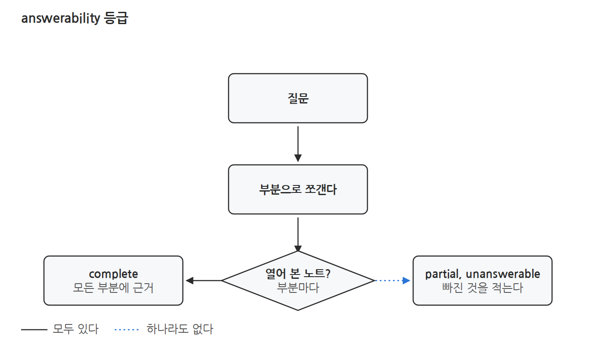
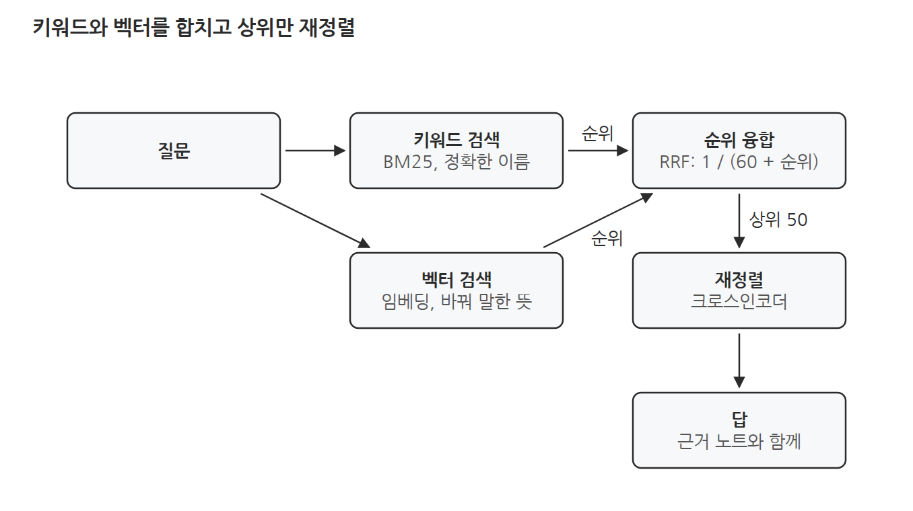

> - 모델이 바뀌어도 같은 지식 창고를 쓰고 싶어서, 노트를 MCP 서버 뒤에 두는 `knowledge` 플러그인과 개인 볼트를 만들었다. 먼저 창고와 검색을 정리했다.
> - 아직 공부 중인 개념입니다. 조금 틀려도 너른 이해 부탁드립니다!
> - 이 글은 개인적인 의견을 다룹니다.

# 다루는 내용
- 세컨드 브레인을 MCP 서버 뒤에 두고, 근거가 있을 때만 답하게 만들면서

---
## 목차
### 1. 모델과 상관없는 창고?
### 2. 세컨드 브레인, RAG, 답할 수 있는 볼트?
### 3. 키워드? 벡터? 재정렬?
### 4. knowledge 플러그인?
### 5. 결과적으로?

---
## 1. 모델과 상관없는 창고?
- 2025년 12월, RAG MCP를 서버에 올릴지 따져 봤다.
	- Claude는 채팅 정리가 목적이면 과하다고 했다.
	- 목적은 채팅 정리가 아니었다.

> MCP를 사용할 수 있는 환경이라면 클로드든 뭐든 관계없이 내 지식 창고를 채우는게 목표니까

- 기준은 특정 모델보다 창고였다. MCP 서버로 두면 MCP를 붙일 수 있는 어떤 클라이언트에서도 같은 창고를 쓴다.
- 창고를 채우는 것, 그 창고로 나처럼 답하게 하는 것. 두 가지를 차례로 만들었다.
	- 앞의 것이 `knowledge` 플러그인이고, 뒤의 것은 [개인 볼트: 기억하고, 떠올리고, 나처럼 쓰기](/ai/2026/11/04/harness-series-15b-개인-볼트.html)에서 다룬다.

## 2. 세컨드 브레인, RAG, 답할 수 있는 볼트?
### 세컨드 브레인은?
- Tiago Forte는 세컨드 브레인을 배운 것과 그 출처를 모아 두는 "바깥에 있는 디지털 저장소"로 설명한다([Building a Second Brain](https://fortelabs.com/blog/basboverview/)).
- 여기서는 저장소에 기억하기, 떠올리기, 그 사람처럼 쓰기의 세 기능을 붙인다. 세 기능은 [개인 볼트: 기억하고, 떠올리고, 나처럼 쓰기](/ai/2026/11/04/harness-series-15b-개인-볼트.html)에서 다룬다.

### RAG는?
- RAG(Retrieval-Augmented Generation)는 답을 만들기 전에 바깥 문서를 찾아 와서, 그 문서를 근거로 답하게 하는 방식이다([Lewis 외, 2020](https://arxiv.org/abs/2005.11401)).
- 모델이 원래 모르는 내 노트도 찾아서 넣어 주면 답에 쓸 수 있다.
- 문제는 찾은 것이 맞는지, 찾지 못했을 때 모델이 어떻게 하는지다.

### 답할 수 있는 볼트는?
- 링크가 잘 걸리고 깔끔해 보이는 볼트도 질문에는 답하지 못할 수 있다.
- `knowledge` 플러그인은 완료 조건을 answerability, 즉 "답할 수 있는가"에 건다.
	- 볼트가 답해야 할 질문(컴피턴시 질문) 목록을 둔다. 온톨로지 공학에서 모델을 평가하던 방식에서 빌려 왔다고 한다.
	- 모든 질문이 인용된 노트로 `complete` 답을 받아야 빌드가 끝난다.
- 답에는 등급을 단다.
	- `complete`: 질문의 모든 부분에 직접 근거가 있다.
	- `partial`, `unanswerable`: 빠진 것을 이름으로 적는다. 그럴듯한 오답으로 덮이지 않고 다음 작업이 된다.
- 등급은 모델의 느낌에 맡기지 않는다.
	- 한 볼트에서 94문항을 돌렸을 때 모델은 `complete`를 69~80번 선언했고, 실제로 맞은 것은 22~38번이었다.
	- 질문을 부분으로 쪼개고, 부분마다 실제로 열어 본 노트를 대게 한다.
	- 한 부분이라도 검색 스니펫이나 추측에 기대면 `partial`로 내린다.


*그림 1. 질문을 부분으로 쪼개고, 부분마다 열어 본 노트가 있어야 complete다.*

> 결과적으로 **볼트의 완료 조건은 answerability에 걸고, 답은 열어 본 근거 노트가 있을 때만 내기로 했다.**

## 3. 키워드? 벡터? 재정렬?
- 레포의 검색 원리 문서는 이것을 도서관에 빗댄다.
	- 책 뒤 찾아보기(키워드 검색), 단어는 달라도 뜻이 같은 책을 아는 사서(벡터 검색)
	- 두 사서의 목록 합치기(순위 융합), 후보 몇 권을 펼쳐 읽고 순서 정하기(재정렬)

### 키워드와 벡터를 섞는 이유
- 키워드 검색(BM25)은 화면 이름, 클래스 이름, 코드 식별자 같은 정확한 이름에 강하다. 대신 바꿔 말하면 못 찾는다.
- 벡터 검색(임베딩과 코사인 유사도)은 바꿔 말한 질문을 잡는다. 대신 정확한 용어가 뜻에 묻힌다.
- 두 점수는 단위가 달라 더할 수 없으니 순위를 합친다.
	- [Reciprocal Rank Fusion](https://plg.uwaterloo.ca/~gvcormac/cormacksigir09-rrf.pdf)(Cormack 외, 2009)은 목록마다 `1 / (60 + 순위)`를 더한다.
	- 양쪽에서 고르게 위에 있는 문서가 올라온다.
- 한국어는 한 단계가 더 있다. "재고" 같은 두 글자 명사는 접두어로 맞춰서 "재고가", "재고를"에 가려지지 않게 한다.

### 재정렬
- 임베딩 비교는 질문과 문서를 따로 벡터로 만들어 거리만 잰다. 빠르지만 대략적이다.
- 크로스인코더는 질문과 문서를 한 입력으로 같이 읽고 관련도를 낸다([Nogueira, Cho, 2019](https://arxiv.org/abs/1901.04085)). 정확하지만 후보마다 모델을 한 번씩 돌려야 한다.
- 싸게 많이 찾고, 상위 후보만 비싸게 정렬하는 구조다.


*그림 2. 질문은 키워드와 벡터 두 갈래로 찾고, RRF로 합친 뒤 상위 후보만 크로스인코더로 재정렬한다.*

- 다만 재정렬은 이미 상위 50 안에 있는 것만 올릴 수 있다.
	- 회수 단계에서 빠진 노트는 살아나지 않는다.
	- 붙이기 전에 상위 10과 상위 50의 회수율 차이를 잰다. 차이가 작으면 회수 단계(어휘, 임베딩, 청크)를 고치는 편이 낫다.

## 4. knowledge 플러그인?
- [claude-skills](https://github.com/newkayak12/claude-skills)의 `knowledge`는 코드, 문서, 노트를 질문에 답하는 지식으로 만드는 스킬 묶음이다.

```bash
/plugin install knowledge@newkayak12-claude-skills
```

| 하고 싶은 것 | 스킬 |
|---|---|
| 링크된 Markdown 볼트와 조회 카탈로그 | `base-builder` |
| 클래스, 관계 이름, 통제 어휘 먼저 정하기 | `ontology-builder` |
| 엔티티와 관계를 그래프 JSONL로 | `graph-builder` |
| 벡터 저장소용 청크와 평가 질문 | `rag-corpus-builder` |
| 로컬 SQLite 인덱스 만들기와 점수 재기 | `sqlite-index-builder` |
| 질문하고 등급 달린 답 받기 | `query` |

- 보통은 자료 하나를 처음부터 끝까지 맡는 진입 스킬 `workflow`에 말로 넘긴다.

```
이 레포를 질의 가능한 지식 시스템으로 만들어줘. 독자는 신규 백엔드 엔지니어고,
온보딩과 영향 분석에 최적화해줘.
```

- 설치하면 로컬 MCP 서버가 붙는다.
	- 볼트를 일회용 SQLite로 색인하고, 하이브리드 검색과 이웃 노드 조회를 도구로 낸다.
	- Git에는 Markdown과 JSONL만 두고, DB는 언제든 새로 만든다.
- `query`의 답은 항상 등급으로 시작한다.

```markdown
Coverage: partial
Parts:
- <질문의 한 부분> -> notes/<열어 본 노트>.md
- <다른 부분> -> none
...
Missing knowledge:
- <빠진 근거를 채울 노트>
```

## 5. 결과적으로?
1. 모델과 상관없이 남는 머릿속은 MCP 서버 뒤에 둔다.
2. 볼트는 깔끔할 때보다 답할 수 있을 때 끝난다. 답은 열어 본 근거가 있을 때만 낸다.
3. 검색은 키워드와 벡터를 순위로 합치고, 상위 후보만 크로스인코더로 다시 정렬한다.

> [이전 글: 컨텍스트가 차면 답이 흐려진다](/ai/2026/11/10/harness-series-14-컨텍스트가-차면.html) / [다음 글: 개인 볼트: 기억하고, 떠올리고, 나처럼 쓰기](/ai/2026/11/04/harness-series-15b-개인-볼트.html)
