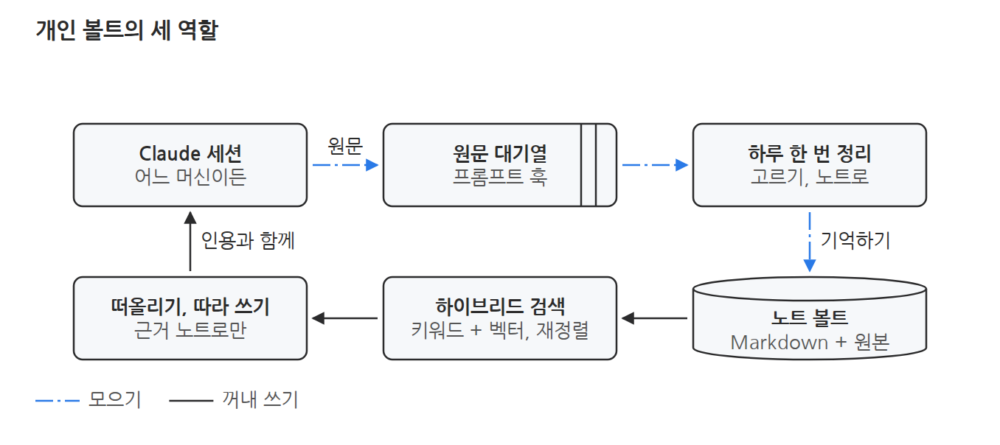

> - [내 머릿속을 MCP 서버로: 근거가 있을 때만 답하는 창고](/ai/2026/10/29/harness-series-15a-내-머릿속을-MCP-서버로.html)에서 만든 창고 위에, 나 한 사람의 개인 볼트를 올린 과정을 이어서 쓴다.
> - 아직 공부 중인 개념입니다. 조금 틀려도 너른 이해 부탁드립니다!
> - 이 글은 개인적인 의견을 다룹니다.

# 다루는 내용
- `knowledge` 위에 기억하기, 떠올리기, 그 사람처럼 쓰기의 세 역할을 가진 개인 볼트를 만들고, 모으는 시점을 원문 수집과 하루 한 번 정리로 바꾸면서

---
## 목차
### 1. 창고 위에 나를?
### 2. 세 역할?
### 3. 모으고 꺼내는 길?
### 4. 언제 모으고, 뭐라고 부를지
### 5. 결과적으로?

---
## 1. 창고 위에 나를?
- 2026년 10월, 창고를 채우는 것에서 한 걸음 더 나갔다.
	- 내 결정을 다 보고 나를 닮은 페르소나를 만들어, 내가 에이전트와 의사결정하는 것처럼 동작하게 하자는 생각이었다.
- `knowledge`가 세컨드 브레인의 바탕이라면, 그것을 나 한 사람에게 쓰는 것이 개인 볼트다.
- 볼트는 내 claude.ai 대화 전체에서 시작했다.

## 2. 세 역할?
- 역할은 셋이다.

| 역할 | 하는 일 | 쓰는 도구 |
|---|---|---|
| 기억하기 | 말, 글, 결정을 원문으로 쌓는다 | 수집 도구, 원문 대기열, 하루 한 번 정리 |
| 떠올리기 | 무엇을 알고 했고 정했는지 근거와 함께 답한다 | 검색, 노트 조회, 원본 조회 |
| 그 사람처럼 쓰기 | 그 사람처럼 판단하고 말하고 쓴다 | 페르소나 노트, 말투와 글쓰기 노트 |

- 지키는 원칙은 네 가지다.
	- 볼트를 읽고 쓰는 길은 MCP 도구 하나이고, 사용 절차는 스킬 하나에 둔다.
	- 기능이 늘어도 스킬을 늘리지 않고 스킬 안의 참고 문서로 나눈다.
	- 사용자의 말만 사용자 입장이다. Claude가 한 말은 근거로 쓰지 않는다.
	- 볼트는 어디에도 올리지 않는다. 레포에는 접근하는 스킬과 서버 코드만 있다.

## 3. 모으고 꺼내는 길?

*그림 1. 낮에는 원문만 모으고, 정리는 하루 한 번, 답은 근거 노트로만 한다*

### 모으는 쪽
- 메시지를 보낼 때마다 `UserPromptSubmit` 훅이 원문을 MCP 수집 도구로 보낸다. 이때는 판단도, 모델 호출도 없다.
- 서버는 원문을 대기열에 쌓기만 한다. 같은 세션의 같은 말은 한 번만 받고, 임시 폴더나 worktree에서 온 자동 실행은 받지 않는다.
- 하루 한 번 자정에 남길 것을 골라 노트로 접는다. 실패한 묶음은 대기열에 남아 다음 날 한 번 더 돈다.
- claude.ai 밖에서 쓴 블로그 글, 코드, Claude Code 대화는 원본 넣기 도구로 따로 넣는다. 수집 도구는 비밀값을 지우고 쌓는다.

### 자정에 고르고 접는 쪽
- 고르기
	- 대화 기록 중 `entrypoint`가 `cli`인 세션만 남긴다. SDK, 하네스, `-p` 실행은 버린다.
	- 붙여넣은 글과 시스템 메시지는 지운다.
	- 남은 말을 세션별로 묶어 4만 자 단위로 `claude -p`에 넘긴다. 이 Claude가 쓸 수 있는 도구는 수집과 검색뿐이다.
- 접기
	- 쌓인 항목을 노트에 반영하고, 처리 표시를 하고, 재빌드 검사가 통과해야 끝난다.
	- 이 단계의 Claude는 볼트 MCP 도구만 쓸 수 있고, 셸과 파일 도구는 없다.

### 꺼내 쓰는 쪽
- 검색과 답은 [내 머릿속을 MCP 서버로: 근거가 있을 때만 답하는 창고](/ai/2026/10/29/harness-series-15a-내-머릿속을-MCP-서버로.html)의 2절, 3절과 같다.
	- 검색 결과마다 키워드로 걸렸는지 뜻으로 걸렸는지 표시한다.
	- 답은 노트 id를 대고, 사용자가 한 말과 Claude가 한 말을 나눈다. 볼트에 없으면 없다고 한다.
- 임베딩은 새벽에만 한다.
	- 매일 새벽 임베딩 서버를 켜고, 바뀐 노트 섹션만 벡터로 만든 뒤 끈다. 처음 전체를 만들 때 노트 295개, 섹션 1,350개에 7분 걸렸다.
	- 낮에는 키워드 상위 결과의 벡터를 질의 대신 써서 뜻이 가까운 노트를 더하고, 두 순위를 RRF로 합친다.
	- 최종 재정렬은 스킬을 따르는 Claude가 스니펫을 읽고 한다.

## 4. 언제 모으고, 뭐라고 부를지
### 수집 시점
- 처음 안(10월 21일)은 compact 순간이었다.
	- compact 하는 순간에 훅으로 정리해서 볼트에 쌓자는 안이었다.
- 10월 27일에는 세션 중 수집을 접었다.
	- "세션 중은 그냥 모아두고 한 번에가 맞는 듯"
	- 30분마다, 그리고 세션이 끝날 때 대화 기록을 묶어서 보냈다.
- 11월 4일 0.15.0에서 지금 구조가 됐다.
	- 클라이언트는 원문을 보내기만 하고, 고르고 정리하는 일은 전부 서버의 자정 작업으로 옮겼다.
	- 클라이언트에서 모델을 돌리지 않으니 어느 머신에서든 같은 훅 하나로 끝난다.
- 기준은 처음부터 하나였다. 사용자가 시키지 않아도 모여야 한다. 그때 한 말은 "이거 알아서 반영되야지;;"였다.

> 결과적으로 **낮에는 판단 없이 원문만 모으고, 정리는 하루 한 번 몰아서 하기로 했다.**

### 이름
- 처음 이름은 나를 따라 하기 위한 볼트였다.
- 10월 27일 세컨드 브레인으로 정의를 바꿨다. 따라 하기는 세 역할 중 하나가 됐고, 기억하기와 떠올리기가 앞에 섰다.
- 다음 할 일도 정의보다 재료였다. "방향은 그렇고 더 모으지 / 모으는거 자동화에 초점"
- 같은 날 0.14.0에서 매일 밤 벡터를 만들고, 키워드와 벡터를 섞어 재정렬하는 검색을 넣었다.

## 5. 결과적으로?
1. 개인 볼트는 `knowledge` 위에 기억하기, 떠올리기, 그 사람처럼 쓰기의 세 역할을 올린 것이다. 따라 하기는 셋 중 하나다.
2. 사용자의 말만 근거로 쓰고, 볼트는 어디에도 올리지 않는다.
3. 모으는 일은 판단 없이 원문으로, 정리는 하루 한 번 몰아서 한다.

> [이전 글: 내 머릿속을 MCP 서버로: 근거가 있을 때만 답하는 창고](/ai/2026/10/29/harness-series-15a-내-머릿속을-MCP-서버로.html)
