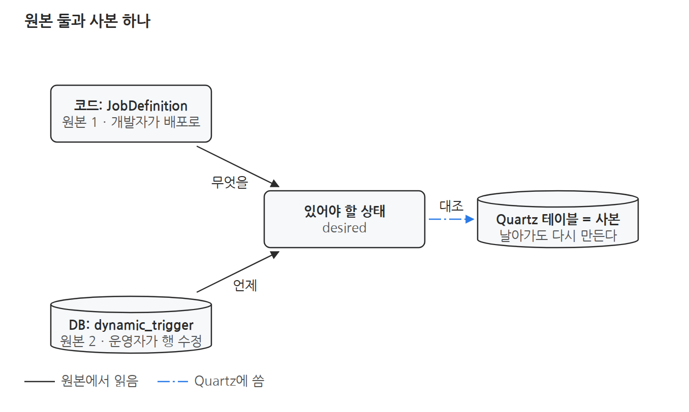

> - 동적 스케줄러 라이브러리를 구상하고 만들면서 내린 판단을 정리하는 연재의 첫 글이다.
> - 이전에 정리한 [스케쥴링 전략](/spring/2025/09/30/Spring-series-50.-스케쥴링-전략.html) 글의 후속이다. `@Scheduled`, Quartz, Jenkins의 기본 비교는 그 글에 있다.
> - 이 글은 개인적인 의견을 다룹니다.

# 다루는 내용
- 배치 스케줄의 원본을 코드와 DB로 나누고, Quartz를 대조 하나로 맞추면서

---
## 목차
### 1. cron 한 줄에 배포 한 번?
### 2. 엔진은 무엇으로?
### 3. 무엇이 원본인가?
#### "있어야 할 상태"는 무엇으로 만들어지나?
### 4. 그럴듯한 안전장치는?
### 5. 계획과 달라진 곳은?
### 6. 결과적으로?

---
## 1. cron 한 줄에 배포 한 번?

새벽 배치를 한 시간 뒤로 옮긴다고 해 보자. 고칠 건 cron 문자열 하나인데, 그 한 줄 때문에 코드를 고치고 리뷰를 받고 배포까지 해야 한다. 예전 글에 Quartz의 단점으로 적어 둔 "스케줄 변경 시 재배포 필요"를 그대로 겪은 셈이다.

- `@Scheduled`는 스케줄이 코드에 박혀 있다. 시각을 바꾸는 것도, 잠깐 끄는 것도 배포다.
- 외부 CI 도구의 주기 트리거는 스케줄마다 Job을 따로 관리해야 하고, 배치가 늘수록 정시 실행이 흔들린다.
- 둘 다 "공휴일은 제외" 같은 애플리케이션 안의 정책을 반영하기 어렵다.

그래서 목표를 아래와 같이 잡았다.
- 스케줄의 등록·수정·삭제를 DB에서 한다.
- 배포 없이 런타임에 반영한다.
- 공휴일·점검 시간 같은 실행 제외를 지원한다.
- **배치의 구현과 비즈니스 로직은 건드리지 않는다.**

테이블을 하나 더 만드는 것 자체는 어렵지 않다. 정해야 했던 건 코드, DB, Quartz 테이블 중 **무엇이 원본인가**였다. 원본을 "무엇을 = 코드, 언제 = DB"로 나누고 Quartz는 그 둘에 맞추는 **대조 하나**로만 바꾸자, 나머지 결정은 거기서 따라 나왔다.

## 2. 엔진은 무엇으로?

후보는 Quartz, Spring `TaskScheduler`, `@Scheduled`, JobRunr, db-scheduler 다섯이었다. 기준은 런타임 등록, DB 영속, 클러스터(여러 인스턴스에서 한 번만 실행), 실행 제외 넷이다.

| | 런타임 등록 | 영속·클러스터 | 실행 제외 |
|---|---|---|---|
| `@Scheduled` / `TaskScheduler` | 재시작 필요 / 가능 | 없음 | 없음 |
| JobRunr, db-scheduler | 가능 | 있음 | 직접 구현 |
| Quartz | 가능 | JDBC JobStore | Calendar 제공 |

- 앞의 세 기준까지는 JobRunr와 db-scheduler도 통과한다. **실행 제외까지 요구하자 Quartz만 남았다.**
- misfire 처리, 대시보드, 재시도까지 칸을 늘려 다시 비교해도 갈리는 칸은 같았다. db-scheduler와는 여전히 실행 제외 하나였고, JobRunr는 misfire 처리가 제한적인 대신 대시보드와 재시도는 더 나았다.
- 대가도 같이 적어 뒀다. 테이블이 늘고, 난이도는 후보 중 가장 높고, DB의 스케줄과 Quartz 상태를 맞추는 동기화 로직이 생긴다. 이 글의 나머지는 대부분 그 동기화 이야기다.

> 결과적으로 **Quartz를 선택했다.** 결정을 가른 칸은 실행 제외 하나였다.

덧붙이면 실행 제외는 결국 Calendar 대신 Quartz `TriggerListener`의 veto(발화 직전 거부)로 풀었다. Calendar가 왜 맞지 않았는지는 05편에서 다룬다.

### 스케줄러는 어디에? 분리형? 내장형?

1. **분리형**: 스케줄러가 별도의 작업 실행 앱을 API로 호출한다. 배포와 리소스는 독립이다. 그러나 호출이 비동기가 되면 Job은 호출만 하고 끝나서, `@DisallowConcurrentExecution`이 막아 주는 건 호출뿐이다. 실행 쪽에 분산락과 멱등키가 따로 필요하고 장애 지점도 둘이 된다.
2. **내장형**: 같은 앱에서 Job이 배치를 직접 실행한다. 배포 주기가 묶이고 무거운 배치가 스케줄러 스레드풀에 영향을 준다.

> 결과적으로 **2를 선택했다.** 트리거가 발화하면 같은 JVM의 핸들러 빈을 바로 부른다.

- 같은 JVM 안의 메서드 호출이라 네트워크 실패, 타임아웃, 재시도를 설계할 필요가 없다.
- Job이 배치가 끝날 때까지 블로킹되니 `@DisallowConcurrentExecution`을 그대로 믿을 수 있다.
- 호출 자체가 실패하지 않는 한 정확히 한 번 실행되니 멱등키를 따로 둘 필요가 없다.
- 배포 주기가 묶이는 건 JDBC JobStore와 클러스터 구성이면 재시작 자체가 큰 문제는 아니라고 봤다. 배포 순간의 짧은 트리거 공백은 남는 대가로 적어 두었다.

## 3. 무엇이 원본인가?

배치 하나에는 성격이 다른 두 가지가 섞여 있다.

| | 원본 | 누가, 어떻게 바꾸나 |
|---|---|---|
| **무엇을** 실행하는가(Job) | 코드 | 개발자가 배포로 |
| **언제** 실행하는가(Trigger) | DB 행 | 운영자가 행 수정으로 |

이렇게 나누면 Quartz 테이블은 사본이다. 날아가도 코드와 DB에서 다시 만들면 된다.

*그림 1. 원본은 코드와 DB 둘이고, Quartz 테이블은 대조로 만드는 사본이다*

### 하는 일은 대조 하나?

> **대조(reconcile)**: 코드와 DB로 "있어야 할 상태"를 만들고, Quartz의 현재 상태와 트리거 키마다 비교해서 다를 때만 쓰는 일. 이 연재에서 계속 쓰는 말이다.

- 없으면 등록한다.
- 다르면 재등록한다.
- 같으면 아무것도 안 한다.
- 있어야 할 목록에 없으면 내린다.

"같으면 아무것도 안 한다"에서 두 가지가 같이 따라왔다.
- 몇 번을 돌려도 결과가 같다. 그래서 부팅과 런타임 재반영이 같은 코드를 쓴다.
- 바뀐 게 없는 배포에서는 Quartz에 아무것도 쓰지 않는다.
	- 단, 동등성 비교에서 발화 이력(시작 시각, 다음 발화 시각)은 뺐다. 넣으면 그 값이 매번 달라 부팅마다 전량 재등록된다.

*그림 2. 대조가 하는 일은 넷뿐이고, 해석에 실패한 행은 대조 밖에서 손대지 않는다*

### "있어야 할 상태"는 무엇으로 만들어지나?

대조의 한쪽은 Quartz의 현재 트리거이고, 다른 한쪽은 원본 둘을 읽어 만든 목록이다. 축마다 재료가 다르다.

- Job 쪽은 코드의 `JobDefinition` 빈 목록이 그대로 desired다. 그룹과 이름이 Quartz의 Job 키가 된다.
- 트리거 쪽은 `dynamic_trigger` 행을 `dynamic_job`과 조인해 읽는다. 범위는 인스턴스 이름 하나로 좁히고, `enabled`로는 거르지 않는다.
- 행마다 트리거 그룹과 이름으로 키를 만들고, Quartz 트리거로 바꿔 본 뒤 셋 중 한 곳에 넣는다.
	- `enabled=false`인 행은 어디에도 넣지 않는다. 그래서 내림 대상이 된다.
	- cron 파싱, `ZoneId.of`, 파라미터 JSON 중 하나라도 실패하거나 다른 앱의 Job을 가리키면 `untouchable`에 넣는다. 아래의 "판단 보류"가 이 집합이다.
	- 나머지는 desired에 들어간다.
- 비교는 키 단위다. desired의 키마다 Quartz 트리거를 다시 읽어 cron, 타임존, 우선순위, misfire 정책, Job 키, 파라미터가 모두 같으면 손대지 않는다.
- Quartz에 있는데 desired에도 `untouchable`에도 없으면 내린다. 단, Job 클래스로 우리 것임을 확인한 트리거만 내린다.
- 행을 쓰는 쪽은 별도 관리 모듈이다. 입력을 `DynamicTriggerDefinition`으로 받고, 컬럼 폭이나 우선순위가 어긋나면 `InvalidTriggerDefinitionException`으로 쓰기 전에 막는다. 대조는 이 타입을 거치지 않고 행을 직접 읽는다.

### Job은 이름만 DB로?

- Job 정의 중 DB로 가는 건 이름뿐이다. 핸들러는 Spring 빈으로 메모리에만 있고, 발화하면 이름으로 찾는다.
- 덕분에 DB에 클래스 이름이 박히지 않아, 클래스를 리네임해도 데이터 마이그레이션이 필요 없다.
- 대가로 롤링 배포 중에는 그 노드에 아직 없는 Job이 발화할 수 있다. 그때는 로그만 남기고 넘긴다.

### 잘못 적힌 행은? 세우기? 빼기?

DB가 원본이면 cron 오타를 어떻게 할지 정해야 한다.

1. 부팅을 세운다: 오타 하나로 서비스가 안 뜬다.
2. 그 행을 목록에서 뺀다: 삭제 대상이 되어 **잘 돌던 배치가 조용히 사라진다.**
3. 판단을 보류한다: 그 행은 손대지 않고, 돌던 건 계속 돌게 둔다.

> 결과적으로 **3을 선택했다.** 오타 하나로 서비스가 멈추지도, 잘 돌던 배치가 사라지지도 않는 길은 이것뿐이었다.

- 깨진 cron, 타임존 오타, 깨진 JSON 파라미터, 다른 앱의 Job을 가리키는 행이 모두 이 길로 간다.
- 타임존은 `ZoneId.of`로 먼저 판정한다. `TimeZone.getTimeZone`은 모르는 이름에 예외 대신 GMT를 돌려줘서, 새벽 배치가 9시간 밀려도 로그 한 줄 남지 않는다.

## 4. 그럴듯한 안전장치는?

원본을 정하고 나니 그럴듯해 보이던 안 셋을 버리게 됐다.

| 안 | 버린 이유 |
|---|---|
| 소프트 삭제 스위치 | 끄는 스위치는 트리거에 이미 있고, "코드가 원본"에 예외가 생긴다 |
| 한 트랜잭션 dual-write | `TRIGGER_ACCESS` 락을 커밋까지 쥐어 전 노드가 멈춘다 |
| 전체 재구축 | 발화 이력이 매번 초기화되고, 재구축 중 다른 노드엔 트리거가 없다 |

### 소프트 삭제 스위치?

- 코드에서 사라진 Job을 지우지 말고 "꺼짐"으로 표시하자는 안이었다.
- 그러나 Job은 스스로 발화하지 않는다. 끄는 일은 트리거 쪽 on/off 스위치가 이미 한다.
- 그래서 물리 삭제를 골랐고, 스케줄 → Job 외래 키는 RESTRICT로 뒀다. 스케줄이 달린 Job을 지우려 하면 부팅이 멈춘다. CASCADE였다면 Job 삭제가 운영자가 건 스케줄까지 조용히 지운다.
- 대가로 "스케줄 행 정리 → 배포" 순서를 지켜야 한다.
- 참조가 있으면 경고만 남기고 삭제를 건너뛰는 완화안도 있었지만 넣지 않았다. 코드에 없는 Job 행이 남아 "코드가 원본" 규칙에 예외가 생기고, 부팅이 멈춰야 할 상황이 WARN 한 줄로 묻힌다.

### INSERT와 Quartz 등록을 한 트랜잭션으로?

둘을 `@Transactional` 하나로 묶으면 원자적이지 않을까? 걸리는 건 Quartz의 락이다.

> **`TRIGGER_ACCESS`**: Quartz JDBC JobStore가 트리거를 바꾸거나 발화할 트리거를 집을 때 `QRTZ_LOCKS` 테이블에서 `SELECT … FOR UPDATE`로 잡는 행 락. 클러스터의 모든 노드가 이 행 하나를 두고 줄을 선다.

- 바깥 트랜잭션 안에서 등록하면 커밋까지 이 락이 유지된다.
- 그동안 클러스터의 모든 노드가 트리거를 하나도 집지 못한다.
- 100건 일괄 등록이나 트랜잭션 안의 외부 호출 한 번이면, 그 시간만큼 전 노드 스케줄러가 로그 한 줄 없이 멈춘다.

*그림 3. 바깥 트랜잭션이 TRIGGER_ACCESS 락을 커밋까지 쥐는 동안 다른 노드는 트리거를 집지 못한다*

> 결과적으로 **쓰기 경로를 하나로 정리했다.** 스케줄 테이블에 쓰는 코드는 Quartz를 건드리지 않고, Quartz에 쓰는 건 대조뿐이다.

대가는 커밋과 반영 사이의 틈, 즉 **최종적 일관성**이다.

### 런타임 재반영은 "전체 재구축"으로?

- 전체 재구축의 문제는 위 표와 같다.
- 반영하는 동안 `standby`로 발화를 막는 안도 있었다. 그러나 `standby`는 그 노드만 멈추고, 클러스터의 다른 노드는 그대로 발화한다.
- 그래서 대조가 지목한 것만 내리고 붙였고, 최종적으로는 "트리거 축만 다시 대조"로 정리했다. Job은 코드가 원본이라 런타임에 바뀌지 않는다.

## 5. 계획과 달라진 곳은?

- 계획에서는 스케줄을 끄면 트리거를 **pause** 하기로 했다. 발화 이력을 잃지 않으려는 이유였다.
- 최종 구현은 반대로 Quartz 트리거만 내리고 DB 행은 남긴다. 다시 켜면 대조가 트리거를 다시 붙인다.
- 일시정지라는 상태가 Quartz에만 있고 DB에는 없어서, 원본과 사본이 서로 다른 말을 하게 되기 때문이다.
- 꺼짐을 "있어야 할 목록에서 빠짐"으로 표현하면 대조의 네 갈래 안에서 끝난다. 규칙이 하나로 유지된다.

## 6. 결과적으로?

1. 스케줄을 DB로 옮기면서 시간을 쓴 곳은 테이블이 아니라 원본을 정하는 일이었다. "무엇을 = 코드, 언제 = DB"로 나누니 Quartz 테이블은 사본이 되고, 하는 일은 대조 하나로 모였다.
2. 원본을 정하고 나니 그럴듯한 안전장치는 버리는 편이 나았다. 소프트 삭제는 "코드가 원본" 규칙에 예외를 만들고, 한 트랜잭션 dual-write는 `TRIGGER_ACCESS` 락으로 클러스터를 멈춘다.
3. 남은 대가는 커밋과 반영 사이의 틈, 그리고 스케줄이 달린 Job을 지울 때 "행 정리 → 배포" 순서를 지켜야 한다는 것이다.

> 다음 글: 02 — 노드 30대가 동시에 뜨면, 이 "대조"가 정확히 30배로 일한다.
