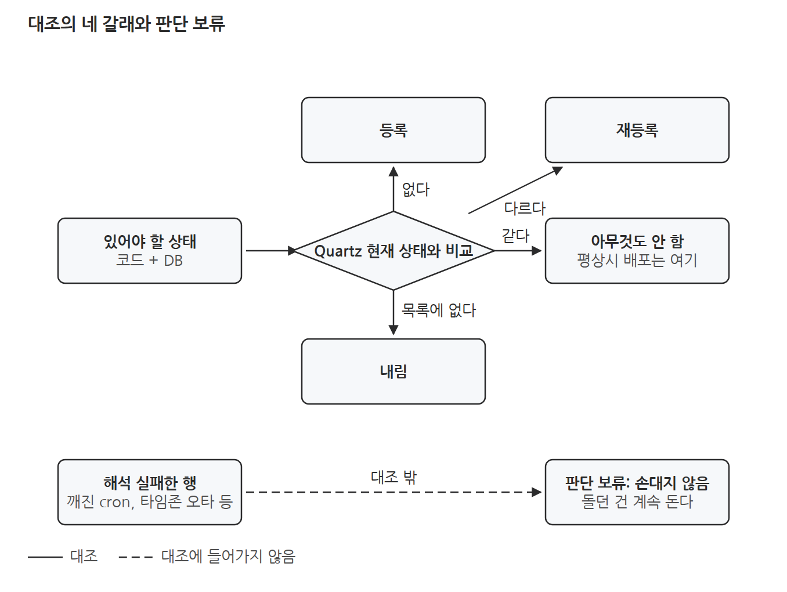
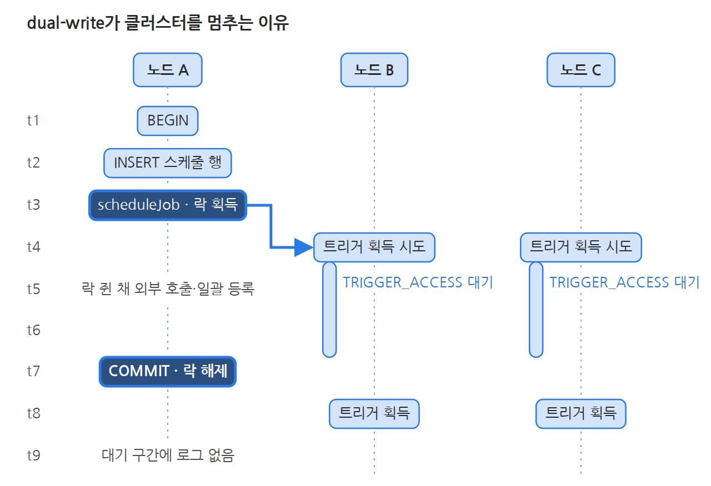

> - 동적 스케줄러 라이브러리를 구상하고 만들면서 내린 판단을 정리하는 연재의 첫 글이다.
> - 이전에 정리한 [스케쥴링 전략](/spring/2025/09/30/Spring-series-50.-스케쥴링-전략.html) 글의 후속이다. `@Scheduled`, Quartz, Jenkins의 기본 비교는 그 글에 있다.
> - 이 글은 개인적인 의견을 다룹니다.

# 다루는 내용
- 배치 스케줄의 원본을 코드와 DB로 나누고, Quartz를 대조 하나로 맞추면서

---
## 목차
### 1. cron 한 줄에 배포 한 번?
### 2. 엔진은 무엇으로?
### 3. 무엇이 원본인가?
### 4. 그럴듯한 안전장치는?
### 5. 계획과 달라진 곳은?
### 6. 결과적으로?

---
## 1. cron 한 줄에 배포 한 번?
- 새벽 배치를 한 시간 뒤로 옮기려 해도 cron 문자열 하나 때문에 코드 수정, 리뷰, 배포를 진행해야 한다.
	- 예전 글에서 Quartz의 단점으로 쓴 "스케줄 변경 시 재배포 필요"를 실제로 겪은 것이다.
- `@Scheduled`는 스케줄이 코드에 박혀 있어 시각을 바꾸는 것도, 잠깐 끄는 것도 배포다.
- 외부 CI 도구의 주기 트리거는 스케줄마다 Job을 따로 관리해야 하고, 배치가 늘수록 정시 실행이 흔들린다.
- 둘 다 "공휴일은 제외" 같은 정책을 반영하기 어렵다.
- 그래서 목표는 아래와 같다.
	1. 스케줄의 등록·수정·삭제를 DB에서 한다.
	2. 배포 없이 런타임에 반영한다.
	3. 공휴일·점검 시간 같은 실행 제외를 지원한다.
	4. 배치의 구현과 비즈니스 로직은 건드리지 않는다.
- 테이블을 하나 더 만드는 것은 어렵지 않다. 실제로 고민한 것은 코드, DB, Quartz 테이블 중 무엇이 원본인가였다.

## 2. 엔진은 무엇으로?
- 기준은 런타임 등록, DB 영속, 클러스터(여러 인스턴스에서 한 번만 실행), 실행 제외 넷이다.
	- `@Scheduled`, `TaskScheduler`: 영속·클러스터, 실행 제외가 없다. `@Scheduled`는 런타임 등록에도 재시작이 필요하다.
	- JobRunr, db-scheduler: 앞의 세 기준은 통과하지만 실행 제외는 직접 구현해야 한다.
	- Quartz: JDBC JobStore로 영속·클러스터를 지원하고, 실행 제외는 Calendar를 제공한다.
- misfire 처리, 대시보드, 재시도까지 넣어 비교해도 결과는 같았다.
- 단점은 테이블이 늘고, 난이도가 가장 높고, DB의 스케줄과 Quartz 상태를 맞추는 동기화 로직이 생긴다는 것이다.

> 결과적으로 **Quartz를 선택했다.** 결정을 가른 기준은 실행 제외 하나였다.

- 실행 제외는 실제로는 Calendar 대신 `TriggerListener`의 veto(실행(fire) 직전 거부)로 구현했다. 이유는 05편에 있다.

### 스케줄러는 어디에? 분리형? 내장형?
1. 분리형: 스케줄러가 별도의 작업 실행 앱을 API로 호출한다.
	- 배포와 리소스는 독립이다.
	- 호출이 비동기면 `@DisallowConcurrentExecution`이 막는 건 호출뿐이다. 실행 쪽에 분산락과 멱등키가 필요하고 장애 지점도 둘이 된다.
2. 내장형: 같은 앱에서 Job이 배치를 직접 실행한다.
	- 배포 주기가 묶이고, 무거운 배치가 스케줄러 스레드풀에 영향을 준다.

> 결과적으로 **2를 선택했다.** 트리거가 실행되면 같은 JVM의 핸들러 빈을 바로 호출한다.

- 메서드 호출이라 네트워크 실패, 타임아웃, 재시도를 설계할 필요가 없다.
- Job이 배치가 끝날 때까지 블로킹되니 `@DisallowConcurrentExecution`을 믿을 수 있다.
- 호출이 실패하지 않는 한 정확히 한 번 실행되니 멱등키도 필요 없다.
- 배포 주기가 묶이는 건 JDBC JobStore와 클러스터 구성이면 큰 문제가 아니라고 봤다. 배포 순간의 짧은 트리거 공백은 감수한다.

## 3. 무엇이 원본인가?
- 배치 하나에는 성격이 다른 두 가지가 섞여 있다.
	- 무엇을 실행하는가(Job): 원본은 코드다. 개발자가 배포로 바꾼다.
	- 언제 실행하는가(Trigger): 원본은 DB 행이다. 운영자가 행 수정으로 바꾼다.
- 이렇게 나누면 Quartz 테이블은 사본이다. 날아가도 코드와 DB에서 다시 만들면 된다.

*그림 1. 원본은 코드와 DB 둘이고, Quartz 테이블은 대조로 만드는 사본이다*

### 하는 일은 대조 하나?
> 대조(reconcile): 코드와 DB로 "있어야 할 상태"(desired)를 만들고, Quartz의 현재 상태와 트리거 키마다 비교해서 다를 때만 쓰는 일. 이 연재에서 계속 쓰는 말이다.

- 대조가 하는 일은 아래와 같다.
	- 없으면 등록한다.
	- 다르면 재등록한다.
	- 같으면 아무것도 안 한다.
	- 있어야 할 목록에 없으면 내린다.
- 몇 번을 실행해도 결과가 같아서 부팅과 런타임 재반영이 같은 코드를 쓴다. 바뀐 게 없는 배포에서는 Quartz에 아무것도 쓰지 않는다.
	- 단, 비교에서 실행 이력(시작 시각, 다음 실행 시각)은 뺐다. 매번 달라지는 값이라 넣으면 부팅마다 전량 재등록된다.

*그림 2. 대조가 하는 일은 넷뿐이고, 해석에 실패한 행은 대조 밖에서 손대지 않는다*

- desired의 Job은 코드의 `JobDefinition` 빈 목록이고, 트리거는 `dynamic_trigger` 행을 `dynamic_job`과 조인해 읽는다.
	- `enabled=false`인 행은 넣지 않으니 내림 대상이 된다.
	- 내리는 건 Job 클래스로 이 라이브러리의 것임을 확인한 트리거뿐이다.

### Job은 이름만 DB로?
- DB로 가는 건 Job 이름뿐이다. 핸들러는 Spring 빈으로 메모리에만 있고, 실행 시점에 이름으로 찾는다.
- DB에 클래스 이름이 없으니 클래스를 리네임해도 데이터 마이그레이션이 필요 없다.
- 단점은 롤링 배포 중 그 노드에 아직 없는 Job이 실행될 수 있다는 것이다. 이때는 로그만 쓴다.

### 잘못 적힌 행은? 세우기? 빼기?
- DB가 원본이면 cron 오타를 어떻게 처리할지도 고민해야 한다.
1. 부팅을 세운다: 오타 하나로 서비스가 안 뜬다.
2. 그 행을 목록에서 뺀다: 삭제 대상이 되어 잘 실행되던 배치가 경고 없이 사라진다.
3. 판단을 보류한다: 그 행은 손대지 않고, 기존 트리거는 계속 동작하게 둔다.

> 결과적으로 **3을 선택했다.** 서비스가 멈추지도, 배치가 사라지지도 않는 방법은 이것뿐이었다.

- 깨진 cron, 타임존 오타, 깨진 JSON 파라미터, 다른 앱의 Job을 가리키는 행은 `untouchable`로 모은다. Quartz에 있어도 내리지 않는다.
- 타임존은 `ZoneId.of`로 먼저 판정한다. `TimeZone.getTimeZone`은 모르는 이름에 예외 대신 GMT를 돌려줘서, 새벽 배치가 9시간 밀려도 로그 한 줄 없다.

## 4. 그럴듯한 안전장치는?
- 원본을 정하고 나니 그럴듯해 보이던 안 셋을 버리게 됐다.

### 소프트 삭제 스위치?
- 코드에서 사라진 Job을 지우지 말고 "꺼짐"으로 표시하자는 안이다.
- 그러나 Job은 스스로 실행되지 않는다. 끄는 일은 트리거 쪽 on/off 스위치가 이미 한다.
- 그래서 물리 삭제를 골랐고, 스케줄 → Job 외래 키는 RESTRICT로 뒀다.
	- 스케줄이 달린 Job을 지우려 하면 부팅이 멈춘다. CASCADE였다면 운영자가 건 스케줄까지 경고 없이 지워진다.
	- 단점은 "스케줄 행 정리 → 배포" 순서를 지켜야 한다는 것이다.
- 참조가 있으면 WARN만 쓰고 건너뛰는 완화안도 넣지 않았다. 부팅이 멈춰야 할 상황이 로그 한 줄로 묻힌다.

### INSERT와 Quartz 등록을 한 트랜잭션으로?
- 둘을 `@Transactional` 하나로 묶으면 원자적이지 않을까? 걸리는 건 Quartz의 락이다.

> `TRIGGER_ACCESS`: Quartz JDBC JobStore가 트리거를 바꾸거나 실행할 트리거를 집을 때 `QRTZ_LOCKS` 테이블에서 `SELECT … FOR UPDATE`로 잡는 행 락. 클러스터의 모든 노드가 이 행 하나를 두고 줄을 선다.

- 바깥 트랜잭션 안에서 등록하면 커밋까지 이 락이 유지된다.
- 100건 일괄 등록이나 외부 호출 한 번이면, 그 시간만큼 모든 노드의 스케줄러가 로그 한 줄 없이 멈춘다.

*그림 3. 바깥 트랜잭션이 TRIGGER_ACCESS 락을 커밋까지 쥐는 동안 다른 노드는 트리거를 집지 못한다*

> 결과적으로 **쓰기 경로를 하나로 정리했다.** 스케줄 테이블에 쓰는 코드는 Quartz를 건드리지 않고, Quartz에 쓰는 건 대조뿐이다.

- 이러한 구조의 trade-off는 커밋과 반영 사이의 틈, 즉 최종적 일관성이다.

### 런타임 재반영은 전체 재구축으로?
- 전체 재구축은 실행 이력이 매번 초기화되고, 재구축 중 다른 노드에는 트리거가 없다.
- `standby`로 막는 안도 고민했지만 `standby`는 그 노드만 멈춘다.
- 그래서 "트리거 축만 다시 대조"로 정리했다. Job은 코드가 원본이라 런타임에 바뀌지 않는다.

## 5. 계획과 달라진 곳은?
- 계획에서는 스케줄을 끄면 트리거를 pause 하기로 했다. 실행 이력을 잃지 않기 위해서였다.
- 최종 구현은 Quartz 트리거만 내리고 DB 행은 둔다. 다시 켜면 대조가 트리거를 다시 붙인다.
- 일시정지 상태가 Quartz에만 있으면 원본과 사본이 서로 다른 말을 하게 된다. 꺼짐을 "목록에서 빠짐"으로 표현하면 대조 규칙 하나로 끝난다.

## 6. 결과적으로?
1. 스케줄을 DB로 옮기면서 가장 고민한 것은 테이블이 아니라 원본을 정하는 일이었다. "무엇을 = 코드, 언제 = DB"로 나누니 Quartz 테이블은 사본이 되고, 하는 일은 대조 하나로 모였다.
2. 원본을 정하고 나니 소프트 삭제, 한 트랜잭션 dual-write 같은 그럴듯한 안전장치는 버리는 편이 나았다.
3. 다만, 커밋과 반영 사이의 틈과 "행 정리 → 배포" 순서라는 trade-off는 감수해야 한다.

> 다음 글: 02. 노드 30대가 동시에 뜨면 이 대조가 정확히 30배로 일한다.
