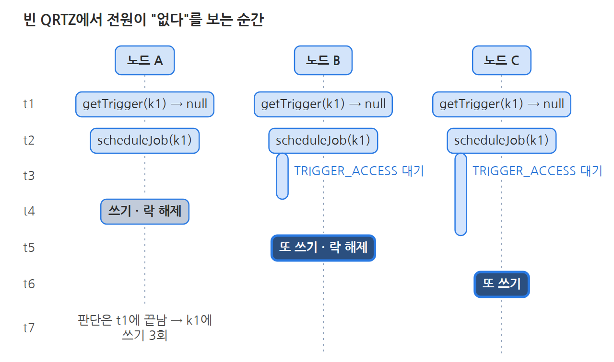
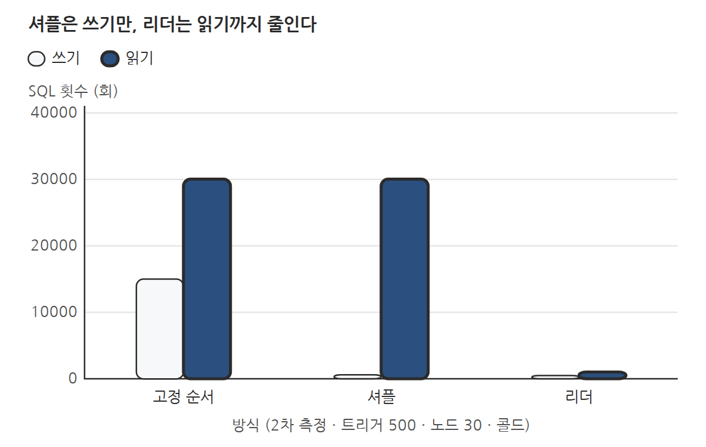
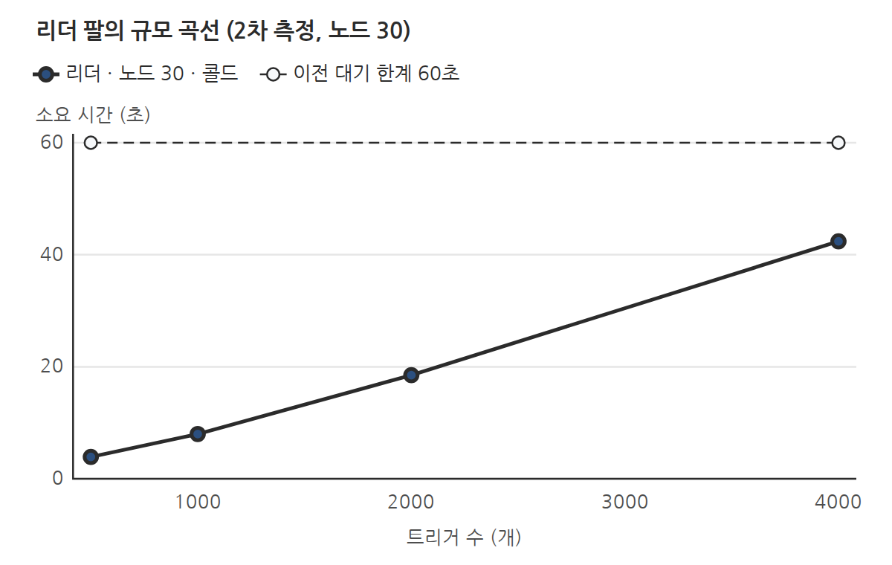

> - 동적 스케줄러 라이브러리 연재 두 번째 글이다. [이전 글](/spring/2026/11/01/dynamic-scheduler-01-스케줄을-코드가-아니라-테이블로.html)에서 "코드 + DB → Quartz" 대조 하나로 스케줄을 맞추는 구조를 정했다.
> - 측정은 로컬 Testcontainers 환경 기준이다. 절대 수치보다 모양을 봐 주면 좋겠다.
> - 이 글은 개인적인 의견을 다룹니다.

# 다루는 내용
- 빈 Quartz 테이블에 노드 여러 대가 동시에 처음 뜰 때의 초기 등록 폭풍을 재면서, 무엇을 세느냐에 따라 대책의 평가가 뒤집힌 과정

---
## 목차
### 1. 평상시엔 0인데, 처음 뜰 때는?
### 2. 어떻게 잴 것인가?
### 3. 1차 측정: 쓰기만 세면?
### 4. 2차 측정: 읽기까지 세면?
### 5. 셔플? 리더?
### 6. 트리거를 더 늘리면?
### 7. 계측기는 믿을 만했나?
### 8. 아직 안 잰 것은?
### 9. 결과적으로?

---
## 1. 평상시엔 0인데, 처음 뜰 때는?
- 빈 Quartz 테이블에 노드 여러 대가 동시에 처음 뜨는 경우를 이 글에서는 초기 등록이라고 부른다.
- 01편의 대조는 트리거 키마다 읽고(`getTrigger`), 비교하고, 다르면 `TRIGGER_ACCESS` 락을 잡고 쓴다(`scheduleJob`).
	- 조건이 붙은 건 쓰기뿐이다. 읽기는 트리거당 2번(`QRTZ_TRIGGERS`, `QRTZ_CRON_TRIGGERS`)에 목록 1번, 즉 `2T+1`번 매번 나간다.
- 평상시 배포는 이미 같은 값이 있어 쓰기가 0이다. 문제는 테이블이 비어 있을 때다.
	- 모든 노드가 같은 키를 같은 순간에 읽고, 모두 `null`을 보고, 모두 쓴다.

*그림 1. 빈 Quartz 테이블에서는 모든 노드가 같은 순간 "없다"를 보고, 락 줄을 선 뒤 모두 쓴다*

### 락 대기로 저절로 어긋나지 않을까?
- 처음엔 락 대기 때문에 노드들이 저절로 어긋나 실제로는 훨씬 적게 쓸 거라고 생각했다.
- 틀렸다. 같은 락을 같은 순서로 통과하면서 줄이 오히려 더 단단해진다. 늦게 온 노드는 이미 "없다"는 판단을 끝낸 채 줄을 서 있다.
- 그래서 대책 둘을 놓고 측정을 진행했다.

## 2. 어떻게 잴 것인가?
- 측정 조건은 아래와 같다.
	- 격자: 트리거 {50, 200, 500} × 노드 {1, 3, 10, 30} × 초기 등록/재시작 × 3회 반복, 중앙값.
	- 재시작은 이미 맞춰진 상태, 즉 평상시 롤링 배포다.
	- 팔(비교하는 방식 하나)들은 같은 JVM에서 번갈아 실행한다. 따로 실행하면 차이가 방식 때문인지 그날 머신 상태 때문인지 알 수 없다.
	- cron은 실행되지 않는 값(2099년)으로 걸어 실행 경로의 UPDATE가 섞이지 않게 한다.
- 호출이 아니라 SQL을 센다. Mockito로 `Scheduler` 호출을 세면 UPDATE가 몇 번 나갔는지 모른다. 그래서 `DataSource`를 동적 프록시로 감싸 실제로 나간 문장을 셌다.
	- 락을 잡는 순간의 `autoCommit`도 읽는다. `true`면 `FOR UPDATE`가 문장이 끝나는 순간 락을 놓아 두 노드가 같은 키에 동시에 쓸 수 있다.
- 노드는 스레드로 흉내 냈다.
	- 클러스터의 동기화 장치는 JVM 모니터가 아니라 DB 행 락(`SELECT … FROM QRTZ_LOCKS … FOR UPDATE`)이라, 경쟁자가 다른 JVM이든 스레드든 DB가 보는 그림은 같다.
	- 노드별 커넥션 풀 고갈, 네트워크 지연, 노드마다 따로 동작하는 Quartz 배경 스레드는 재현되지 않는다.

## 3. 1차 측정: 쓰기만 세면?
- 1차에서는 두 팔을 비교했다.
	1. 고정 순서: 아무것도 안 한다. 모든 노드가 같은 순서로 도달해 모두 쓴다.
	2. 셔플: 노드마다 순회 순서를 섞는다. 충돌 시점을 흩으면 늦게 온 노드가 비교 단계에서 "같다"를 보고 끊긴다는 계산이다.
- 고정 순서의 쓰기는 12개 지점 전부에서 정확히 `N × T`이고, 3회 반복의 최솟값과 최댓값이 같다.
- 셔플은 대략 `T + 3.2N`이다. 초과 쓰기(쓰기 − T)가 T와 거의 무관하게 노드 수만 따라간다.
	- 노드 3: 3회, 노드 10: 33~34회, 노드 30: 97회
- 노드 30에서 고정 순서는 15,000회 쓰고 63.1초, 셔플은 597회에 6.1초다.
- 고정 순서의 부팅 시간은 대략 `N×T ÷ 230`초다. 10노드 × 500트리거에서 22.6초로, k8s `startupProbe` 기본값 30초에 꽤나 가깝다. 셔플은 4.2초다.
- 셔플이 손해를 보는 건 노드 1대일 때뿐이다(10~15%). 무작위 순서 INSERT가 클러스터드 PK 페이지 분할을 늘리는 것으로 추정만 했다.
- 이 시점의 결론은 "셔플이면 됐다"였다. 노드를 늘려도 부팅이 느려지지 않는다(노드 1개 4.5초, 30개 6.1초)고도 생각했다.
- 리더 한 대만 대조하는 안도 고민했지만 "1.5초쯤 아낄 것"이라고 봤다. 읽기는 `TRIGGER_ACCESS` 락을 타지 않으니 N대가 나눠 병렬로 흡수할 거라는 계산이었다.

## 4. 2차 측정: 읽기까지 세면?
- 계수기에 읽기를 추가하고 리더 팔을 붙여 다시 측정했다.
	- 리더 팔은 행 락 하나로 한 노드만 대조하고, 나머지는 완료 표시를 보고 건너뛴다(구현은 03편).
	- 리더 팔은 셔플을 켠 채로 쟀다. 끄면 두 변수를 한꺼번에 바꾸게 된다.
- 아래는 트리거 500 · 노드 30 · 초기 등록 · 3회 중앙값이다.

| | 쓰기 | 읽기 | 시간 |
|---|---:|---:|---:|
| 고정 순서 | 15,000 | 30,030 | 65.3초 |
| 셔플 | 603 | 30,030 | 7.9초 |
| 리더 | 500 | 1,001 | 3.9초 |

- 셔플은 쓰기를 25배 줄였지만 **읽기는 고정 순서와 똑같이 30,030회**(= 30 × `2T+1`)였다. 격자 24칸 전부에서 두 팔의 읽기는 한 자리도 다르지 않았다.
- 늦게 온 노드도 "쓸 필요 없다"고 판단하려면 전부 읽어야 한다. 셔플은 판단의 결과를 바꿀 뿐 판단의 비용은 바꾸지 못한다.
- 재시작, 즉 평상시 롤링 배포도 같았다.
	- 쓰기 0, 락 0이었지만 SELECT는 여기서도 30,030회 나가고 있었다.
	- 리더로 바꾸면 1,001회, 시간은 4.1초에서 1.1초로 줄었다.
- 1차에서 내린 두 판단도 같이 뒤집혔다.

| 2차 · 트리거 500 · 초기 등록 | 노드 1 | 노드 3 | 노드 10 | 노드 30 |
|---|---:|---:|---:|---:|
| 셔플 | 4.2초 | 3.3초 | 4.8초 | 7.9초 |
| 리더 | 4.8초 | 5.0초 | 4.6초 | 3.9초 |

- 셔플은 노드 3을 지나면서 노드가 늘수록 느려졌다. 리더는 노드 수와 무관하게 평평했고, 노드 30에서는 셔플의 절반이었다.
- "1.5초쯤"이던 추정도 틀렸다. 기대했던 N대 병렬 흡수는 원래 없었다. 같은 락 줄에 서는 비용이 나눠 읽어서 버는 시간보다 컸다. **경합이 병렬성보다 비쌌다.**

*그림 2. 2차 측정(트리거 500 · 노드 30 · 초기 등록). 셔플은 쓰기만 줄이고, 리더는 읽기까지 줄인다*

## 5. 셔플? 리더?
- 세 안을 비교하면 아래와 같다.
	1. 고정 순서: 쓰기 `N×T`, 읽기 `N×(2T+1)`. 부팅 시간이 노드 수에 비례한다.
	2. 셔플만: 쓰기 `T + 약 3N`, 읽기 `N×(2T+1)`. 평상시 배포마다 읽기가 노드 수만큼 곱해진다.
	3. 리더(+셔플): 쓰기 `T`, 읽기 `2T+1`. 팔로워가 뜨는 시점이 리더에 묶인다.

> 결과적으로 **셔플과 리더 동기화를 둘 다 기본값으로 켰다.** 셔플은 쓰기를, 리더는 읽기를 줄여 겹치지 않는다. 리더를 켜면 셔플은 리더 혼자 대조하는 순서에만 영향을 준다.

- 등록 로그 순서가 비결정적이 되는 게 문제일 수 있어 셔플을 끄는 스위치는 뒀다.
- 셔플에는 `ThreadLocalRandom`을 썼다. `Collections.shuffle`의 기본 `Random`은 전역 하나라 스레드들이 seed를 두고 CAS로 경합한다.
- 리더의 단점은 팔로워가 리더의 대조 시간만큼 늦게 뜬다는 것이다.
	- 대기 한계를 넘으면 각자 대조하는 폴백으로 떨어진다.
	- 2차 측정 리더 팔 72라운드에서 읽기가 전부 정확히 `2T+1`이었으니 폴백은 한 번도 없었다.
- CI 계약은 절대량이 아니라 기울기로 걸었다. 숫자는 환경마다 흔들리기 때문이다.
	- 쓰기가 노드 수에 비례하지 않는다.
	- 재시작에서 쓰기 0, 락 0.
	- 리더의 읽기는 노드 1개분 × 2 이하.

## 6. 트리거를 더 늘리면?
- 2차 측정 리더 팔(노드 30 · 초기 등록)로 트리거 수를 늘려 봤다.
	- 1,000개: 8.0초, 2,000개: 18.5초, 4,000개: 42.4초
- 트리거가 하나 늘 때 더해지는 시간이 7ms에서 12ms로 늘어나는 초선형이다. Quartz 테이블이 커지면서 쓰기마다 인덱스 비용이 붙는 것으로 보인다.
- 바뀐 게 없는 재시작도 4,000개에서는 8.5초가 걸렸다.

*그림 3. 2차 측정 리더 팔(노드 30 · 초기 등록)의 규모 곡선. 4,000개에서 이전 대기 한계 60초의 71%다*

- 4,000개에서 42.4초면 리더 대기 한계 60초의 71%다.
	- 한계를 넘으면 모든 팔로워가 폴백해서 리더의 이득이 사라지고 기다린 시간까지 손해가 된다.
	- 그래서 기본값을 3분으로 올렸다.
- 숫자로 안내하는 것은 포기했다. 60초 한계를 "트리거 약 8,000개"로 외삽했는데 실측 한계는 5,400개였다. 초선형 곡선에서 외삽은 늘 낙관적이다.
- 대신 부팅마다 실제 소요 시간을 로그로 쓰고, 한계의 50%를 넘으면 WARN을 올린다.

## 7. 계측기는 믿을 만했나?
- 계측기 쪽 결함도 나왔다.
	- Quartz 배경 스레드 셋(실행 획득, 클러스터 체크인, misfire 핸들러)의 락 획득이 계수에 섞였다. 트리거를 500으로 올리자 "평상시 락 0" 단언이 1로 깨졌다. 1차 격자 전체에서 12,809회였고, 스레드 이름으로 나눠 따로 셌다.
	- 단언이 실패하면 그 아래 구간 표를 못 보던 문제는 표를 `finally`에서 출력하게 바꿨다.
	- 리더 읽기 단언은 노드 30까지만 건다. 모든 노드가 커넥션 풀 하나를 나눠 쓰는 하네스라, 노드 수가 풀 크기에 닿으면 리더가 교착한다.
- 정합성은 깨끗했다. 1차 144라운드에서 수렴 실패와 `autoCommit` 상태의 락 획득이 0, 2차도 실패 0이다.

## 8. 아직 안 잰 것은?
- 다중 JVM에서만 생기는 경합은 들어 있지 않다. 노드가 N개면 Quartz 배경 스레드도 N세트다.
- 리더가 죽은 뒤의 승계 지연, 트리거 4,000개 초과, 노드 2대도 아직이다.

## 9. 결과적으로?
1. 대책을 비교하려고 시작한 측정이었는데, 판단을 가장 크게 바꾼 건 무엇을 세느냐였다. 쓰기만 셌을 때 셔플은 폭풍을 끝낸 것처럼 보였고, 읽기를 세자 30,030회가 여전히 있었다.
2. "평상시 배포는 아무 일도 안 한다"는 믿음도, 리더는 "1.5초쯤" 아낀다는 추정도 세지 않은 축이 있어서 틀렸다. 대책보다 계측기를 먼저 의심해야 했다.
3. 숫자는 환경마다 흔들려서 CI에는 기울기를 걸고, 대기 한계는 외삽 대신 부팅마다 실측을 로그로 쓰게 했다.

> [이전 글: 01. 배치 스케줄을 코드가 아니라 테이블로](/spring/2026/11/01/dynamic-scheduler-01-스케줄을-코드가-아니라-테이블로.html) / [다음 글: 03. 리스도 하트비트도 없는 리더 선출](/spring/2026/11/05/dynamic-scheduler-03-DB-행-락-하나로-대표-뽑기.html)
