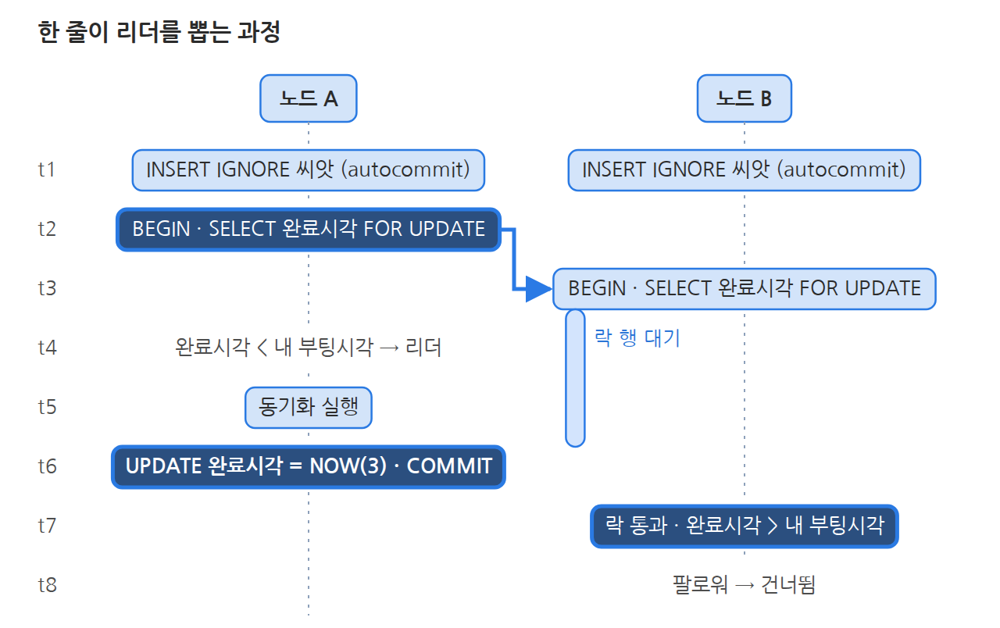

> - 동적 스케줄러 라이브러리 연재 세 번째 글이다. [이전 글](/spring/2026/11/03/dynamic-scheduler-02-빈-테이블에서-노드-30대가-동시에-뜨면.html)에서 "리더 한 대만 동기화"가 읽기 30,030회를 1,001회로 줄이는 것을 쟀다. 이번 글은 그 리더를 어떻게 뽑았는지다.
> - 이 글은 개인적인 의견을 다룹니다.

# 다루는 내용
- 부팅 동기화를 클러스터에서 한 대만 하도록, `SELECT … FOR UPDATE` 한 줄과 완료 시각 하나로 리더를 뽑으면서

---
## 목차
### 1. 흩어서 다 하기? 한 대만?
### 2. 대표는 어떻게 뽑을까?
### 3. 컬럼 두 개면 충분할까?
### 4. 마커에는 규칙이 몇 개 필요할까?
### 5. 실패하면 어느 쪽으로?
### 6. 실제로 돌려 보니?
### 7. 결과적으로?

---
## 1. 흩어서 다 하기? 한 대만?

노드 N대가 부팅하면서 각자 대조를 전부 돈다. 지난 글의 셔플로 쓰기는 줄였지만, 읽기는 노드 수만큼 그대로였다.
- 읽기까지 줄이려면 N대가 흩어서 다 하는 대신 **한 대만** 해야 했다.
- 한 대로 충분한 근거는 클러스터 모드의 JDBC JobStore에 있다. 노드는 트리거를 메모리에 캐시하지 않고, 발화할 트리거를 고를 때마다 테이블을 다시 읽는다.
- 결과물이 DB에 남으니, 한 대가 맞춰 두면 나머지는 할 일이 없다.

> 작업이 멱등하고 결과가 공유 DB에 남는다면, 리스·하트비트 없이 트랜잭션 행 락 하나와 완료 마커 하나로 리더를 뽑을 수 있다. 실패는 누락이 아니라 중복 쪽으로 떨어지게 한다.

## 2. 대표는 어떻게 뽑을까?

선택지는 여섯이었다.

1. **노드를 행으로 등록하고 `ORDER BY … LIMIT 1`로 제일 먼저 온 노드를 리더로**
	- 원자적인 선출이 아니라 스냅샷 읽기다. 동시에 뜨면 각자 다른 스냅샷을 봐서 리더가 0개나 2개가 된다. 계획 문서에서 세 노드의 순서를 한 줄씩 적어 보다가 걸렀다.
2. **01편의 `TRIGGER_ACCESS` 락을 활용**
	- 쓰기 1건마다 잡았다 놓는 락이라 줄은 세우지만 중복은 못 없앤다.
	- 통째로 쥐고 있으면 `scheduleJob()`이 Quartz 자기 커넥션으로 같은 락을 잡으러 와서 자기 자신과 교착한다.
3. **리스 만료 + 하트비트로 "리더가 죽었는지 추정"**
	- 살아 있는 리더를 밀어내 리더가 둘이 되는 경우와, 노드 간 시계 동기화라는 전제를 같이 끌고 온다.
4. **"QRTZ에 이미 있나?"를 보고 건너뛸지 판정**
	- 확인하려면 `getTrigger`를 T번 돌려야 하는데, 그게 바로 없애려던 읽기다.
5. **`SELECT … FOR UPDATE WAIT n`으로 대기 한계를 건다**
	- MariaDB에만 있는 문법이다. MySQL 8에서도 도는 방법은 세션 변수 `innodb_lock_wait_timeout`뿐이었다.
6. **락 전용 행 + 트랜잭션에 묶인 행 락 + 완료 마커**

> 결과적으로 **6을 선택했다.** 1·2·4·5는 동작하지 않거나 목적을 못 이뤘고, 3은 동작하지만 이 작업에는 과했다.

6도 새로운 장치는 아니다.
- Quartz가 `TRIGGER_ACCESS`로 하는 것과 같은 구조다. 행을 하나 두고, 모두가 그 행에 `FOR UPDATE`를 건다.
- 이 모듈은 이미 그 행 락 위에서 돌고 있다. 같은 패턴을 잡는 단위만 "쓰기 1건"에서 "동기화 전체"로 바꿔 한 번 더 쓴 것이다.

## 3. 컬럼 두 개면 충분할까?

락 테이블에는 컬럼이 둘뿐이다.
- 클러스터 이름(PK): 행 하나가 클러스터 하나의 락이다.
- 완료 시각: NULL이면 아직 아무도 끝내지 않았다. 아래에서는 **마커**라고 부른다.
- 누가 쥐고 있는지는 DB가 알기 때문에 보유자 컬럼은 두지 않았다.

흐름은 네 단계다.
1. **씨앗**: `INSERT IGNORE`로 행을 만든다. 본 트랜잭션 **밖**에서 autocommit으로 한다. 안에서 하면 INSERT가 잡은 락을 동기화가 끝날 때까지 쥐어서, 락을 놓는 시점이 두 군데가 된다.
2. **선출**: `SELECT 완료시각 … FOR UPDATE`. InnoDB가 하나만 통과시키고 나머지를 막는다. 통과한 하나가 리더다.
3. 통과했는데 `완료시각 > 내 부팅시각`이면 팔로워로서 건너뛰고, 아니면 리더로서 동기화한다.
4. 성공한 뒤에만 `UPDATE 완료시각 = NOW(3)` 하고 같은 트랜잭션에서 커밋한다. "락은 풀렸는데 마커는 아직"인 창이 없다.

*그림 1. 리더를 계산하는 코드 없이 InnoDB 행 락이 하나만 통과시키고, 늦게 온 노드는 마커를 보고 건너뛴다*

- 결국 `SELECT … FOR UPDATE` 한 줄이 줄을 세우고, 리더를 지목하고, 뒤에 온 노드에게 "이미 끝났다"를 알린다.
- 세 번째는 마커가 있어야만 된다. 락은 상호 배제만 한다. 마커가 없으면 리더가 나간 뒤 나머지가 차례로 들어와 다 같이 일하고, 줄만 세운 꼴이 된다.

### 커넥션 수명이 곧 정확성?
- 리더가 죽으면 커넥션이 끊기는 순간 InnoDB가 행 락을 푼다. 마커는 안 찍혔으니 다음 노드가 이어받는다. 승계 코드가 따로 없다.
- 그래서 `JdbcTemplate`은 쓰지 않았다. 호출마다 커넥션을 빌렸다 돌려주는 방식으로는 "끝날 때까지 한 커넥션을 붙든다"를 표현할 수 없다.
- 잠금 순서는 "락 행 → `QRTZ_LOCKS`" 한 방향으로만 뒀다. 락을 Quartz 테이블과 다른 행에 둔 이유다.
- Job과 Trigger 동기화는 한 락 안에서 같이 한다. 나눠 잠그면 그 사이에 "Job은 반영됐는데 Trigger는 아직"인 상태가 보인다. 스케줄러 기동은 락 밖이다.

## 4. 마커에는 규칙이 몇 개 필요할까?

마커는 단순해 보였는데 규칙이 네 개 필요했다. 어기면 생기는 일로 정리하면 아래와 같다.

1. **NULL 여부가 아니라 세대를 본다.** 마커가 있다는 것만으로 건너뛰면 지난 배포가 남긴 마커를 새 노드가 믿는다. 롤링 배포에서 새 스케줄이 영영 안 붙는다.
2. **시작할 때가 아니라 끝난 뒤에 찍는다.** 시작할 때 찍으면 중간에 죽은 리더가 "완료"로 남아 아무도 이어받지 않는다.
3. **시각은 DB 시계(`NOW(3)`)로만 쓰고 읽는다.** 노드 시계가 느리면 지난 마커를 자기 세대 것으로 착각하고, 빠르면 매번 쓸데없이 다시 동기화한다.
4. **부팅 시각은 락을 잡기 전에 잰다.** 락 안에서 재면 리더가 방금 찍은 마커보다 항상 나중이라, 팔로워 전원이 "낡은 마커"로 판정한다.

## 5. 실패하면 어느 쪽으로?

동기화를 건너뛰는 경우는 둘뿐이다.
- 다른 노드가 끝냈다는 기록을 DB에서 확인했을 때
- 부팅 자체가 실패했을 때

락 대기 타임아웃, 데드락, SQL 오류는 전부 "조정 없이 각자 실행", 즉 폴백으로 모인다.
- 폴백 동작은 기능을 껐을 때와 같아서 새 실패 모드가 생기지 않는다.
- 전제는 동기화가 멱등하다는 것이다. 키마다 읽고 비교하고 쓰는 구조라 두 번 돌아도 결과가 같다. 그 위에서 **최악은 중복 실행이고, 누락은 없다.**

| 실패 지점 | 결과 | 방향 |
|---|---|---|
| 락 테이블 없음 / DB 시각 조회 실패 | 부팅 실패(조립 시점) | 드러남 |
| 리더 급사 | 커넥션 끊김 → 락 해제 → 다음 노드 승계 | 중복 |
| 락 대기 타임아웃·데드락·SQL 오류 | 폴백(각자 실행) | 중복 |
| 동기화 성공 후 마커 기록 실패 | 다음 노드가 한 번 더 | 중복 |
| 동기화 자체 예외 | 부팅 실패, 마커 없음 | 드러남 |

대기 한계는 기본 3분이다(02편의 규모 곡선을 보고 60초에서 올렸다).
- 폴백은 늦게라도 조정받는 것이 아니다. 기다린 시간을 버리고 각자 실행한다. 한계를 넘기면 팔로워 전원이 동시에 원래 폭풍을 겪어, 기능을 안 켠 것보다 나쁘다.
- 반대로 길게 잡는 손해는 작다. 리더가 죽으면 락은 즉시 풀리니, 이 대기를 다 쓰는 건 리더가 살아 있으면서 끝나지 않는 경우뿐이다.

## 6. 실제로 돌려 보니?

- 02편 2차 측정(트리거 500 · 노드 30 · 초기 등록)에서 셔플만 쓸 때 읽기 30,030회·7.9초가 리더로는 1,001회·3.9초였다. 팔로워의 비용은 `SELECT … FOR UPDATE` 1회다.
- 테스트로 고정한 계약은 먼저 잡은 노드만 실행, 동시 부팅에서 정확히 하나, 리더 실패 시 승계, 지난 배포의 마커는 근거가 아님, 느린 리더에서 폴백, 세션 변수 복원이다.

### 직접 밟은 함정은?
- 리더가 행에 `FOR UPDATE`를 걸고 있으면 **씨앗 `INSERT IGNORE`도 막힌다.** 중복 키를 확인하려면 그 행의 잠금이 필요해서다.
- 타임아웃 세션 변수를 씨앗보다 뒤에 걸었더니, 첫 대기가 세션 기본값으로 기다렸다. 계획 단계 실측에서 "1초로 설정했는데 50초 대기"가 나왔다.
- 그래서 세션 변수는 씨앗보다 먼저 걸고, 커넥션이 풀로 돌아가기 전에 원래 값으로 돌려놓는다. 남겨 두면 이 모듈과 무관한 쿼리의 대기 시간까지 바뀐다.
- try-with-resources는 본문이 정상 종료해도 `close()`가 던지면 catch로 간다. 리더가 커밋까지 마친 뒤 커넥션 반납에서 예외가 나면 폴백으로 동기화가 한 번 더 돈다. 멱등이라 정합성은 괜찮지만, 트리거 4,000이면 42초를 한 번 더 쓴다.

### 받아들인 대가와 남은 한계는?
솔직히 폭풍이 대기열로 바뀐 것이다.
- 팔로워는 일을 안 하는 대신 리더를 기다린다. 클러스터 전체 기동 시간이 리더의 동기화 시간에 묶이고 `startupProbe` 예산을 먹는다.
- 살아 있는데 느린 리더(GC 스톨 같은)는 락을 놓지 않아서 승계도 없다.
- Quartz 배경 스레드끼리의 경합은 그대로 N배다(미측정).
- 리더는 동기화 내내 커넥션 하나를 쥐고 다른 커넥션을 더 빌린다. 풀이 1~2개면 부팅이 실패하는데, 이 요건이 문서에 없었다.
- 부팅 시각이 락 담당 빈 생성 때 잡혀서, 리더가 마커를 찍은 뒤에 그 빈을 만든 노드는 한 번 더 동기화한다.

## 7. 결과적으로?

1. 이 작업에는 리스도 하트비트도 필요 없었다. 작업이 멱등하고 결과가 공유 DB에 남는다는 두 전제 위에서, 행 락 하나가 줄 세우기와 리더 지목을, 완료 마커 하나가 "이미 끝났다"를 맡았다.
2. 실패 지점 표에 누락 칸은 없다. 실패는 부팅 실패로 드러나거나 중복 실행으로 떨어진다. 그 대가로 폭풍이 대기열로 바뀌는 것을 받아들였다.
3. 거꾸로 그 전제가 깨지는 작업, 결과가 노드 메모리에 남거나 두 번 하면 안 되는 작업이라면 이 패턴은 그대로 못 쓴다.

> 이전 글: 02 — 노드 30대의 초기 등록 폭풍 측정. / 다음 글: 04 — 부팅은 DB 락으로 뽑았는데, 운영 중 재반영은 왜 Redis Streams로 뽑았나.
