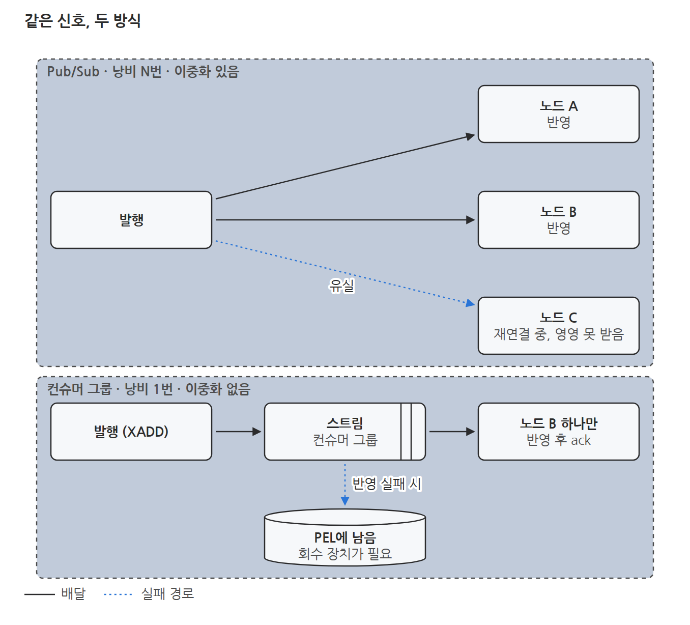

> - 동적 스케줄러 라이브러리 연재 네 번째 글이다. [이전 글](/spring/2026/11/05/dynamic-scheduler-03-DB-행-락-하나로-대표-뽑기.html)에서 부팅 시 대표 한 대를 DB 행 락으로 뽑았다. 이번 글은 런타임 재반영 신호다.
> - 라이브러리가 Boot 2 계열도 지원하는 것을 목표로 해서, Spring Data Redis도 그 시절 버전 기준이다.
> - 이 글은 개인적인 의견을 다룹니다.

# 다루는 내용
- "스케줄 다시 읽어라" 신호를 Pub/Sub에서 Redis Streams 컨슈머 그룹으로 옮기면서

---
## 목차
### 1. "다시 맞춰라"를 어떻게 알릴까?
### 2. Pub/Sub? DB 락? Streams?
### 3. 신호에 무엇을 담을까?
### 4. 신호는 어디서 사라지고, 어디서 두 번 실행될까?
### 5. 컨슈머 그룹이 만든 구멍은?
### 6. 소리 없이 끊기는 곳은 없을까?
### 7. 결과적으로?

---
## 1. "다시 맞춰라"를 어떻게 알릴까?
- DB의 스케줄 행을 고치면 배포 없이 반영하기 위해 클러스터에 "다시 맞춰라"를 알려야 한다. 부팅 때는 노드가 스스로 대조를 진행하지만, 런타임에는 누군가 신호를 줘야 한다.
- 처음에는 가장 간단한 Redis Pub/Sub으로 설계했다. 그러나 문제가 두 가지 있었다.
	1. fire-and-forget이다. 재연결 중이던 노드는 메시지를 못 받고 옛 스케줄로 실행되는데, 예외도 로그도 없다.
	2. N대에 같은 일을 시킨다. 02편의 초기 등록 폭풍과 같은 구조다.

## 2. Pub/Sub? DB 락? Streams?
- 고민한 선택지는 아래와 같다.

1. Pub/Sub 유지
	- 위 두 문제가 여전하다.
2. 부팅과 같은 DB 행 락을 재반영에도 쓴다
	- 신호를 전할 수단은 어차피 필요하다. 그 수단이 컨슈머 그룹이면 이미 한 노드에만 가서, DB 락은 중복 선출이다.
3. Redis Streams + 컨슈머 그룹
	- `XREADGROUP`으로 읽은 엔트리는 그룹 안의 한 컨슈머에게만 가고, `XACK` 전까지 PEL에 있다.

> 결과적으로 **3을 선택했다.** 엔트리가 스트림에 있어서 유실을 막고, 한 노드에만 가서 낭비를 없앤다.

> PEL(Pending Entries List): 컨슈머 그룹에서 "읽어 갔지만 아직 ack되지 않은" 엔트리 목록이다. `XPENDING`으로 엔트리마다 idle(마지막 배달 뒤 지난 시간)을 볼 수 있다.

- 부팅과 수단이 다른 이유는 신호의 유무다. 부팅에는 신호가 없어 DB 행 락이 판정하고, 재반영은 신호를 받는 쪽이 곧 대표다.

*그림 1. Pub/Sub은 모두에게 뿌리고 놓친 노드는 영영 못 받는다. 컨슈머 그룹은 한 노드에만 주고, 실패하면 PEL에 남긴다*

## 3. 신호에 무엇을 담을까?
- 내용은 싣지 않는다. 엔트리는 "맞춰라"뿐이고, 받으면 언제나 DB의 현재 상태로 대조한다.
- 한 번 맞추면 그 전의 요구가 모두 충족되는 level-triggered 신호다.
- 이러한 성질로 아래 동작이 가능하다.
	- 밀린 신호가 10건이어도 반영은 한 번이다.
	- 반영 성공 후 `XTRIM MAXLEN 10`으로 자른다. 맞춘 시점 이전 엔트리는 의미가 없다.
	- 아직 안 읽은 엔트리가 잘려도 괜찮다. `MAXLEN`은 오래된 쪽부터 자르고 최신을 둔다.
	- 부팅 시 PEL에 있던 엔트리는 재처리 없이 ack만 한다. 부팅 동기화가 이미 현재 상태를 반영했다.
- 자르는 것도 수신 쪽이 한다. 발행자에게 맡기면 지켜지는지 확인할 수 없다.

## 4. 신호는 어디서 사라지고, 어디서 두 번 실행될까?
- level-triggered라서 밀림·잘림·중복은 문제가 없다.
- 따져 볼 것은 신호가 반영 없이 끝나거나 두 번 반영되는 경우다. 아래와 같다.
	- 읽고 반영에 실패: 자동 ack를 껐으니 PEL에 있고, 회수 스레드가 집는다(5절).
	- 회수가 처리 중인 엔트리를 집음: 반영이 두 번 실행된다. idle이 주기의 2배를 넘은 것만 집는다.
	- 한 노드에서 리스너·회수가 동시에 반영: 멱등이라 락 경합만 는다.
	- 부팅 노드가 PEL을 정리: 다른 노드가 처리 중인 엔트리까지 ack할 수 있다.
	- Redis 초기화로 그룹이 사라짐: `NOGROUP`으로 그룹은 다시 만들지만 반영은 하지 않는다. 다음 신호까지 옛 스케줄이다.
- 중복 쪽은 멱등으로, 유실 쪽은 수동 ack와 PEL 회수로 막았다. 마지막 경우는 아직 열린 구멍이다. 그룹을 새로 만든 경우에만 한 번 반영하면 닫힌다.

## 5. 컨슈머 그룹이 만든 구멍은?
- **Pub/Sub의 N중 낭비를 버리면서 N중 이중화도 같이 버렸다.**
	- 신호는 한 노드에만 가니, 그 노드의 실패가 곧 클러스터 전체의 실패다.
	- `XREADGROUP`은 스스로 재배달하지 않는다. `ReadOffset.lastConsumed()`로 새 엔트리만 읽어서, 누가 꺼내지 않으면 계속 PEL에 있다.
- 신호 받은 노드가 반영에 실패하는 경우는 아래와 같다.
	- 죽고 새 노드가 뜸: 부팅 동기화가 덮는다.
	- 살아남은 채 반영만 실패, 또는 죽고 새 노드가 뜨지 않음(스케일 다운): 다음 배포까지 옛 스케줄이다.
- 뒤의 경우를 막으려고 회수 스레드를 뒀다.
	1. 주기(기본 60초)마다 `XPENDING`으로 PEL 앞쪽 100건을 보고, idle이 주기의 2배를 넘은 엔트리만 고른다.
	2. 고른 건수와 상관없이 반영은 한 번만 진행하고, 고른 엔트리를 모두 ack한다.
	3. 반영이 실패하면 ack하지 않는다. 재배달이 없으니 idle은 계속 늘고, 다음 주기에 다시 집힌다.
- 2배의 여유는 처리 중인 엔트리를 뺏지 않기 위해서다. 뺏어도 정합성은 깨지지 않지만, 트리거 4,000개면 재반영 한 번이 8.5초라 그 비용을 두 번 내게 된다.
- fixed delay로 실행한다. fixed rate면 회수가 주기보다 오래 걸릴 때 밀린 실행이 연달아 터진다.
- 회수는 부팅 동기화 뒤에만 실행되도록 빈 의존으로 강제했다. 먼저 실행되면 `NOGROUP`으로 실패하거나 이미 반영된 신호를 또 반영한다.

### 컨슈머 이름은 노드별로? 공유?
- 그 버전의 Spring Data Redis에는 `XCLAIM`(다른 컨슈머의 미확인 엔트리를 가져오는 명령)이 없었다. 노드별 이름이면 죽은 노드의 PEL을 가져올 방법이 없다.
- 그래서 이름을 공유했다. PEL이 클러스터 공용이라 회수가 바로 ack한다.
- Redis는 컨슈머 이름이 아니라 읽기 요청 단위로 배분해서, 한 노드에만 주는 성질은 유지된다.
- 단점은 4절의 "부팅 노드가 PEL을 정리" 경우다.

## 6. 소리 없이 끊기는 곳은 없을까?
- Streams로 바꿔도 "예외도 로그도 없이 옛 스케줄"이 되는 경우가 더 있었다.

### 편의 메서드 `receive()`를 쓸까?
- 쓰지 않았다. `receive(consumer, offset, listener)`는 에러가 나면 구독을 취소하는 게 기본값이다.
	- 읽기가 한 번만 실패해도 폴링 루프가 끝나는데, 컨테이너는 running 상태이고 ERROR 로그 한 줄뿐이다.
	- Redis 재시작 한 번이면 실제로 일어난다.
- 그래서 옵션을 직접 잡았다. 아래와 같다.
	- 자동 ack를 끄고, 반영이 끝난 뒤에만 ack한다.
	- 에러가 나도 구독을 취소하지 않는다. 에러 핸들러가 곧 재시도 정책이다.
	- 에러 핸들러에 2초 백오프를 둔다. `NOGROUP`이나 커넥션 거절은 `BLOCK`이 걸리지 않아 대기가 없으면 초당 수천 번 재시도한다.
	- `NOGROUP`이면 그룹을 다시 만든다. 재시작이 필요 없다.

### 켜는 쪽과 보내는 쪽은?
- 기본 꺼짐이다. 켰는데 Redis 커넥션 팩토리가 없으면 시작 시 예외로 세운다. Redis 5.0 이상이 필요하다.
- 락 테이블 DDL을 빠뜨리면 부팅 실패로 드러나지만, 발행을 `PUBLISH`에서 `XADD`로 안 바꾸면 명령은 성공하고 아무도 받지 않는다.
	- 그래서 스위치 두 개로 단계를 나눠 켜도록 안내했다.
- 신호는 커밋 이후에 보내고, 발송이 실패해도 예외를 던지지 않는다. 커밋 전이면 받은 노드가 아직 없는 행을 읽고, 던지면 호출자가 쓰기까지 재시도한다.
- 알람 조건은 하나다. **반영 실패 카운터는 오르는데 회수 카운터가 따라 오르지 않으면, 스케줄이 옛것으로 굳은 것이다.**
	- 다만 회수 자체의 실패는 실패 카운터를 올리지 않아서 이 조건으로는 못 잡는다.

## 7. 결과적으로?
1. 컨슈머 그룹으로 바꾸니 N중 낭비와 함께 N중 이중화도 사라졌다. 낭비라고 부른 것의 절반은 이중화였다.
2. 그 빈자리는 level-triggered 신호와 수동 ack, PEL 회수로 메웠다. Redis가 초기화되는 경우 하나는 아직 열려 있다.
3. `receive()`처럼, 버리려던 문제(소리 없는 구독 종료)가 새 도구의 기본값에 들어 있는 경우도 있었다.

> 이전 글: 03 부팅 시 리더를 DB 행 락 하나로 뽑기 / 다음 글: 05 Quartz를 고른 이유였던 Calendar를 결국 쓰지 않은 이야기
