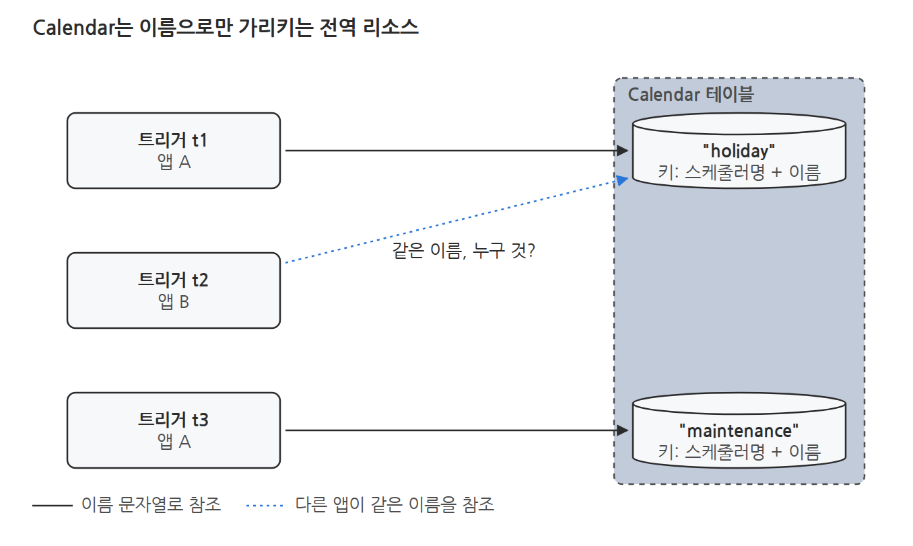
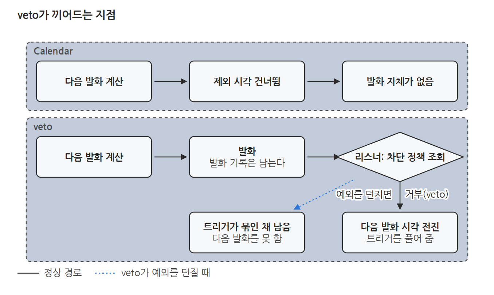

> - 동적 스케줄러 라이브러리 연재 다섯 번째 글이다. [첫 글](/spring/2026/11/01/dynamic-scheduler-01-스케줄을-코드가-아니라-테이블로.html)에서 Quartz를 고른 이유 중 하나가 "실행 제외(Calendar)"였다. 이번 글은 그 Calendar를 결국 쓰지 않은 이야기다.
> - Quartz 2.3 기준이다.
> - 이 글은 개인적인 의견을 다룹니다.

# 다루는 내용
- 특정 기간의 실행을 막는 데 Quartz Calendar 대신 TriggerListener veto를 쓰면서

---
## 목차
### 1. 지우지 말고 막을 수는 없을까?
### 2. Calendar를 열어 보니?
### 3. Calendar? veto?
### 4. 규칙은 어떻게 적을까?
### 5. 리뷰에서 나온 것은?
### 6. 결과적으로?

---
## 1. 지우지 말고 막을 수는 없을까?

"이번 연휴엔 이 배치를 돌리지 않는다", "점검 시간에는 멈춘다" 같은 요구는 배치 스케줄러라면 피하기 어렵다.

- 가장 쉬운 방법은 트리거를 지우는 것이다. 다만 지우면 되살리는 걸 잊는다.
- 그래서 요구를 이렇게 잡았다. **트리거는 살려 둔 채 특정 기간·패턴의 발화만 막는다.**
- 처음 계획은 Quartz Calendar였다. 이름부터 "공휴일 제외"용이고, 01편의 엔진 비교에서 Quartz를 남긴 칸이었다.
- 계획에도 "Calendar 하나를 여러 트리거가 공유하면 바꿀 때 영향이 넓어진다"는 리스크는 적어 뒀다.
- 그러나 이름이 요구사항과 같다고 맞는 기능은 아니었다. 판단을 바꾼 건 **그 기능이 어디에, 어떤 키로 저장되는지**였다.

## 2. Calendar를 열어 보니?

Quartz 배포본의 DDL에서 Calendar 테이블의 키는 `(SCHED_NAME, CALENDAR_NAME)`이 전부였다. 트리거는 캘린더를 이름 문자열로 가리킬 뿐이다. 즉 Calendar는 트리거가 아니라 스케줄러에 매인 전역 리소스였고, 여기서 문제가 두 개 나왔다.

1. **스케줄 단위 제외를 표현할 수 없다.** "이 스케줄만 이 날 제외"를 하려면 스케줄 수만큼 캘린더를 만들어야 한다. 전역 리소스를 이름 규칙으로만 나눠 쓰는 가짜 격리가 된다.
2. **소유권을 판별할 수 없다.** 트리거는 Job 클래스 이름으로 "우리 것"을 구분할 수 있었는데, 캘린더에는 대응하는 컬럼이 없다. `SCHED_NAME`도 같은 스케줄러를 쓰는 다른 앱과 공유된다. 이 상태로 "참조되지 않는 캘린더 정리"를 구현하면 다른 앱이 등록한 캘린더를 부팅마다 지운다.

*그림 1. Calendar는 트리거가 이름 문자열로만 가리키는 전역 리소스라, 같은 이름을 다른 앱이 써도 누구 것인지 알 수 없다*

- 이걸 안 건 구현 초반, 계획 문서에서 실행 차단 쪽을 설계하던 때였다. Job 쪽만 구현돼 있었고 트리거 쪽은 손대기 전이었다.

## 3. Calendar? veto?

대안은 TriggerListener의 `vetoJobExecution`이었다. 발화 직전에 리스너가 차단 정책 테이블을 보고, 막아야 하면 실행을 거부(veto)한다. 정책 행 하나는 대상 트리거, 시작·끝 시각, cron, 설명을 담고, 행을 쓰는 쪽에서는 `DynamicTriggerPolicyDefinition`으로 받는다.

| | Calendar | veto |
|---|---|---|
| 스케줄 단위 제외 | 캘린더를 스케줄 수만큼 | 게이트가 트리거마다 평가해서 문제없음 |
| 소유권 | 판별 수단 없음 | Quartz 테이블에 쓰지 않아 남의 것을 지울 경로 자체가 없음 |
| 발화 계산 | 제외 시각을 애초에 잡지 않음 | 일단 발화한 뒤 실행만 막음 → 차단 창 안에서도 발화 기록이 남음 |

두 문제는 결국 Calendar 테이블에 쓰기 때문에 생긴다. 쓰지 않으면 둘 다 사라진다.

> 결과적으로 **veto 단독을 선택했다.** 차단된 창 안에서도 발화 기록과 `triggerFired`가 남는 시끄러움을 받고, 두 문제를 통째로 없앴다.

- veto를 받아도 Quartz는 다음 발화 시각을 정상적으로 전진시키고 트리거를 풀어 준다.
- 정책 테이블은 처음에 "calendar"라는 이름이었는데, 다음 사람이 `QRTZ_CALENDARS`와 대조되는 무언가로 읽을 것 같아 바꿨다.

*그림 2. Calendar는 발화 시각 계산에서 제외 시각을 빼고, veto는 발화한 뒤 실행만 막는다. veto가 예외를 던지면 트리거가 묶인다*

### veto가 예외를 던지면?
- 절대 던지면 안 된다.
- 리스너가 예외를 던지면 Quartz의 실행 셸이 완료 처리를 하지 않고 빠져나간다. 발화 기록 행이 남고 트리거가 풀리지 않아서, 그 트리거는 다음 발화를 못 한다.
- 정상 veto와 이 상태의 차이는 **try/catch 하나**다. 그래서 게이트 안의 모든 경로를 감쌌다.

## 4. 규칙은 어떻게 적을까?

막는 수단을 정하고 나니 "어떤 규칙을 어떻게 적느냐"가 남았다.

### ALLOW? DENY? 둘 다?
DENY만 골랐다. 행 하나가 차단 창 하나다.
- ALLOW: "행이 없으면 허용"을 특례로 따로 처리해야 한다.
- DENY: "하나라도 걸리면 차단"이 0행에서 특례 없이 false다.
- 둘 다: 우선순위 규칙과 서로 어긋난 행 조합의 방어가 딸려 온다. 그 요구가 나오면 그때 컬럼을 추가하면 된다.

### 평가할 수 없을 때는? 막기? 통과?
DB 조회 실패, cron 파싱 실패처럼 판정 자체를 못 할 때는 통과시키는 쪽(fail-open)을 골랐다.
- WARN 로그를 남기고 그 행은 차단하지 않는다.
- 얻는 것: 판정 분기가 하나로 줄고, 게이트의 고장이 배치를 멈추지 않는다.
- 잃는 것: 잘못 쓴 차단 행이 조용히 아무것도 막지 않는다.
- 게이트 구현은 앱이 교체할 수 있다. 원래는 자기 차단 정책 테이블을 가진 앱을 위해 뺀 자리인데, fail-closed가 맞는 배치도 결과적으로 같은 자리에서 풀 수 있다.

### 규칙 타입 컬럼이 필요할까?
`ONCE / REPEAT / CRON` 타입 컬럼과 요일·시각 컬럼 대신 기간(시작/종료)과 cron 하나만 뒀다. 둘의 조합으로 한 번, 반복, cron이 다 나오고 "기간 한정 반복"도 표현된다.
- 요일 + 시각 컬럼은 cron의 부분집합이다.
- 자정을 넘는 창("금 22시~토 02시")에는 "요일은 시작 요일 기준" 같은 암묵 규칙이 필요하다.
- 타입을 빼면 타입과 컬럼이 어긋난 행이 아예 표현될 수 없다.

### cron은 "발화 시각"? "순간 술어"?
차단 규칙의 cron은 다음 발화를 계산하는 데 쓰지 않는다. 어떤 순간이 조건을 만족하는지만 본다(`CronExpression.isSatisfiedBy`). 그러다 보니 초 필드가 중요해진다.
- `* 0-29 9 ? * MON`은 월요일 09:00:00~09:29:59 구간이다.
- 발화용으로 쓰던 `0 0 9 * * ?`를 그대로 넣으면 하루에 딱 1초만 걸린다.
- 둘 다 유효한 cron이라 예외도 로그도 없다.

계획은 "초 필드가 `*`가 아니면 적재할 때 거부"였지만, 최종 구현은 WARN만 남긴다.
- `0/30 * * * * ?`처럼 그 초에 떨어지는 발화만 골라 막는 것도 유효한 의도라, 거부하면 이 용법까지 막힌다.
- 그래서 "초가 `*`면 구간 차단, 초를 지정하면 발화 마스크"라는 두 용법으로 문서화했다.

### 타임존, 기준 시각, 캐시는?
- **타임존은 트리거 것을 쓴다.** 정책에 타임존 컬럼을 두면 "cron은 KST로 도는데 차단 창은 UTC로 판정"이 표현 가능해진다.
- **기준 시각은 예정 발화 시각이다.** `new Date()`를 쓰면 misfire 복구나 워커 대기 때문에 같은 입력이 다른 판정을 내고, 테스트도 불가능해진다.
- **정책 조회 캐시는 없다.** 발화마다 인덱스 조회 1회를 한다. 정책을 바꾸는 주체가 라이브러리 밖에 있어서, 캐시를 두면 "껐는데 그 뒤에 돌았다"와 분산 무효화가 딸려 온다.
	- cron 파싱 결과만 `표현식 + 타임존` 키로 캐시한다. 값이 바뀌면 키가 바뀌어 무효화 문제가 없다.
	- 발화당 조회 1회의 비용은 따로 재지 않았다. 프로파일링에서 문제가 되면 그때 짧은 TTL을 얹기로 미뤘다.

## 5. 리뷰에서 나온 것은?

veto는 지표·로그와 같은 리스너에 있다. 리스너가 안 붙으면 **실행 차단까지 같이 사라진다.** 리뷰에서 지표를 `SchedulerMetrics` 인터페이스로 빼 Micrometer 의존을 끊은 것을 맞는 판단으로 본 이유도 이것이다. 나온 것은 아래와 같다.
- 리스너를 붙이는 코드가 `javax.annotation.PostConstruct`를 쓰고 있었다. Spring 6(Boot 3)은 `jakarta` 쪽만 봐서 예외도 로그도 없이 호출되지 않는다. 증상이 "돌면 안 되는 날 배치가 그냥 돈다"뿐이라 최고 등급으로 분류했고, `InitializingBean`으로 바꿨다.
- "예정 발화 시각은 misfire가 나도 원래 시각"이라는 문서는 틀렸다. Quartz 소스를 보면 misfire 임계를 넘기면 복구 시각이 된다. 바로잡으려면 misfire 정책을 바꾸거나 원래 슬롯을 따로 계산해야 해서, 이 한계를 문서에 밝히는 데서 멈췄다.
- 파싱에 실패한 정책 cron은 "빈 결과"로 캐시되어 재시작 전까지 다시 파싱하지 않는다. "잘못 쓴 차단 행은 조용히 아무것도 막지 않는다"가 프로세스 수명만큼 지속된다.
- 앱이 Job 파라미터에 라이브러리 내부 키(트리거 식별자)와 같은 이름을 넣으면 게이트가 엉뚱한 정책을 볼 수 있다. 마지막 리뷰에서 낮은 등급으로 남았다.

설계상 열려 있는 항목은 둘이다. 차단된 발화도 발화 기록과 INFO 로그를 남기는 시끄러움, 그리고 잘못 쓴 차단 행을 어떻게 드러낼지.

## 6. 결과적으로?

1. Calendar는 이름이 요구사항과 같았고 Quartz를 고른 이유 중 하나였지만, 키가 `(SCHED_NAME, CALENDAR_NAME)`뿐인 전역 리소스라 결국 쓰지 않았다. 판단을 바꾼 건 기능 이름이 아니라 저장 구조였다.
2. Quartz 테이블에 아무것도 쓰지 않는 veto 게이트로 바꾸면서 두 문제가 같이 사라졌다. 대가는 차단된 창에도 발화 기록이 남는 시끄러움이다.
3. 게이트는 DENY 전용, 평가 불가는 통과, 예외 금지로 잡아 고장 나도 배치를 멈추지 않게 했다. 다만 잘못 쓴 차단 행이 조용히 아무것도 막지 않는 trade-off가 있다.

> 이전 글: 04 — 재반영 신호를 Redis Streams로. / 다음 글: 06 — Boot 2와 3에서 같이 쓰는 라이브러리를 만들며, 조용히 실패하는 경로를 시끄럽게.
