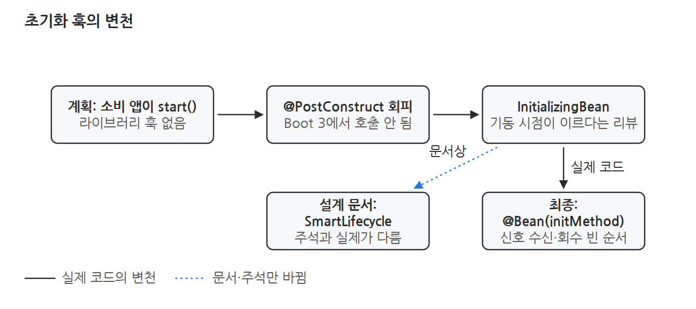

> - 동적 스케줄러 라이브러리 연재 여섯 번째이자 마지막 글이다. 01~05편이 스케줄러의 설계였다면, 이번 글은 그걸 **다른 앱이 가져다 쓰는 라이브러리로 만들면서** 정한 것들이다.
> - 이 글은 개인적인 의견을 다룹니다.

# 다루는 내용
- 스케줄러를 Boot 2·3 겸용 라이브러리로 설계하면서, 예외 없이 무시되는 경로를 기동 실패로 바꾼 결정들

---
## 목차
### 1. 앱 코드였다면 안 해도 될 결정?
### 2. 아티팩트는 하나? 둘?
### 3. 조용한 실패를 어떻게 시끄럽게?
### 4. 계획과 달라진 곳은?
### 5. 남은 것은?
### 6. 결과적으로?

---
## 1. 앱 코드였다면 안 해도 될 결정?

스케줄러는 한 앱 안의 코드가 아니라 의존성으로 가져다 쓰는 라이브러리로 설계했다. 목표는 한 아티팩트로 Boot 2.x(Java 8)와 3.x 양쪽에서 쓰는 것이었다.

초기 상태를 점검해 보니 실패하는 방식이 대부분 조용했다.
- 의존성이 전부 `compileOnly`라 POM에 흔적이 없다. 앱에서 컴파일은 되고 부팅에서 `NoClassDefFoundError`가 난다.
- 필드 초기화로 둔 프로퍼티가 바인딩되지 않는다. yaml에 써도 예외 없이 무시된다.
- `Scheduler` 타입 빈이 둘이라, 앱이 필드 이름을 다르게 지으면 주입이 실패한다.

라이브러리는 내가 모르는 앱의 환경에서 돈다. 거기서는 원인과 먼 곳에서 터지거나 아예 안 터진다. 그래서 결정의 기준을 하나로 잡았다. **예외 없이 무시되는 경로를 기동 실패로 바꾼다.**

## 2. 아티팩트는 하나? 둘?

1. Boot 2용과 3용을 따로 낸다.
2. 하나로 낸다.

Boot 2 계열로 컴파일하고 Java 8 바이트코드로 내면 Java 17 런타임에서도 돈다. 걸리는 건 애노테이션과 패키지 이동뿐이라 따로 낼 이유가 없었다.

> 결과적으로 **2를 선택했다.** 대신 그 "걸리는 것"을 하나씩 피해야 했다.

- **프로퍼티 바인딩**: `@ConstructorBinding`은 Boot 3.0에서 패키지를 옮겨, 2.x 것을 참조하면 3 런타임에 없다. 그래서 불변 바인딩을 버리고 JavaBean 바인딩으로 갔다.
- **데이터 접근**: `javax`/`jakarta` 의존을 줄이려고 JPA 대신 JDBC를 썼다. 통합 테스트는 실제 MySQL 컨테이너에서 돌렸다. H2로는 `ON DUPLICATE KEY UPDATE`, 복합 FK, JSON 컬럼을 검증할 수 없다.
- **초기화 훅**: `javax.annotation.PostConstruct`는 Spring 6에서 예외가 아니라 **호출이 안 된다**(05편).
- **의존성 스코프**: Spring 계열은 `compileOnly`로 두어 버전을 강요하지 않는다. Quartz도 처음엔 `compileOnly`였는데, 부팅에서야 터진다는 지적이 나와 버전 없는 전이 의존으로 돌렸다. 실제 버전은 앱의 Boot BOM이 정한다.

## 3. 조용한 실패를 어떻게 시끄럽게?

같은 기준을 빈과 테이블에도 적용했다.

- **테이블**: DDL은 앱이 적용한다. 빠뜨리면 첫 동기화에서 SQL 오류로 터지는데, 그때는 스케줄러가 이미 떠 있어 원인이 흐려진다. 그래서 기동 시 메타데이터를 조회해 없는 테이블을 **모아서** 한 번에 알린다. 하나씩 알리면 DDL을 돌릴 때마다 다음 것이 나온다. 선택 기능의 테이블은 그 기능을 켰을 때만 본다.
- **스키마 프로퍼티**: 따로 받으면 "한쪽만 지정된" 상태가 생긴다. 하나로 두고, SQL에 문자열로 붙으니 조립 시점에 식별자 문법을 검사한다.
- **DataSource**: 타입으로 주입하면 Quartz와 다른 DataSource를 집을 수 있어 이름으로 고른다. Quartz가 보는 DB와 라이브러리 테이블의 DB가 같아야 대조가 성립한다.
- **관측**: `@ConditionalOnMissingBean`은 자동 설정 클래스 밖에서는 평가 순서에 기대고, 어긋나면 예외 없이 지표만 빈다. 그래서 Micrometer 구현과 NoOp 구현을 `@ConditionalOnClass`/`@ConditionalOnMissingClass`로 배타적으로 갈랐다. 이 리스너는 실행 차단도 쥐고 있다(05편).
- **빈 중복**: `WebEndpointProperties`를 새로 만들면 Boot 자동 설정이 두 개를 보고 `NoUniqueBeanDefinitionException`으로 앱이 안 뜬다. 그래서 `BeanPostProcessor`로 기존 빈을 고쳤다. `Scheduler` 빈도 FactoryBean이 노출하는 하나만 둔다. 이후 관리 모듈이 등록한 `JdbcTemplate`도 앱의 타입 주입 후보에서 제외했다.
- **켠 기능의 전제**: Redis 수신을 켰는데 커넥션 팩토리가 없는 것처럼 확인할 수 있는 건 기동을 세운다. 확인할 수 없는 건 문서에 "조용히 실패한다"고 적었다(04편).

| 함정 | 원래 증상 | 바꾼 뒤 |
|---|---|---|
| 의존성 전부 compileOnly | 컴파일 OK, 부팅에서 NoClassDefFoundError | Quartz는 버전 없는 전이 의존 |
| 필드 초기화 프로퍼티 | yaml에 써도 무시 | JavaBean 바인딩 |
| `javax` PostConstruct | Boot 3에서 호출 안 됨(무증상) | InitializingBean → initMethod |
| 테이블 없음 | 첫 동기화에서 SQL 오류 | 기동 시 없는 테이블을 모아서 예외 |
| 관측 OnMissingBean | 순서 어긋나면 지표만 빔 | OnClass/OnMissingClass 배타 |
| Scheduler 빈 둘 | 필드 이름에 따라 주입 실패 | 빈 하나 |

## 4. 계획과 달라진 곳은?

세 군데가 계획과 다르게 끝났다.

**자동 설정**
- 계획: 등록 파일을 두 개 다 넣는다. `spring.factories`는 3.0에서 자동 설정 용도로 제거됐고, `.imports`는 2.5에 없다. 한쪽만 넣으면 절반의 앱에서 예외 없이 빈이 하나도 뜨지 않는다.
- 최종: 등록 파일이 없다. 앱이 `@Import(SchedulerConfig.class)` 한다. 구현 점검과 커밋 정리 기록에 "정할 것"으로 남아 있고, 정한 기록은 없다.
- 이후 만든 관리 모듈은 처음부터 `.imports`를 넣었다.

**기동 주체**
- 계획: "기동은 앱이 부른다"를 닫힌 결정으로 적었다. 마이그레이션, 워밍업 같은 선행 조건을 라이브러리가 알 수 없기 때문이다. 대가로 적은 것은 "안 부르면 아무 일도 일어나지 않고, 아무도 모른다"였다.
- 구현 중간: 기동을 부르는 코드가 한 군데도 없어서 스케줄러가 아예 뜨지 않는 상태였다. 계획이 적은 대가 그대로다.
- 최종: 라이브러리가 빈 초기화 시점에 동기화와 기동을 스스로 한다. 계획이 걱정한 선행 조건 문제는 아래 "컨텍스트가 다 준비되기 전에 발화할 수 있다"로 남았다.

**초기화 훅**: 아래 그림처럼 여러 번 바뀌었다.

*그림 2. 초기화 훅은 계획의 라이브러리를 쓰는 앱의 호출에서 InitializingBean을 거쳐 @Bean(initMethod)로 끝났고, SmartLifecycle은 문서와 주석에만 있었다*

- 주석은 "SmartLifecycle이라 모든 싱글턴 생성 후 기동"이라고 적혀 있었는데, **실제로는 빈 생성 시점에 기동**하고 있었다. 주석을 고쳤고, 방식은 유지했다.
- 유지한 이유는 Redis 수신과 회수 빈이 "매니저 빈이 있으면 부팅 반영이 끝났다"를 전제로 조립되기 때문이다. 기동을 lifecycle 단계로 미루면 신호 수신이 부팅 반영보다 먼저 시작된다. 미루는 수정도 시도했지만 이 의존 때문에 되돌렸다.
- 그래서 "컨텍스트 refresh가 끝나기 전에 발화할 수 있다"는 지적은 구조상 그대로다.
- 같은 `PostConstruct` 함정을 `QuartzSchedulingManager`에서는 피하고 리스너 설정에서는 밟았다. 리뷰는 이걸 "결론이 코드 전체에 적용됐는지 확인하는 절차가 없다는 신호"로 봤다.

## 5. 남은 것은?

- **"Boot 2.x·3.x 모두 지원"은 아직 검증되지 않은 주장이다.** 테스트는 Boot 2 플랫폼에서만 돈다.
- 관측을 프로퍼티로 끄면 지표 빈이 없어져 부팅이 실패할 수 있다.
- 지표 태그 4종(트리거·Job의 그룹과 이름)이 붙어 시계열 수가 트리거 수 × 미터 6종이 된다. 트리거 단위 태그를 유지할지, Job 단위까지만 둘지는 "결정해 둘 것"으로만 남아 있다.
- Duration 프로퍼티를 단위 없이 쓰면 ms로 해석되고 경고가 없다.
- 지원 MySQL 버전과 커넥션 풀 최소 크기 같은 기동 요건이 문서에 아직 없다.

## 6. 결과적으로?

1. 라이브러리에서는 애노테이션도, 프로퍼티도, 조건부 빈도 실패할 때 예외 없이 무시되는 경우가 많았다. 그래서 설계의 기준을 기능보다 **실패가 드러나는 방식**에 두었고, 확인할 수 있는 건 기동 실패로 바꿨다.
2. 그 기준이 끝까지 지켜지지는 않았다. 자동 설정은 계획과 달리 빠졌고, 같은 `PostConstruct` 함정을 한 클래스에서 다시 밟았고, Boot 3 지원은 검증 전이다.

> 이전 글: 05 — Calendar 대신 veto.
> 동적 스케줄러 연재는 이 글로 마친다. 01~05편이 스케줄러의 설계, 이 글이 그 스케줄러를 라이브러리로 내면서 정한 것이었다.
