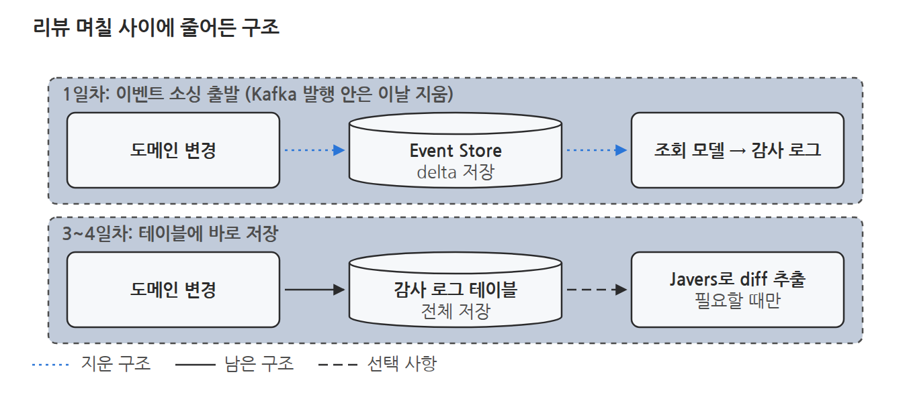
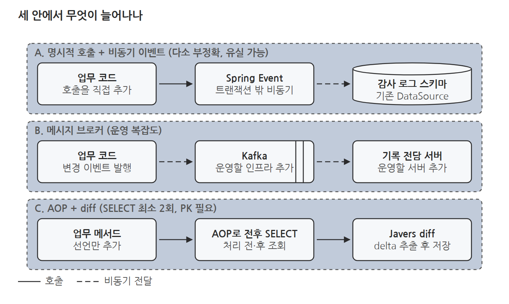
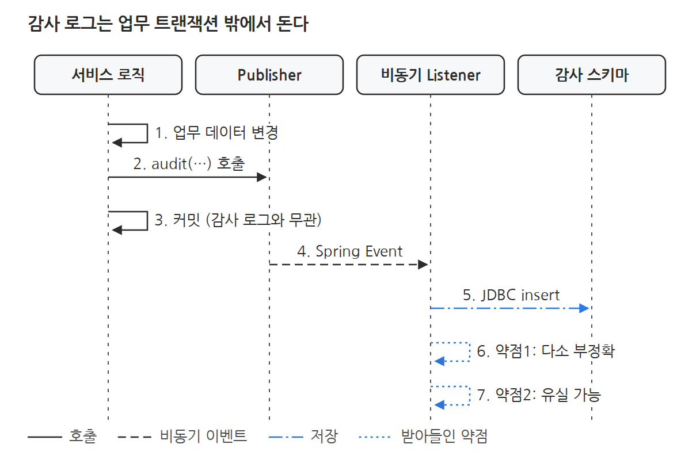

> - 이 글은 개인적인 의견을 다룹니다.
> - 테이블·스키마 이름은 일반 명칭으로 바꿨습니다.

# 다루는 내용
- 레거시에 범용 감사 로그를 붙이면서 이벤트 저장소 안이 라이브러리 하나로 줄어든 과정과, 그 과정에서 받아들인 약점

---

## 목차
### 1. 누가 바꿨는지 알 수 없다면?
### 2. 처음엔 이벤트 저장소?
### 3. 명시적 호출? 브로커? AOP?
### 4. A안, 그리고 받아들인 약점은?
### 5. 미뤄 두기 쉬운 세 가지는?
### 6. 라이브러리로 내보낼 때 걸린 것은?
### 7. 그 뒤로는?
### 8. 결과적으로?

---

## 1. 누가 바꿨는지 알 수 없다면?
- 등록·수정이 많이 일어나는 레거시 시스템인데, 누가 언제 어디서 무엇을 바꿨는지 확인하기 어렵다.
- 운영 쪽에서 "이 값 누가 바꿨나?"라는 확인 요청이 반복해서 들어온다.
	- 이력 테이블이 있는 곳도 있지만, 있어도 직전 상태만 알 수 있다.
	- 이력을 쌓으려고 비즈니스 로직을 대대적으로 고치기도 어렵다. 로직이 이미 복잡하다.
- 그래서 설계 문서에 목표와 비목표부터 정리했다.
	- 목표: 범용 감사 로그 체계, 현재 인프라(RDB, 캐시) 유지, 복잡도를 높이지 않기
	- 비목표: 기존 로직의 대대적 수정, 운영 복잡도가 올라가는 방식
- 이후 선택지를 고민할 때마다 이 비목표 두 줄을 기준으로 삼았다.

## 2. 처음엔 이벤트 저장소?
- 처음 낸 안은 이벤트 소싱 방향이었다.
	- 도메인별 이벤트 저장소에 변경 이벤트(delta)를 쌓고, 이걸 조회용 모델로 바꿔 감사 로그로 쓰는 구조다.
	- Kafka로 발행해 전달하는 안도 있었지만 첫날 지웠다.
- 리뷰를 진행하면서 이 안은 이틀 만에 줄었다.
	- 이벤트를 저장하는 것 자체가 부담이 될 수 있다는 판단이 나와서, 이벤트 저장소 없이 감사 로그 테이블에 바로 쓰기로 했다.
	- payload도 delta만 쌓던 방향에서 전체를 쌓는 쪽으로 바꿨다.
- 그다음 날에는 변경분이 꼭 필요하면 Javers(객체 간 diff를 뽑아 주는 라이브러리)로 뽑을 수 있다는 의견이 나왔다.
	- 최종 설계 문서에서 Javers는 C안(AOP + diff)에만 남았다.

*그림 1. 이벤트 저장소에서 출발한 구조가 리뷰 며칠 사이에 감사 로그 테이블 하나로 줄었다*

## 3. 명시적 호출? 브로커? AOP?
- 설계 문서에 최종적으로 남은 안은 아래와 같다.

1. A안: 명시적 호출 + 비동기 이벤트
	- 감사 로그 메서드를 직접 호출하면 Spring Event로 비동기 발행하고, JDBC로 별도 스키마에 저장한다. 패키지로 배포한다.
	- 장점
		- 여러 프로젝트에서 공용으로 쓴다.
		- 각 프로젝트의 기존 DataSource를 쓴다.
		- 액션과 대상이 명확하다.
		- 기존 흐름을 막지 않는다.
	- 단점
		- 호출을 직접 넣고, 이벤트와 PK를 수동으로 넘긴다.
		- 전체 상태를 기록하므로 PII 처리가 필요하다.
		- 같은 트랜잭션에서 돌지 않아 다소 부정확하다.
		- 저장 중 JVM 오류로 유실되면 알 방법이 없다.
2. B안: 메시지 브로커
	- Kafka로 변경 이벤트를 발행하고, 별도 서버가 기록한다.
	- 장점: 기록과 처리를 한 곳에서 전담한다.
	- 단점: 관리형으로 써도 운영 복잡도가 높다.
3. C안: AOP + diff
	- AOP로 처리 전후를 SELECT하고 Javers로 delta를 추출한다.
	- 장점: 선언만으로 쌓인다. 변경분이 한눈에 보인다.
	- 단점: SELECT가 최소 두 번 필요하다. 메서드 인자나 리턴 값에 PK가 있어야 한다.

- 고민한 기준은 두 가지였다.
	- 기존 코드에 얼마나 손대야 하는가?
	- 운영할 인프라가 늘어나는가?
- 기준에 대 보면 아래와 같다.
	- A: 업무 코드에 호출을 넣어야 한다. 인프라는 기존 DataSource만 쓴다.
	- B: 브로커와 기록 서버가 늘어난다. 두 번째 비목표와 정면으로 부딪힌다.
	- C: 코드 수정이 가장 적어 보이지만, PK가 없는 메서드에는 붙일 수 없고 호출마다 조회가 늘어난다.

*그림 3. B는 운영할 인프라가, C는 호출마다 조회가 늘고, A는 업무 코드에 호출을 넣는 대신 기존 인프라만 쓴다*

## 4. A안, 그리고 받아들인 약점은?
> 결과적으로 **A안을 선택했다.** 비목표 두 줄에 가장 잘 맞았다.

- 리뷰 중간에 원칙을 따로 정리했다.
	- 감사 로그 저장의 실패는 비즈니스 로직의 성공·실패와 무관해야 한다.
	- 감사 로깅은 기존 로직이 성공했을 때 동작하되, 기존 로직의 성공 여부에는 관여하지 않는다.
	- 업무 스키마와 감사 로그 스키마를 분리한다.
	- 구현은 먼저 한 프로젝트 안에서 진행하고, 이후 패키지로 옮긴다.
- 약점은 문서에 명시하고 받아들였다.
	- 트랜잭션 밖에서 비동기로 돌기 때문에 다소 부정확할 수 있다.
	- 저장 중 JVM이 죽으면 유실될 수 있다.
	- 명시적 호출 방식이라 호출을 넣지 않은 곳은 기록도 없다.
- 감사 로그 때문에 업무 요청이 실패하는 것보다는, 감사 로그가 빠지는 쪽을 택했다.

*그림 2. 업무 트랜잭션은 먼저 커밋되고, 감사 로그는 비동기 이벤트로 트랜잭션 밖에서 저장된다*

### 테이블과 메타는?
- 테이블은 최소한으로 잡았다. 컬럼을 역할로만 보면 아래와 같다.
	- 식별 키, 업무 카테고리, 대상 테이블
	- 동작(event type)
	- 전문(payload, JSON)과 감사 메타(meta, JSON)
	- 기록 시각
- 메타에는 네 가지를 넣는다.
	- 요청 단위 상관관계 ID: 애플리케이션 로그에도 같이 남긴다.
	- 사용자 식별 최소값
	- 동작 위치(서비스·클래스·메서드)
	- 시각

## 5. 미뤄 두기 쉬운 세 가지는?
- 설계 문서 끝에 "추가 논의 필요"로 남은 항목이 세 개 있었다. 리뷰에서 각각 한 줄짜리 결론을 냈다.
	- PII 처리: payload를 통째로 암호화한다.
	- Spring Event 유실: 유실 시 로그를 남긴다.
	- 보존 기간과 파티셔닝: 3개월 보존, 파티셔닝은 추후 진행한다.
	- 추가로 상관관계 키는 MDC의 correlation key를 쓴다.
- 물론 결론마다 단점이 있다.
	- payload를 통째로 암호화하면 payload 안의 값으로는 검색할 수 없다.
		- 조회는 내부 운영 도구에서 확인하는 용도다.
		- 리뷰 초안에서 잡은 인덱스는 식별 키, 그리고 동작과 시각이다.
	- 유실 시 로그를 남겨도 유실 자체는 막지 못한다. 유실이 났다는 것만 알 수 있다.

## 6. 라이브러리로 내보낼 때 걸린 것은?
- 여러 프로젝트에서 쓰려면 Spring Boot 2.x와 3.x를 둘 다 받아야 한다.
	- Spring 의존성은 `compileOnly`로 두어 쓰는 쪽 버전을 따르게 했다.
	- 설계 문서 기준으로 `implementation`은 JDBC 스타터 하나다. context, tx, autoconfigure, jackson은 모두 `compileOnly`다.
	- 활성화 방식은 AutoConfiguration과 `@Enable…` 두 가지를 놓고 고민했다.
- 나중에 고친 것도 있다.
	- 라이브러리가 쓰는 `JdbcTemplate`을 쓰는 쪽 애플리케이션의 타입 주입 후보에서 제외했다.
	- 라이브러리가 등록한 빈 하나가 쓰는 쪽의 주입에 끼어들 수 있다.
	- 이 수정은 [동적 스케줄러 06편](/spring/2026/11/11/dynamic-scheduler-06-라이브러리로-배포할-때-조용한-실패.html)의 관리 모듈과 같이 진행했다.

## 7. 그 뒤로는?
- 리뷰 시작부터 결론 정리까지 약 1주가 걸렸다. 라이브러리는 그다음 날 올렸고, 첫 머지까지 약 3주가 걸렸다.
- 이후 다른 서비스 하나에 이 라이브러리가 적용됐다(감사 로그 테이블 추가 포함).
- 같은 시기에 만든 다른 기능의 변경 이력은 이 라이브러리 없이 별도 이력 테이블로 구현됐다. 둘을 나란히 놓으면 아래와 같다.
	- 저장 형태: 감사 로그는 전체 상태, 그쪽은 직전 값 Snapshot이다. 둘 다 Delta는 택하지 않았다.
	- 트랜잭션: 그쪽 이력은 변경과 같은 트랜잭션에 묶여서, 변경이 롤백되면 이력도 같이 롤백된다. 감사 로그는 트랜잭션 밖에서 돈다.
- 적용 후 이력 확인 요청이 얼마나 줄었는지는 재지 못했다.

## 8. 결과적으로?
1. 이벤트 소싱에서 출발했지만, 목적을 감사 로그 하나로 좁히자 이벤트 저장소와 브로커가 빠지고 라이브러리 하나가 남았다.
2. 트랜잭션 밖 비동기라 부정확할 수 있고 유실될 수 있다는 약점은 남았다. 이를 문서에 명시하고 기존 코드와 인프라를 건드리지 않는 쪽을 택했다. 정확성을 조금 내주고 레거시를 지킨 trade-off다.
3. 다만 변경과 이력이 같이 롤백돼야 하는 기능이라면, 이 라이브러리로는 그걸 보장할 수 없다.
