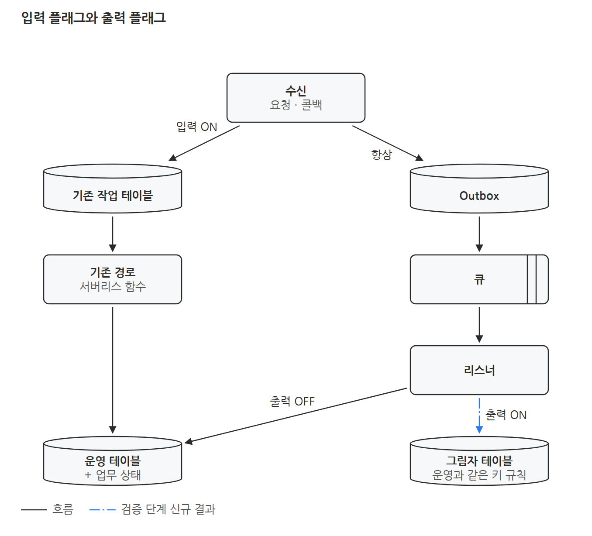
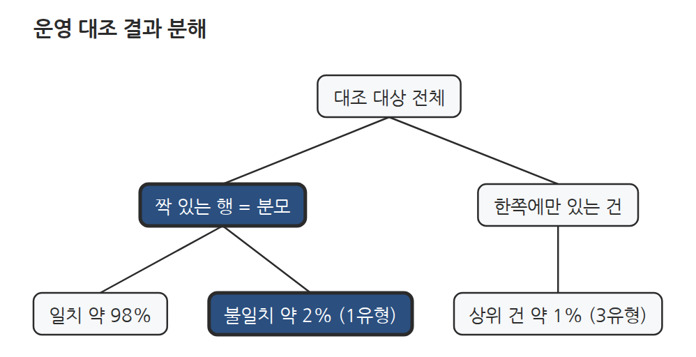

> - [이전 글](/migration/architecture/2026/10/10/migration-01-서버리스-연동을-상주-애플리케이션으로.html)에서 트래픽 분할 롤아웃을 버리고 병행 기록으로 갔다. 이번 글은 그 병행 기록을 어떻게 구성했는지다.
> - 무엇을 하는 시스템인지는 일반화했다. 이 글은 개인적인 의견을 다룹니다.

# 다루는 내용
- 새 코드의 결과를 운영에 반영하지 않고 따로 쌓아, 기존 결과와 건별로 대조해 전환 여부를 정한 구조

---
## 목차
### 1. 검증할 방법이 있었나?
### 2. 한 번에? 분할? 병행 기록?
### 3. 플래그 하나면 안 되나?
### 4. 실제로 붙여 보니?
### 5. 대조 결과는?
### 6. 결과적으로?

---
## 1. 검증할 방법이 있었나?
- 로직을 새 코드로 옮길 때 확인해야 할 건 "옮긴 코드가 예전과 같은 결과를 내는가"다.
- 그런데 초기 설계 문서에서 이 걱정은 리스크 항목 한 줄, "기존 동작과 달라짐 및 서비스 장애"가 전부였다.
- 리뷰가 짚은 것도 이 부분이다. 트래픽 분할로는 같은 결과를 내는지 **검증할 수 없다.**
	- 분할끼리 대조하면 서로 다른 데이터의 통계를 비교하게 된다.
	- 로직을 옮기며 생긴 건 단위 차이는 잡을 수 없다.
- 기존 구조는 대조할 과거도 남기지 않았다.
	- 성공하면 작업 행을 지워서, 어떤 항목이 실제로 처리됐는지 나중에 확인하기 어렵다.
	- 오류 행 하나가 같은 분할의 뒤 항목을 계속 막는 알려진 결함도 있었다.
	- 이 연동 결과로 업무 상태를 정하기 때문에, 틀리면 상태가 곧바로 틀어진다.

## 2. 한 번에? 분할? 병행 기록?
- 검증 방법으로 고민한 안은 아래와 같다.

1. 한 번에 전환
	- 초기 문서에 대안으로 한 줄만 있다.
	- 채택안의 장점으로는 병용 기간 동안 오작동하면 기존 함수로 fallback할 수 있다는 점을 꼽았다. 한 번에 전환하면 이 fallback이 없다.
2. 트래픽 분할 롤아웃
	- 분할을 하나씩 옮기고, 옮긴 분할과 안 옮긴 분할의 건수·상태 분포를 비교한다.
	- 위 지적대로 결국 분포 비교다.
3. Feature Flag로 발행만 제어, 병행 기록 없음
	- 재배포 없이 바로 롤백할 수 있다.
	- 다만 이 안을 낸 쪽도 운영에서 양쪽 결과를 대조할 방법이 없다는 한계를 인정했다.
4. 병행 기록 + Feature Flag로 Shadow 대조
	- 같은 입력을 기존 흐름과 새 흐름에 함께 흘리고, 결과를 따로 쌓아 건별로 비교한다.

- 2안과 4안은 비교 대상부터 다르다. 2안은 다른 데이터의 분포를, 4안은 같은 데이터의 결과를 본다.
- 3안과 4안은 얻는 게 다르다.
	- 3안은 롤백만 주고 대조는 주지 않는다.
	- 4안은 대조를 얻는 대신 격리 테이블, 플래그 두 개, 식별자 우회처럼 나중에 걷어낼 것을 떠안는다.

> 결과적으로 **4안을 선택했다.** 롤백 수단(플래그)과 대조 수단(병행 기록)은 서로 다른 것이고, 이관에서 먼저 필요한 건 후자다.

## 3. 플래그 하나면 안 되나?
- 처음 떠올리기 쉬운 건 "신규를 켠다/끈다" 플래그 하나다. 이 구성이면 새 결과를 쌓는 순간 운영에도 반영된다.
- 그래서 플래그를 둘로 나눴다.
	- 입력 플래그: 기존 흐름을 계속 돌릴지 정한다.
		- ON: 기존 작업 테이블과 Outbox에 모두 기록하고, 두 흐름이 다 진행된다.
		- OFF: 기존 흐름을 멈춘다.
	- 출력 플래그: 새 결과를 실제로 반영할지 정한다.
		- ON: 큐로 받은 결과를 그림자 테이블에만 기록한다. 운영 원장과 업무 상태는 건드리지 않는다.
		- OFF: 운영 테이블에 반영하고 업무 상태를 갱신한다.
- Outbox는 플래그와 상관없이 항상 기록한다.
	- 검증 단계는 ON/ON이다. 실제 반영은 기존 흐름이 하고, 새 결과는 그림자 테이블에 쌓인다.
	- 전환은 OFF/OFF다. 검증 → 전환 → 정리를 플래그 조작만으로 진행할 수 있다.

> 그림자 테이블: 새 코드의 결과만 따로 받아 두는 격리 테이블이다. 운영 데이터에는 영향을 주지 않고, 대조에만 쓴다.

- 대조 키도 고민한 부분이다. 그림자 테이블의 유니크 키를 운영 테이블과 같은 규칙으로 만들었다. 키 규칙이 다르면 대조 자체가 안 된다.
- 플래그는 테스트 계획을 처음 쓸 때부터 둘이었다. 다만 입력 플래그의 뜻은 구현하면서 바뀌었다.
	- 처음: ON이면 기존 작업 테이블, OFF면 Outbox에 쓰는 양자택일
	- 나중: Outbox는 항상 쓰고, ON이면 기존 테이블에도 같이 쓴다.
- 걷어낼 것은 처음부터 목록으로 만들었다. 플래그와 분기, suffix, 그림자 테이블, 기존 테이블·프로시저, 기존 수신 API, 함수와 스케줄 규칙이다.

*그림 1. 입력 플래그는 기존 흐름을 계속 돌릴지, 출력 플래그는 새 결과를 그림자 테이블과 운영 테이블 중 어디에 쓸지를 가른다.*
| 단계 | 입력 | 출력 | 실제 반영 | 새 결과 |
|---|---|---|---|---|
| 검증 | ON | ON | 기존 흐름 | 그림자 테이블 |
| 전환 | OFF | OFF | 새 흐름 | 운영 테이블 |
| 정리 | 플래그·분기 제거 | | | |

## 4. 실제로 붙여 보니?
### 개발 환경에서는?
- 기존 서버리스 함수가 환경별로 나뉘어 있지 않아서, 개발 환경에는 기존 흐름을 띄울 수 없었다.
- 개발 환경에서는 큐에 메시지를 직접 넣는 실패 처리 테스트만 하고, 병렬 대조는 스테이징부터 했다.

### 수신처가 하나뿐이라면?
- 연동처는 한 식별자에 한 수신처만 허용한다. 같은 식별자로 두 곳에서 콜백을 받을 수 없다.
- 그래서 새 흐름으로 등록하는 건에는 식별자 뒤에 suffix를 붙여 별개 건으로 등록하고, 수신 측에서 구분했다.
- 대신 나중에 정리할 것이 하나 늘었다.

### INSERT IGNORE는 괜찮나?
- shadow insert가 `INSERT IGNORE`라서, 그림자 테이블의 컬럼 폭이 원본과 다르면 `Data too long`이 경고로만 지나간다.
	- 대조 결과는 "일치"로 보이는데 실은 잘려 들어간 값일 수 있다.
	- 그래서 컬럼 정의를 원본과 미리 맞췄다.
- 숫자 컬럼의 범위 초과(`Out of range`)도 검증 중에 만났다. 해당 컬럼을 `int`로 넓히는 변경을 같이 정리했다.

### 빈틈은 없었나?
- 검증 중에 하나를 찾았다. 수신 API가 Outbox에 기록한 뒤 큐로 발행하는 사이에 장애가 나면 발행이 유실될 수 있다.
- 그래서 발행 중·실패 상태로 남은 건을 다시 보내는 처리를 넣었다.

## 5. 대조 결과는?
- 대조는 스테이징에서 먼저 돌리고, 그다음 운영에서 병행으로 돌렸다.

### 스테이징에서는?
- 두 플래그를 ON으로 두고 같은 건을 양쪽에 등록했다. 1차는 실패했고, 수정한 뒤에 성공했다.
- 결과는 아래와 같다.
	- 새 흐름: 콜백 9건이 발행돼 9건 모두 수신·삭제됐다. DLQ와 큐 잔량은 둘 다 0이다.
	- 기존 흐름: 같은 9건이 처리되고 업무 상태 전이까지 확인했다.

> DLQ(Dead Letter Queue): 정해진 횟수만큼 처리에 실패한 메시지를 따로 옮겨 두는 큐다.

- 그런데 그림자 테이블에는 **6행**만 있었다.
	- 빠진 건 없다. 멱등 키로 접힌, 의도한 중복 제거다.
	- 건수와 행 수는 다를 수 있으니, 행 수만 보고 누락으로 읽으면 안 된다.

### 운영 병행에서는?
- 업무 식별자와 이력 멱등 키를 묶어 대조 키로 썼다.
- 양쪽에 짝이 있는 행 중 **약 98%가 일치**했다. 분모는 전체 행이 아니고 짝이 있는 행이다.
- 나머지 약 2%의 불일치는 모두 한 유형, 같은 이벤트가 한 번 더 들어온 경우였다.
	- 이력 멱등 키에 시각이 없어서 양쪽이 각자 먼저 처리한 건만 남았다. 문제 없음으로 봤다.
	- 이후 멱등 키에 이벤트 상세 값의 해시를 붙이는 후속 수정을 넣었다.
- 한쪽에만 있는 상위 건도 약 1% 있었다. 유형은 아래와 같다.
	- 식별자를 공유하는 건
	- 특정 연동 대상의 첫 이벤트
	- 하나의 상위 건에 하위 항목이 여럿인 경우(과반)
- 결론은 방향별로 갈렸다.
	- 수신(큐 적재) 쪽: 새 흐름만으로 운영할 수 있다.
	- 전송(등록) 쪽: 하위 항목이 여럿인 건에서 하나만 처리되는 게 보여서, 기존 전송을 끄기 전에 확인이 필요하다.

*그림 2. 98%는 짝이 있는 행이 분모이고, 불일치 2%는 한 유형이다. 한쪽에만 있는 1%는 상위 건 기준이다.*

## 6. 결과적으로?
1. 롤백 수단과 대조 수단은 따로 필요했다. 입력 플래그와 출력 플래그를 나누고 Outbox를 항상 기록해서, 검증 → 전환 → 정리를 플래그 조작만으로 진행하게 했다.
2. 불일치는 비율보다 유형으로 나눠 봤고, 전환 여부는 수신·전송 방향별로 따로 정했다.
3. 비어 있는 것도 있다. **전환을 정하는 사전 수치 기준**(일치율·누락률 임계값, 관찰 기간)을 미리 정하지 않았다.
	- 문서에는 "누락 비율을 확인", "정상 작동한다고 판단될 시"까지만 있다.
	- 이번에는 불일치가 모두 설명할 수 있는 한 유형이라 정할 수 있었다.

> [이전 글: 01. 서버리스 연동을 상주 애플리케이션으로 옮기는 구조](/migration/architecture/2026/10/10/migration-01-서버리스-연동을-상주-애플리케이션으로.html) / [다음 글: 03. FIFO를 권유받고 Standard를 골랐다](/migration/architecture/2026/11/16/migration-03-FIFO를-권유받고-Standard를-골랐다.html)
