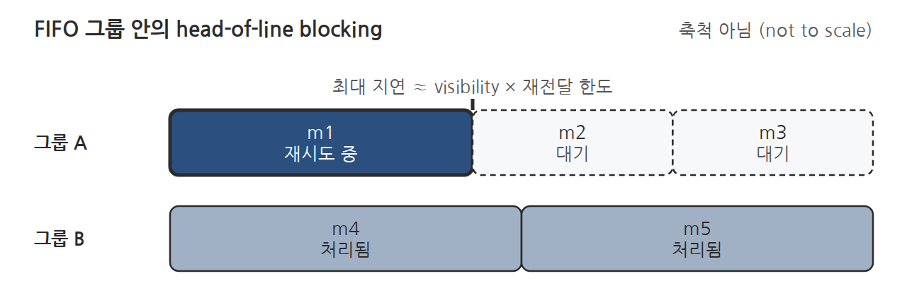
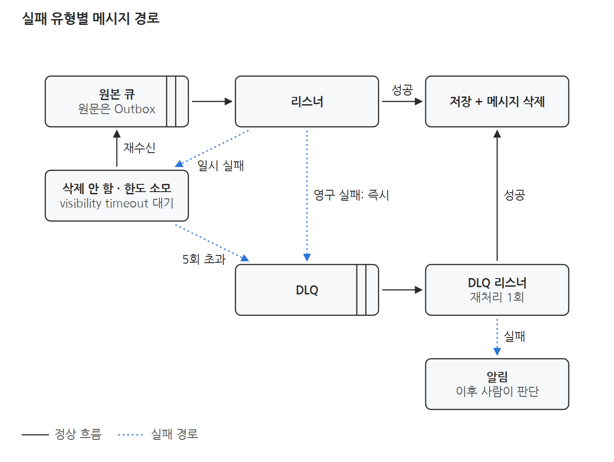

> - 서버리스 함수 이관 연재의 세 번째 글이다. [이전 글](/migration/architecture/2026/11/14/migration-02-신구-코드를-동시에-돌려-대조하기.html)에서는 신·구 코드를 병행으로 대조했다. 이번 글은 그 사이에 놓인 큐 이야기다.
> - 무엇을 하는 시스템인지는 일반화했다. 이 글은 개인적인 의견을 다룹니다.

# 다루는 내용
- 외부 콜백을 큐로 넘기면서 FIFO 대신 Standard를 고른 근거와, 실패를 유형별로 DLQ로 보내는 구조를 확인한 과정

---
## 목차
### 1. 순서가 중요하면 FIFO?
### 2. FIFO? Standard?
### 3. 왜 Standard였나?
### 4. 실패는 어떻게 나눴나?
### 5. 실패 처리는 실제로 도나?
### 6. 결과적으로?

---
## 1. 순서가 중요하면 FIFO?
- 외부 연동처가 보내는 상태 콜백을 주 애플리케이션에 REST로 밀어 넣던 구조를 큐로 바꾸기로 했다.
- 상태가 순서대로 반영돼야 하니 FIFO 큐를 쓰자는 생각이 먼저 든다. 설계 리뷰의 권고도 FIFO였다.
- 리뷰의 요지는 아래와 같다.
	- FIFO 큐와 DLQ redrive 전략을 쓴다.
	- 근거는 건 단위 상태 진행 순서 보장이다. 건 식별자를 그룹 키로, 멱등 키를 dedup ID로 쓴다.
	- 같은 그룹 안에서는 앞 건이 재시도되는 동안 뒤 건이 막힌다는 단점도 같이 짚었다.
	- FIFO를 쓰더라도 멱등 소비자는 필수다. DLQ에서 재처리할 때쯤이면 dedup 윈도우가 이미 지나 있기 때문이다.

> DLQ(Dead Letter Queue): 정해진 횟수만큼 처리에 실패한 메시지를 따로 옮겨 두는 큐다. redrive는 원본 큐에서 DLQ로, 또는 DLQ에서 원본 큐로 메시지를 옮기는 동작을 말한다. SQS에는 replay가 없어서, 실패한 메시지를 따로 떼어 둘 곳은 사실상 DLQ 하나다.

- 고민은 이 마지막 항목에서 시작했다. 멱등 소비자가 어차피 필요하다면, FIFO가 더 주는 건 무엇일까?

## 2. FIFO? Standard?
### 큐 타입은?
- 두 타입을 나란히 놓으면 아래와 같다.

1. FIFO
	- 그룹 단위 순서와 exactly-once를 준다.
	- 대신 처리량 제한이 있고, 그룹 안에서 head-of-line blocking이 생긴다.
	- exactly-once도 dedup 윈도우(5분) 안에서만 성립한다.
2. Standard
	- at-least-once, 순서는 best-effort, 처리량은 사실상 제한이 없다.

- 처리량 한도와 윈도우 수치는 작성 시점 공식 문서 기준이다.

*그림 1. 같은 그룹에서 앞 건이 재시도 중이면 뒤 건은 기다리고, 다른 그룹은 계속 처리된다.*

### 순서를 다루는 방법은 큐뿐인가?
- 큐가 순서를 보장하게 할 수도 있고(FIFO), 순서가 틀려도 결과가 맞게 할 수도 있다. 후자는 상태에 서열을 두고 역행을 막는 조건부 갱신을 거는 방식이다.
- 어느 쪽이 맞는지는 다루는 연산에 달렸다.
	- 상태가 단조 증가하는 상태 머신이면 후자로 충분하다.
	- 잔액 증감처럼 누적되는 연산이면 전자가 필요하다.

### 중복은 어디서 생기나?
- 중복이 생기는 경우는 세 가지다.
	- 처리 후 삭제 직전에 죽는 경우
	- visibility timeout을 넘긴 경우
	- 큐 내부 분산 저장의 특성

> visibility timeout: 소비자가 메시지를 받아 간 뒤 다른 소비자에게 다시 보이지 않게 숨겨 두는 시간이다. 이 안에 삭제하지 않으면 메시지가 다시 나타난다.

- 앞의 둘은 코드로 줄일 수 있지만 마지막은 막을 수 없다.
- 그래서 dedup 키에 메시지 ID나 재전송 때마다 바뀌는 랜덤 UUID는 쓸 수 없다. **원본 사건에서 정해지는 업무 필드 조합**이어야 한다.

## 3. 왜 Standard였나?
- 근거는 두 가지였다.

1. 원천이 애초에 순서대로 보내지 않는다. 연동처가 상태를 순차적으로 전달하지 않으니, 큐가 받은 순서를 지켜도 의미가 없다.
2. 중복은 소비 측에서 걸러낸다. 큐의 dedup에 기대지 않는다.

> 결과적으로 **Standard를 선택했다.** 원천이 순서를 지키지 않고 소비자가 어차피 멱등해야 하니, FIFO는 제약만 남는다고 봤다.

- 큐가 맞는 업무라는 판단도 깔려 있다. 원래 주기 배치로 반영되던 흐름이라, 몇 초에서 몇 분 정도의 지연은 문제가 되지 않는다.
- 대신 숙제가 하나 남는다. 늦게 도착한 과거 상태가 최신 상태를 덮지 않게 막는 일은 이제 큐 대신 소비 측 몫이다.

## 4. 실패는 어떻게 나눴나?
- 큐를 정했으니 다음 고민은 실패를 다루는 방식이었다. 실패는 둘로 나눴다.
	- 일시 실패(커넥션, 네트워크): 메시지를 지우지 않고 둔다. visibility timeout이 지나면 원본 큐에서 다시 받는다.
	- 영구 실패(업무 예외, 대상 데이터 없음 등): 실패 사유를 헤더에 붙여 DLQ로 바로 발행한다. 재전달 횟수를 쓰지 않는다.
- 재전달 한도(5회)를 넘기면 redrive로 DLQ에 간다.
- DLQ에도 리스너를 뒀다.
	- 저장 없이 재처리를 한 번만 하고, 그래도 실패하면 알림을 보낸다.
	- 그다음은 사람이 본다.
- 큐에서 메시지가 사라지는 최악의 경우에 대비해, 수신한 원문은 Outbox에 먼저 기록한다. 그러면 DB에서 다시 발행할 수 있다.
- 재전달 한도는 일시 실패와 영구 실패 사이에서 정해야 한다.
	- 작으면 정상 건이 DLQ로 가고, 크면 영구 실패에 시간을 버린다.
	- 영구 실패를 코드가 먼저 걸러내면, 한도는 일시 실패만 보고 정할 수 있다.

*그림 2. 일시 실패는 재전달 한도를 쓰며 다시 받고, 영구 실패는 한도를 쓰지 않고 DLQ로 바로 간다.*

### 리뷰 제안과 무엇이 달라졌나?
- 큐 타입 말고도 리뷰 제안과 달라진 곳은 아래와 같다.
| 항목 | 리뷰 제안 | 실제 |
|---|---|---|
| 큐 타입 | FIFO | Standard + 소비 측 중복 제거 |
| 재전달 한도 | 3 | 5 |
| DLQ 재처리 | 수동 redrive | 자동 1회 후 알림 |
| 영구 실패 | 사람이 DLQ에서 가려냄 | 코드가 사유 붙여 DLQ 직행 |
| 소비 위치 | 배치 쪽(커넥션 풀 격리) | 주 애플리케이션 |
| 수신 원문 | 큐 단일(조건부로 DB 선기록) | Outbox 선기록 후 발행 |

- DLQ 재처리: 리뷰는 고쳐지지 않은 메시지가 끝없이 돌 것을 걱정했다. 자동 재처리는 1회로 제한해서 끝없이 돌지는 않게 했다.
- 소비 위치: 리뷰가 말한 커넥션 풀 격리는 포기하고 구현 단계의 추가 피드백을 따랐다. 배치를 따로 두면 관리할 대상이 하나 늘고, 큐는 pull 모델이라 소비 측이 몰리는 요청에 쓰러질 걱정은 이미 풀려 있다는 것이다.
- 수신 원문: 리뷰도 연동처의 재시도가 약하다면 DB 선기록이 필요하다는 조건을 달았다. 실제 구현이 그 조건부 안과 같은 모양이 됐다.

## 5. 실패 처리는 실제로 도나?
- 설정만 해서는 실패 처리가 실제로 도는지 알 수 없어서, 개발 환경에서 큐에 메시지를 직접 넣어 가며 하나씩 확인했다.

| # | 시나리오 | 기대 | 결과 |
|---|---|---|---|
| 1 | 정상 수신 | 저장, 메시지 삭제, DLQ·알림 없음 | 같음 |
| 2 | 영구 실패(대상 없음) | DLQ 직행, 재처리도 실패해 알림 | 알림 수신, 저장은 롤백 |
| 3 | 일시 실패 후 원인 제거 | 원본 큐 재수신에서 성공 | 약 1분 뒤 성공, DLQ 안 감 |
| 4 | 재전달 초과 | 5회 실패 후 DLQ, DLQ에서 재처리 성공 | 약 1분 간격 5회 실패 후 DLQ에서 성공 |
| 5 | 깨진 전문(숫자 필드에 문자열) | 5회 후 DLQ, 원문을 알림으로 | 1차 실패, 수정 후 성공 |

- 5번은 1차에 실패한 뒤 수정해서 통과했고, 나머지는 기대대로 돌았다.
- visibility는 30초인데 재수신 간격은 약 1분으로 찍혔다.
- 스테이징에서는 발행 건수와 수신·삭제 건수가 같고, DLQ와 큐 잔량이 모두 0인 것을 확인했다.

### 설계 전제대로 설정했나?
- 설계 문서에는 "SQS를 쓴다면 필수"로 둔 전제가 아래와 같이 있다.
	- long polling(대기 20초). 빈 응답이 가장 큰 비용 항목이 되기 때문이다.
	- 한 번에 10건씩 받기, visibility는 배치 전체 처리 시간 이상, 배치 API 부분 실패 처리
- 구현 단계의 큐 설정은 수신 대기 0초(short polling)에 visibility 기본 30초였다. 설계 전제와 큐 설정이 어긋난 곳이다.
- 기본값을 유지한 것도 있다. 보존 기간과 최대 메시지 크기는 바꾸지 않았다. 명세상 필드를 다 채워도 약 1.3KB라 바꿀 이유가 없었다.

## 6. 결과적으로?
1. FIFO가 더 주는 건 "원천이 순서대로 보낼 때의 순서"와 "5분짜리 중복 제거"였다. 원천이 순서를 지키지 않고 소비자가 어차피 멱등해야 하는 상황에서는 처리량 제한과 그룹 단위 막힘만 남았다.
2. Standard를 고르면서 순서와 중복은 소비 측 몫이 됐다. 중복은 업무 필드 조합의 멱등 키로 거르고, 늦게 온 과거 상태는 상태 서열을 보는 갱신으로 막아야 한다.
3. 실패는 일시/영구로 나눠, 영구 실패는 재전달 한도를 쓰지 않고 DLQ로 보냈다. 다만 long polling 전제와 실제 큐 설정이 어긋난 것처럼, 설계 문서와 설정은 따로 맞춰 봐야 했다.

> [이전 글: 02. 신·구 코드를 동시에 돌려 대조하기](/migration/architecture/2026/11/14/migration-02-신구-코드를-동시에-돌려-대조하기.html)
